# DTM: Disturbance Torque Monitor for FANUC Robot Reducers

**English** | [繁體中文](README.zh-TW.md)

[](https://doi.org/10.5281/zenodo.23910956)

> **Beta: decision thresholds still need field validation.** v2.1.0 is the first public release. The algorithms and thresholds have been tuned with simulated data and scenario tests, but have not yet been validated over the long term on a real production line. Start with a "shadow mode" trial (see [Recommendations for the first deployment](#recommendations-for-the-first-deployment)) and do not decide on stops or replacements based on this system's recommendations alone.

| Item | Current status (v2.1.0) |
|---|---|
| PC software (monitoring, cross-analysis, maintenance, notifications, multi-plant, Pro) | ✅ Done; 233 automated tests pass, and most features have been run end to end with simulated data |
| Robot-side programs (`DTM_BG`, `DTM_DIAG`, `DTM_SWEEP`, KAREL streaming) | 🧩 Templates; must be adapted to the controller and confirmed on a real robot |
| Connection to a real FANUC controller | — Not yet |
| Long-term validation on a production line, threshold calibration | — Not yet (the goal of v3.0) |

How far each feature has been implemented and verified, and what is not yet done or deliberately left out, is listed in the [feature status table](docs/FEATURE_STATUS.md) (in Chinese, with an English summary).

**In one sentence: DTM uses the disturbance torque that a FANUC controller already computes to spot reducer wear weeks in advance, with no added sensors and no production stop.**

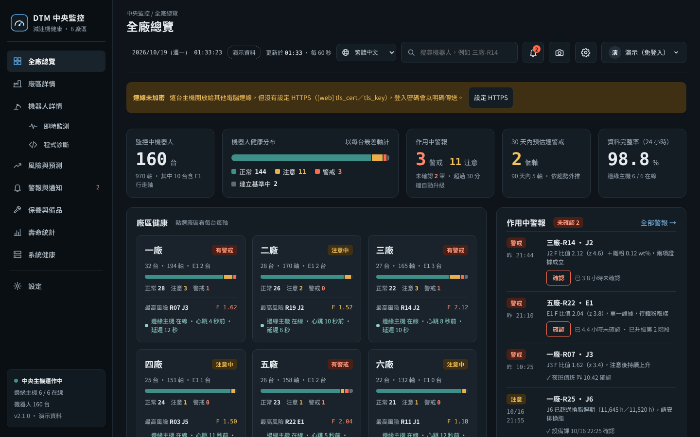

- **Logging and early warning**: live disturbance-torque monitoring; health degradation (against each axis's own baseline, z-scores, consecutive confirmation); production motion-code monitoring (no need to stop production for diagnostic runs).
- **Cross-analysis**: disturbance torque × vibration × iron debris × temperature × component life, giving for each axis "when to change the grease, when to replace the reducer/gearbox, when to inspect the motor"; a replacement is recommended only when two kinds of evidence are abnormal at the same time.
- **Maintenance in practice**: spare parts and work packages, work orders, maintenance schedules, teardown forms (so the thresholds become more accurate with use), threshold replay.
- **Multi-plant**: standalone, edge host (several robots in one plant), central server (8 screens for all plants); small mode for 10 robots or fewer.
- **Long-term operation**: Windows service, watchdog, daily backups (optionally to a network folder), restore wizard, planned stops, commissioning report.
- **Pro program-level diagnosis**: raises the sampling rate for a short period (3–7 days) to find which program lines and which angle ranges consume reducer life; uses existing waiting slack to suggest changes that aim to keep the cycle time unchanged (text only; nothing is written back to the controller); after the change, proves the effect with before/after measurements and a control robot.
- **6 languages**: Traditional Chinese, Simplified Chinese, English (US usage), Japanese, Korean and Vietnamese; each user switches with the language menu (globe icon) at the top of the screen. Notifications can be set to each recipient's language, so foreign colleagues in the same plant receive SMS and e-mail they can read.
- **One window**: standalone, plant and central modes share the same left-hand menu; each robot's live monitoring and program diagnosis open directly inside it without separate URLs. The gear at the top right is "Settings": my account, user accounts, privacy & security, notification recipients, system information & backup, change history (see [section 14](#14-one-window-and-settings-21)).
- Pure Python standard library; runs directly on Python 3.11 or later; the dashboard needs no Internet access. Currently targets the **R-2000iC/165F** only.

**What DTM does.** DTM (Disturbance Torque Monitor) turns the disturbance torque that a FANUC robot controller already computes into a reducer health monitor: no extra sensors and no production stop. It logs the torque, separates friction from the gravity offset with short forward/reverse diagnostic runs (or uses daily medians of production motions), compares each axis with its own baseline, and combines torque with optional vibration, iron-debris (ferrous wear particles in the grease) and temperature data to recommend when to change grease, replace a reducer or gearbox, or inspect the servo motor. It runs standalone, as an edge host for one plant, or as a central server for several plants. The interface, notifications, reports and work packages are available in six languages, switchable per user (translations other than Simplified Chinese are AI-made; corrections from native speakers are welcome). The methods are published as a defensive publication (prior art) in full English, Japanese and Traditional Chinese: [`docs/TECHNICAL_DISCLOSURE.en.md`](docs/TECHNICAL_DISCLOSURE.en.md), [`docs/TECHNICAL_DISCLOSURE.ja.md`](docs/TECHNICAL_DISCLOSURE.ja.md), [`docs/TECHNICAL_DISCLOSURE.md`](docs/TECHNICAL_DISCLOSURE.md).

Suggested GitHub topics: `predictive-maintenance`, `condition-monitoring`, `fanuc`, `industrial-robot`, `reducer`, `rv-reducer`, `disturbance-torque`, `iron-powder`, `weibull`, `python`, `sqlite`, `smart-manufacturing`.

**How it was built: I design, AI writes the code, I verify.** The decision logic, thresholds and field procedures come from the author's ten years of FANUC robot maintenance experience; the code was written by AI (Anthropic Claude) according to that design, and the author is responsible for review, testing and field judgement. License, trademark and disclaimer notes are at the end under [License and notices](#license-and-notices).

> **About this English README.** The original README is in Traditional Chinese ([README.zh-TW.md](README.zh-TW.md)). This English version covers the same content. The screen texts quoted here are those of the English interface; most other documents in `docs/` are in Chinese. Where the two READMEs differ, check the code or open an issue.

## Recommendations for the first deployment

1. **Shadow mode**: for the first 1–3 months, only watch; do not base replacement decisions on DTM. Run its recommendations in parallel with your existing maintenance practice and compare where they differ; at first, send alarms only by e-mail or webhook to the responsible engineers, not to the production line.
2. **Start with 1–3 robots**: pick robots whose reducers were replaced recently (a clean new-component baseline) or those that cause the most trouble. Expand once things are stable; use small mode for 10 robots or fewer, and set up a central server for more.
3. **Check the registers**: before deployment, confirm that **R[101]–R[113]** on the controller are not used by other programs (DTM uses R[101]–R[107] for each axis's disturbance torque, R[110] for the segment/motion code, R[111] for the diagnostic flag, R[112] for the heartbeat and R[113] for the speed override). If they are taken, move them to free numbers in the `[registers]` section of the config file and change the robot programs to match.
4. **Put program changes through change management**: the background logic DTM_BG, the diagnostic program DTM_DIAG and writing motion codes in production programs all modify robot programs. Apply, review and back up (AOA/programs) according to your plant's change-management procedure, and upload and test-run them during a planned stop.
5. **Supported model**: currently only the **FANUC R-2000iC/165F** (RV reducers on J1–J3, gearboxes on J4–J6). Other models differ in number of axes, reducer types, rated torques and work packages; adapt the settings and the work-package catalogue first and validate them yourself.
6. **Read the commissioning report after 7 days**: start scheduling maintenance from DTM's decisions only when sampling, data gaps, diagnostic segmentation and noise are all ✔; always fill in the teardown form when replacing a component.

## System architecture

```
Robot controller                   Monitoring computer (DTM)
┌──────────────────────┐        ┌───────────────────────────────────────┐
│ DTM_BG (background)   │        │ Data source → live buffer → SQLite    │
│ $CUR_DIS_TRQ → R[101~]│  HTTP  │          ↘ live alarms (torque, beat) │
│ beat, override→R[112~]│ ─────→ │          ↘ segmentation → F, G, Fc, Fv│
│ DTM_DIAG (diagnostic) │ or PLC │              → health check → alarms  │
│ segment code → R[110] │        │ Dashboard http://monitor-pc:8080      │
└──────────────────────┘        └───────────────────────────────────────┘
```

## Files

| Path | Contents |
|---|---|
| `robot/DTM_BG.LS` | Background logic: copies the J1–J6 disturbance torque to R[101]–R[106] and writes the heartbeat and speed override |
| `robot/DTM_DIAG.LS` | Diagnostic program: J2 and J3 each run forward and backward at 5%, 10% and 20% speed, with R[110] marking each segment |
| `dtm/` | Monitoring program (acquisition, segmentation, judgement, alarms, web) |
| `config.example.toml` | Site configuration template, with a comment on every item |
| `config.sim.toml` | Simulator configuration for testing without a robot |
| `dtm/cross.py` | Cross-analysis and maintenance decisions |
| `dtm/life.py` | Operating hours, effective grease aging, Weibull life |
| `dtm/workpack.py` | Spare parts and work packages, printable work orders |
| `workpacks.r2000ic_165f.toml` | R-2000iC/165F work-package template (part numbers to be confirmed) |
| `workpacks.r2000ic_165f.<lang>.toml` | Language versions of the work packages (generated by a tool) |
| `dtm/i18n.py`, `dtm/locales/` | Internationalization: translation function and translation tables |
| `tools/i18n_tool.py` | Extracts translatable strings from the code and checks each language for gaps |
| `tools/workpack_l10n.py` | Generates the language versions from the Traditional Chinese work-package catalogue |
| `tests/` | Unit and system tests |
| `start_sim.bat`, `start.bat` | Windows double-click launchers: simulator trial, production monitoring (`start.bat` checks the config file first) |
| `LICENSE`, `NOTICE`, `CITATION.cff` | Apache-2.0 license, copyright notice, citation information |
| `CHANGELOG.md`, `CONTRIBUTING.md`, `.github/` | Change log, how to contribute (DCO), issue templates and automated tests |
| `docs/TECHNICAL_DISCLOSURE.md`, `.en.md`, `.ja.md` | Technical disclosure (defensive publication), published simultaneously in Traditional Chinese, English and Japanese |
| `docs/FEATURE_STATUS.md` | Feature status table: completion and verification level of every feature (tests, simulation, real robot, field) |
| `dtm/export.py`, `dtm/teardown.py`, `dtm/downtime.py`, `dtm/commissioning.py`, `dtm/replay.py` | Analysis export, teardown form, planned stops, commissioning report, threshold replay (2.1) |
| `dtm/auth.py` | Write password, login, lockout after wrong passwords |
| `dtm/backup.py` | Daily automatic backup, copy to a network folder |
| `dtm/restore.py` | Restore wizard: recover lost data / return to a point in time, preview differences, rebuild from central |
| `dtm/check.py` | Config-file check and connection self-diagnosis |
| `dtm/scenarios.py` | False-alarm / missed-alarm scenario simulation |
| `robot/DTM_BG_E1.LS`, `robot/DTM_MCODE_EXAMPLE.LS` | E1 travel-axis torque (R[107]), production motion-code example (2.0) |
| `dtm/motion.py`, `dtm/sensors.py` | Production-cycle monitoring, vibration and temperature sensors (2.0) |
| `dtm/runtime.py`, `dtm/watchdog.py`, `dtm/winservice.py` | Status file, self-check, watchdog, Windows service (2.0) |
| `dtm/fleet.py`, `dtm/sync.py` | Edge host (several robots in one plant), upload to central (2.0) |
| `dtm/central.py`, `dtm/fleetviews.py`, `dtm/fleetweb.py`, `dtm/static/central.html` | Central server and its 8 screens (2.0) |
| `dtm/demo.py` | Central demo data (6 plants, 160 robots, marked "Demo data") |
| `config.edge.example.toml`, `config.central.example.toml` | Edge-host and central-server configuration templates |
| `config.small.example.toml`, `start_small.bat` | Small mode (10 robots or fewer, no central; also works with 1) configuration template and launcher (2.1) |
| `dtm/thermal.py`, `dtm/trend.py` | Sudden temperature-rise detection, conservative extrapolation when a trend accelerates (2.1) |
| `start_central_demo.bat`, `start_central.bat` | Launchers for the central demo and the central server |
| `tools/winsw/` | WinSW (MIT license), used to install DTM as a Windows service |
| `dtm/pro/`, `dtm/static/pro.html` | Pro program-level diagnosis: program parsing, line alignment, per-line damage, angle concentration, sweep, waiting slack, suggestions, improvement verification (2.1) |
| `robot/DTM_SWEEP.LS` | Pro full-range sweep program (once a week, each axis slowly forward and backward) |
| `robot/DTM_STREAM.KL` | KAREL template for Pro diagnostic-period streaming (**not yet tested on a real robot**) |
| `tools/build_static_demo.py` | Generates a static demo of the central screens (one per language, suitable for GitHub Pages) |
| `docs/DESIGN_CONSTRAINTS.md` | Design boundaries: what this system deliberately does not do (read before changing or adding features) |
| `dtm/sysconf.py`, `dtm/sysweb.py` | Settings (gear at the top right): system settings editable on the web and their change history, user accounts, signed-in devices, operation log, diagnostic bundle (2.1) |
| `dtm/demolive.py` | Simulated robots in the central demo (live monitoring and program diagnosis can be tried in the demo) |
| `dtm/vendors.py` | Service providers: service offices published on the websites of FANUC companies in each region (region chosen by screen language), and your plant's service contact (2.1) |
| `dtm/fx.py` | Shows spare-part prices in the local currency of the screen language (online exchange rates; falls back to the last rates if unavailable; can be manual or off) (2.1) |
| `dtm/tlscert.py`, `dtm/settings.py` | One-click HTTPS: generates a self-signed certificate without OpenSSL; changes only the keys it names in the config file, after a backup, and checks the result (2.1) |
| `dtm/wizard.py` | First-time setup wizard (standalone): data source and IP, connection test, monitored axes and rated torque (2.1) |
| `dtm/validation.py` | Field validation report: detection rate, days of early warning, missed alarms, false-alarm candidates (2.1) |
| `dtm/static/vendor/` | html2canvas 1.4.1 (MIT license) for full-page screenshots, running in the browser |
| `SECURITY.md`, `tools/sbom.py` | Security policy (reporting, secure design, IEC 62443-4-2 self-assessment), software bill of materials SBOM (CycloneDX) |
| `README.md`, `README.zh-TW.md` | This English README (shown by default on GitHub); the original Traditional Chinese README |

## 1. Try the simulator first (5 minutes)

**Portable version (recommended)**: download `DTM-<version>-win64.zip` from the GitHub Releases page (Python included, nothing else to install), extract it to, for example, `C:\DTM`, and double-click `start_sim.bat`. To build the portable version or the installer yourself, run `python tools/build_windows.py` on a computer with Internet access and then compile `tools/installer/dtm.iss` with Inno Setup.

**With your own Python**: after installing Python 3.11 or later, double-click `start_sim.bat` in the program folder. The first run generates 180 days of simulated data (about 1 minute) and then opens the dashboard automatically. Close the black console window to stop. When you connect a real robot, use `start.bat` instead (create `config.toml` first).

From the command line:

```bash
cd torque_monitor
python -m dtm -c config.sim.toml simulate-history --days 180   # generate 180 days of history
python -m dtm -c config.sim.toml run                            # opens http://localhost:8080
```

The left-hand menu has "Live monitoring", "Program diagnosis" and "Settings"; at the top right are the language menu, the alarm bell, the gear (Settings) and the account. On first use, create an administrator account locally on this computer (without an account, everything is read-only).

Simulated scenarios:

- J2 grease aging: viscous friction rises gradually and the system raises "Caution"; after the grease change on day 120 the baseline is rebuilt automatically and the axis returns to "Normal".
- The J3 reducer starts wearing on day 60 and deteriorates at an accelerating rate: "Caution" around day 91, "Alert" on day 130.
- The J3 iron-debris generation rate and radial envelope rise together: "Prepare spare parts" is recommended around day 117 and "Schedule replacement" on day 133.
- The servo-motor bearing of the J4 gearbox starts degrading on day 100: friction rises, but iron debris and reducer frequencies stay normal and only motor-rotation-frequency vibration rises. The system diagnoses "Servo motor abnormal", not the gearbox.
- A "Simulated fleet" replacement history is also imported to demonstrate Weibull life fitting. These numbers are illustrative, not real data.
- In live mode, a diagnostic run is inserted every 90 seconds, and a torque spike is created on J3 every 75 seconds to test the live alarms.

## 2. Deployment on site

### 2.1 Robot side

1. **Verify the variable first**: on the teach pendant, use DATA → system variables or the register screen to confirm that `$MOR_GRP[1].$CUR_DIS_TRQ[n]` can be read, and compare its values with the disturbance-torque screen under MENU → STATUS → Axis while jogging slowly. Variable names and indexes vary with the controller version and are not documented publicly by the manufacturer, so **do not skip this step**.
2. Load `DTM_BG.LS` (requires the ASCII upload function; without it, type the content in on the teach pendant), and set it to run under MENU → SETUP → BG Logic. If your version does not support the `MOD` operation on line 11, change it to a simple `R[112]=R[112]+1`.
3. Teach the points, all recorded in **joint coordinates**:
   - `PR[50]`: safe start position;
   - `PR[51]`/`PR[52]`: J2 start A and end B, changing only J2, with the angle of B larger than A;
   - `PR[53]`/`PR[54]`: J3 start A and end B, changing only J3, with the angle of B larger than A.

   Make the stroke long enough for a constant-speed portion of at least 4 seconds at 5% speed (for example ±25°), and make sure the whole stroke is free of interference.
4. Load `DTM_DIAG.LS`. Run it once a day **at a fixed time, after warm-up, with the same load**. It can be scheduled at shift changes or periodic maintenance, or called by a PLC.
5. Register assignment (changeable in the config):

| Register | Contents |
|---|---|
| R[101]–R[106] | J1–J6 disturbance torque |
| R[110] | Diagnostic segment code = axis × 1000 + speed% × 10 + direction (1 = A→B, 2 = B→A), e.g. 3102 = J3, 10%, reverse; 0 = not in a diagnostic segment |
| R[111] | Diagnosis running = 1 |
| R[112] | Heartbeat (incremented continuously by BG Logic) |
| R[113] | Speed override; diagnostic segments not run at 100% are judged invalid |

### 2.2 Communication (choose one)

- **`fanuc_http` (recommended to start with)**: reads `http://robot-IP/MD/NUMREG.VA` from the controller's web server directly, with no extra options. First check in a browser that this URL opens. The rate is about 2–5 readings per second, enough for trends and diagnostic averages.
- **`modbus`**: a PLC or gateway reads the registers and the PC reads them over Modbus TCP; requires `pip install pymodbus`. The field mapping is written in `[source.modbus.map]`.
- Neither is fast enough for millisecond-level spectrum analysis (crankshaft frequency components); that needs the manufacturer's tools or ZDT.

### 2.3 Configure and start

```bash
cp config.example.toml config.toml        # edit the IP, axes and registers
python -m dtm -c config.toml check        # check the config file: typos, format, value ranges
python -m dtm -c config.toml check --connect   # then read from the robot for 10 s: heartbeat, torque registers, override
python -m dtm -c config.toml run
```

Double-clicking `start.bat` runs `check` first; if the config file has an [ERROR], it stops and shows the reason instead of starting.

If you prefer not to edit the config file by hand: copy `config.example.toml` to `config.toml`, double-click `start.bat`, open the screen **locally on this computer** (`http://localhost:8080`), create the first administrator account, and click "First-time setup → Start setup" at the top of the screen (or "Settings → System information → Setup wizard"): choose the data source, enter the controller IP, press "Test connection" to read about 5 seconds of data, tick the monitored axes and enter the rated torque, save and restart (see [section 15](#15-date-and-time-full-page-screenshots-local-currency-https-setup-wizard-field-validation-21)).

Starting automatically at boot:

- **Windows**: in Task Scheduler, add an "At startup" trigger that runs `python -m dtm -c C:\dtm\config.toml run` with `C:\dtm` as the start-in folder.
- **Linux**: a systemd service with `ExecStart=/usr/bin/python3 -m dtm -c /opt/dtm/config.toml run`, `WorkingDirectory=/opt/dtm`, `Restart=always`.

### 2.4 Build the baseline

The first 10 valid diagnostic runs after start-up build the baseline. During this period the status shows "Building baseline" and no health judgement is made. After a grease change or replacing a reducer or motor, register it under "Maintenance event" on the dashboard; the system rebuilds the baseline from the next 10 diagnostic runs.

### 2.5 Conversion to Nm (calibration by added weight, optional)

Full monitoring works without calibration, because the health judgement uses ratios to the baseline and does not depend on units. To display Nm and use live alarms as a percentage of rated torque, proceed as follows:

1. Run `DTM_DIAG` once under normal load and note the diagnostic ID: `python -m dtm -c config.toml runs --axis 3`.
2. Add a known mass m at the end of the arm (within the allowable load), measure the **horizontal distance** d from its centre of gravity to the axis under test (in the middle posture of the diagnostic stroke), and run `DTM_DIAG` again.
3. Compute and save:

   ```bash
   python -m dtm -c config.toml calibrate --axis 3 --mass 5 --dist 1.2 --without 101 --with 102 --save
   ```

Principle: G is the average of forward and reverse, in which friction cancels out, so the difference in G before and after adding the weight reflects only the gravity moment m·g·d, and k = m·g·d ÷ |ΔG|. The run with the added weight is excluded from the health judgement automatically.

**Safety notes**:

- Do not change the payload setting (PAYLOAD) when adding the weight, or the difference will be removed by the model.
- The collision-detection margin becomes smaller; run at low speed with the area cleared, following your plant's safety rules.

### 2.6 Enter the rated torque

Look up the rated output torque in the reducer catalogue and enter it as `rated_nm`. Live torque at 80% raises "Caution" and at 100% raises "Alert" (adjustable); it must persist for 2 seconds to trigger.

## 3. Decision logic

| Indicator | Calculation | Meaning |
|---|---|---|
| F friction | (τ forward − τ reverse) / 2, at the 10% reference speed | Overall level of reducer friction |
| Fc constant friction | Intercept of the regression of F on speed | Wear, preload, brake drag |
| Fv viscous friction | Slope of the regression of F on speed | Grease viscosity, amount of grease, temperature |
| G gravity-type offset | (τ forward + τ reverse) / 2 | Balancer, payload setting (not friction) |
| Ripple | Standard deviation within constant-speed segments | Local damage, tooth-flank or bearing abnormalities |

- **Levels**:
  - Ratio ≥ 1.5 is Caution, ≥ 2.0 is Alert.
  - The z-score can raise the level to Caution early: z ≥ 2 and ratio ≥ 1.15. So the trend chart may show "a yellow dot below the Caution line", meaning the value already deviates clearly from the baseline statistically.
  - With the Caution ratio reached and z ≥ 3, the level rises to Alert.
- **Hysteresis**: the level rises only after 2 consecutive runs reach it and falls only after 2 consecutive runs are below it.
- **Removal of temperature and common changes** (revised in 1.5; see [section 10, item 5](#105-temperature-warm-up-and-common-changes-false-alarm-scenario-simulation)):
  - With a temperature signal: values are multiplied by exp(k × (temperature − mean temperature of the baseline period)). k uses default values (viscous friction 2.5% per °C, constant friction 0.4%) and can be estimated from your own data with the `temp-coef` command. When only one axis is monitored and the temperature difference in the baseline period reaches 5 °C, k is learned from the baseline-period data itself.
  - With two or more axes monitored: viscous-friction changes that happen on all axes "at the same time" (air temperature, warm-up, takt changes) are removed and converted to constant friction and F through the temperature coefficients. This works without a temperature signal too. Setting `[health] common_mode`: `true` (default), `"auto"` (remove only when there is no temperature signal), `false` (do not remove).
- **Trend**: linear regression of the last 30 values of F, extrapolated to the Caution and Alert thresholds. When degradation is accelerating, the thresholds are reached earlier than estimated.
- **Failure-mode hints**: a direction is given from the combination of indicator changes, for example "mainly the viscous term rising: grease degradation, too much grease or low temperature". These are only hints and must be confirmed with iron debris, vibration and teardown findings.

All values above are suggested starting points. Accumulate field data and adjust `[health]` against iron-debris concentrations and teardown findings.

## 4. Alarm types

| Category | Trigger | Cleared when |
|---|---|---|
| Live torque | Reaches 80%/100% of rated for 2 seconds | Below the threshold for 2 seconds |
| Communication | Heartbeat unchanged for 5 seconds, or no data can be read | Restored |
| Data | Disturbance torque is an invalid value (e.g. 32767) | Restored |
| Diagnosis | Constant-speed segment too short, override not 100%, missing forward/reverse pair | Next valid diagnosis |
| Health | See the previous section | Level falls, or a reset event is registered |

Notification settings are in `[notify]`; the same alarm is notified only once within 30 minutes.

## 5. API (for SCADA or MES integration)

| Method | Path | Contents |
|---|---|---|
| GET | `/api/status` | Connection status, live values and health level of each axis |
| GET | `/api/live?seconds=120` | Live curves |
| GET | `/api/health` | Indicators, ratios, z-scores and reasons for each axis |
| GET | `/api/trend?axis=3&metric=F&days=180` | Trend and baseline |
| GET | `/api/alarms?active=1` | Alarms |
| GET | `/api/events` | Maintenance events (including revoked ones) |
| GET | `/api/audit?limit=50` | Operation log: who, from which computer, what was done, success or failure |
| POST | `/api/login` `{"who": "alex", "password": "…"}` | Log in; returns a token |
| POST | `/api/logout` | Log out |
| POST | `/api/ack` `{"id": 12}` | Acknowledge an alarm |
| POST | `/api/event` `{"axis": 3, "kind": "grease_change", "note": ""}` | Register a maintenance event; returns the event ID |
| POST | `/api/event/undo` `{"id": 25, "note": "wrong axis selected"}` | Revoke an event |
| GET | `/api/report`, `/api/export.csv` | Report, feature data |

Every POST must carry the header `X-DTM-Token: <token obtained at login>`, otherwise it returns 401; while no account exists, the whole dashboard is read-only (returns 403). Reading (GET) needs no login by default (it does when `require_login = true`). Keep the dashboard on the plant's internal network only.

## 6. Cross-analysis and maintenance decisions

### 6.1 Data to enter

| Data | Source | Suggested frequency |
|---|---|---|
| Disturbance torque F, Fc, Fv, ripple, G | Automatic (DTM_DIAG) | Once a day or once a shift |
| Vibration: radial and axial RMS, envelope, mesh frequency, motor rotation frequency, kurtosis | The measurement system calls `POST /api/vibration`, a CSV is imported with `vib-import`, or values are entered manually on the dashboard (handheld vibration meter) | Same time as the diagnosis; handheld measurement at least once a week |
| Iron-debris concentration wt% | Dashboard or the `iron` command; the default sample type is "Purged grease (middle portion)": the first portion near the outlet is discarded and the middle portion is sent for analysis | At each grease change (old grease middle portion + residual after 24 hours) + at least one interim sample between grease changes; every 60 days after Caution, every 21 days after Alert (scheduled automatically) |
| Housing temperature, ambient temperature | Temperature sensors (ticked in "Equipment settings") or temperature registers | Automatic |
| Component installation dates | Registered once with the `install` command at deployment | Grease changes and replacements afterwards are registered as events and continue automatically |
| Replacement history of the past or of other robots | Import a CSV with `history` (`comp,life_h,failed,robot,note`) | Once, then accumulated continuously |
| Hour meter | The `hours` command, or the hours entered when registering an event | Once a month is enough |

Deployment example:

```bash
python -m dtm -c config.toml install --axis 3 --comp reducer --date 2021-05-01
python -m dtm -c config.toml install --axis 3 --comp motor   --date 2021-05-01
python -m dtm -c config.toml install --axis 3 --comp grease  --date 2025-11-20
python -m dtm -c config.toml history fleet_life.csv
python -m dtm -c config.toml iron --axis 3 --wt 0.048                      # default --sample drain_mid (middle portion of purged grease)
python -m dtm -c config.toml iron --axis 3 --wt 0.051 --sample interim     # interim sample
python -m dtm -c config.toml vib-import vib.csv          # columns: ts or time, axis, direction, rms, env, mesh, motor1x, kurt
python -m dtm -c config.toml event --axis 3 --kind reducer_replace --failed --teardown "crankshaft bearing spalling" --hours 52310
python -m dtm -c config.toml decide
```

### 6.2 Analysis method

1. **Severity**: each signal is first compared with its own baseline and converted to a severity of 0–1.5 (0.5 = Caution, 1.0 = Alert).
   - Torque, vibration and the iron-debris generation rate W use multiples of their baselines;
   - Iron-debris concentration (RV) and kurtosis use absolute values.
2. **Three independent kinds of evidence**:
   - torque shows friction;
   - iron debris shows the amount of wear;
   - vibration shows impacts and frequencies.

   **Replacing a reducer or motor requires two kinds of evidence to be abnormal at the same time.** With only one kind, the result goes at most to "Watch", or to "Prepare" in extreme cases, so that a single sensor's misjudgement does not stop a robot for a replacement.
3. **Identifying the component from the combination**:

| Diagnosis | Torque | Iron debris | Vibration | Life |
|---|---|---|---|---|
| Grease deterioration | Viscous friction Fv rises | Normal or slightly high | Envelope rises slightly | Effective grease life nearly used up |
| Reducer/gearbox wear | Constant friction Fc and ripple rise; still above the new-component baseline after a grease change | Concentration and generation rate W rise | Radial envelope, mesh frequency and kurtosis rise; axial/radial ratio changes | Age risk |
| Servo motor (bearing, brake) | Friction rises | **Does not rise** | **Motor rotation frequency** rises, reducer frequencies do not | Age risk |
| Balancer, payload setting | Gravity-type offset G shifts | Does not rise | Not necessarily | — |

4. **Explain away**: when friction rises but iron debris and reducer frequencies are normal while motor-rotation-frequency vibration rises, the friction rise is attributed to the motor and not counted as reducer wear.
5. **New-component baseline**: a grease change resets the torque baseline, which could wash out continuing wear. So values are also compared with the baseline of "the first diagnostic runs after component replacement" (cumulative ratio), which a grease change does not reset.
6. **Grease life**: whichever comes first, hours or years (default 11,520 hours or 3 years; change according to the manual). For every 10 degrees the housing temperature is above 40 °C, effective aging doubles. This common rule of thumb only brings grease changes forward and never postpones them. The dashboard, the central robot page and the maintenance schedule show the temperature correction factor and the corrected grease-change interval. **Steady high temperature only shortens the grease-change interval and is not treated as a reducer abnormality.**
7. **Component life**:
   - A Weibull distribution is fitted with preventive replacements and components still in service as censored data;
   - the B10 life and the probability of failure within the spare-part lead time are calculated;
   - with fewer than 3 failure records, no age risk is computed (or the prior from the config file is used).
8. **Time estimates**: the torque trend, the iron-debris generation rate and the vibration envelope are each extrapolated to Alert, and the earliest is taken. If it is shorter than the spare-part lead time, an immediate order is prompted.
   - When the torque trend **is accelerating** (the slope of the second half is clearly larger than that of the first half, or a curve fits clearly better than a line), a conservative estimate is used (the shortest of the line, the second-half slope and a quadratic curve).
   - **After iron debris reaches Caution, the remaining days are no longer extrapolated**: the screen shows "Iron debris past the turning point", the reducer is at least at "Prepare spare parts", and ordering the spare directly is recommended. Reaching this threshold is a screening signal that wear may be accelerating, not proof; sample more often and cross-check with torque and vibration.
   - When the iron-debris generation rate W **rises at an accelerating rate twice in a row** (three samples increasing, each increase larger than the last), the iron-debris severity rises by one level.
9. **Anti-flapping**: like the health judgement, maintenance decisions rise or fall only after 2 consecutive results. After a grease change or component replacement is registered, the corresponding recommendation is cleared automatically.

### 6.3 Sudden temperature rise (2.1)

| Item | Rule (default values; all changeable in `[thermal]`) |
|---|---|
| Temperature rise ΔT | Housing temperature − ambient temperature, compared using daily medians of the same motion code (only the same motion is comparable) |
| Reference temperature | The ambient sensor if available; otherwise the median housing temperature of the other axes (at least 2 others); if neither: display only, no alarms |
| Sudden rise (Caution) | ΔT is 8 °C above its own 14-day median, or rises 5 °C within a day while the ambient does not rise with it |
| After a grease change | No sudden-rise judgement within 72 hours; if after 72 hours (within 14 days) it is still 5 °C above the pre-change level → a reminder to check that residual pressure was released, the amount of grease, and the oil seals for leaks |
| Overheating | Absolute threshold `overheat_c`, which raises Alert directly; default 0 = disabled |
| In maintenance decisions | Counted in the torque (friction) family with weight 0.6; a temperature abnormality alone goes at most to "Watch" |

### 6.4 Evidence weights `[decision.weights]`

| Key | Default | Contents |
|---|---|---|
| `fc_ripple` | 1.0 | Constant friction Fc, ripple, cumulative ratios |
| `f_motion` | 0.8 | Friction F at the reference speed, daily medians of production cycles |
| `temp_rise` | 0.6 | Sudden temperature rise |
| `vib_reducer` | 1.0 | Vibration envelope, mesh frequency, kurtosis |
| `vib_axial` | 0.8 | Axial RMS, axial ratio |
| `iron` | 1.0 | Iron-debris concentration, generation rate |

Weights are numbers from 0 to 1.5; `check` reports misspelled keys and out-of-range values. Leaving them unchanged is recommended until you have real teardown records.

### 6.5 What the recommendations mean

| Component | Caution (score ≥ 0.5) | Alert (score ≥ 0.9) |
|---|---|---|
| Grease | Grease change recommended (next planned stop) | Change grease now (or grease life is used up, or iron-debris concentration has reached Alert) |
| Reducer/gearbox | Prepare spare parts, shorten the monitoring interval | Schedule replacement (planned downtime) |
| Servo motor | Inspect the bearings, brake and encoder and prepare spare parts | Schedule replacement or repair |

A replacement is normally recommended only with two kinds of evidence. The one exception is age risk: when the Weibull probability of failure within the spare-part lead time is high enough, a preventive replacement can be recommended from life statistics alone.

**When grease and reducer cannot be told apart** (high grease score, medium reducer score), the system recommends "change the grease first and compare after 2–4 weeks":

- if Fc and the iron-debris generation rate return to within 1.3 times the new-component baseline, it was a lubrication problem;
- if they stay high, the reducer is degrading.

Every time a reducer or motor is removed, register a "Failure replacement" and the teardown findings. These records make the Weibull life and the thresholds more accurate over time, and they are the only basis for verifying whether the judgements were right.

## 7. Notifications: SMS, e-mail, webhook

From 2.1 on, only three built-in channels remain: **SMS** (4G modem or an SMS provider's HTTP gateway), **e-mail** and **webhook**. For messaging apps such as LINE, Teams or WeCom, connect them yourself through the webhook according to each vendor's API (a LINE example follows); they are no longer built in, so that API changes by those vendors do not require changes to the program.

### 7.1 Default rules

| Channel | Default minimum level | Suited for |
|---|---|---|
| SMS | Alert | Supervisors, night duty; SMS costs money, so only the most important messages are sent |
| E-mail, webhook | Caution | Maintenance groups, record keeping, integration with messaging apps |

Protection against flooding:

- The same alarm at the same level on the same channel is not re-sent within 30 minutes, but a rise in level (Caution to Alert) is always notified immediately.
- SMS has a daily limit (default 30 messages); messages beyond it are logged in the notification log and not sent.
- Whether to notify when an alarm clears is optional (`notify_clear`).
- Each failed send is retried automatically twice, and all results are written to the notification log, which can be viewed in the "Notifications" panel of the dashboard; the test buttons are available to administrators only.

SMS messages are shortened automatically to fit one message (70 characters for Chinese), for example (Chinese system language): `[警戒]R-2000iC #1 J3 減速機：安排更換（排程停機）… 10/14 18:52` ("[Alert] R-2000iC #1 J3 reducer: schedule replacement (planned downtime) … 10/14 18:52").

### 7.2 SMS

| provider | Description |
|---|---|
| `modem` | **A USB 4G SMS modem with a SIM card, no Internet needed**, suited to industrial networks that cannot connect outside. Requires `pip install pyserial`; set `[notify.sms.modem] port` to the modem's serial port |
| `http` | An SMS provider's HTTP gateway (Mitake, Chunghwa Telecom enterprise SMS, Twilio, etc.). Fill in `url` and `params` according to the provider's documentation; `{phone}`, `{phone_e164}` and `{message}` are substituted automatically; set `success` to the string (regular expression) in the response that indicates success. `config.example.toml` contains example settings for Mitake and Twilio |

- `fallback = ["http"]`: use the fallback when the primary cannot send.
- `template`: a custom SMS format, using `{level}{robot}{site}{message}{time}{brand}`.
- Test: `python -m dtm -c config.toml notify-test --channel sms`.

**Delivery reports (received by the phone, 2.1)**: with `[notify.sms.report] enabled = true`, every SMS asks the carrier for a delivery report, and the delivery log in "Alarms and notifications" shows "Received by phone (time)", "Waiting for delivery report" or "Not delivered"; messages without a report after `timeout_min` (default 30 minutes) are marked "No report (timed out)".

| provider | Where the delivery report comes from |
|---|---|
| `modem` | A status report (TP-SRR) is requested when sending; the reports in the modem are read every `poll_s` seconds (default 60) and deleted after reading (ordinary received messages are left alone). Most 4G modems work with the default `cnmi = "AT+CNMI=2,1,0,2,0"`; a few models need `2,1,0,1,0`, or `report_mem = "SR"` to specify where reports are stored |
| `http` | The provider calls back with the delivery result to `{public_url}/api/sms/report?key=…`. Fill in `key` (can be written as `env:VARIABLE_NAME`), `id_regex` or `id_json` to extract the message ID from the send response, the callback field names `id_field`/`status_field`, and `delivered` (regular expression) for "delivered". The callback URL needs no login and is not restricted by "Allowed computers"; it is protected only by `key`, and without a `key` it is not opened. The DTM host must be reachable by the provider (usually requiring firewall settings); if it cannot be reached, use a 4G modem instead |

### Recipient list: each person in their own language (2.1)

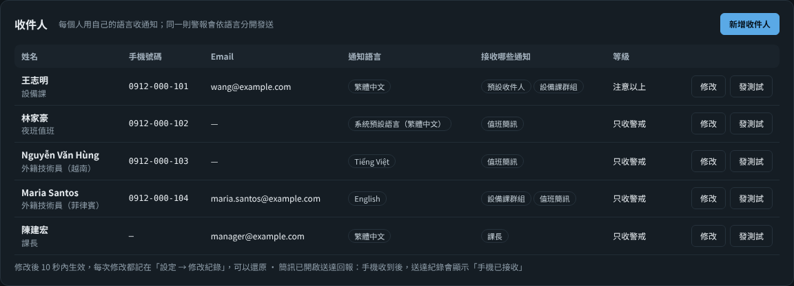

When the plant has foreign colleagues, add recipients under "Alarms and notifications → Recipients" (or "Settings → Notifications"): name, mobile number, e-mail, **notification language**, which notifications to receive (default recipients or which rules of the config file), only Alert or Caution and above, enabled/disabled. The same alarm is sent separately by language; for example, Vietnamese colleagues receive Vietnamese SMS and others receive Chinese. Next to each person is a "Test" button that sends a test message in that person's language.

- Only administrators can add and modify recipients; others see only part of the phone numbers and e-mail addresses. Every change is recorded in "Settings → Change history" and can be reverted; the operation log does not record phone numbers or e-mail addresses.
- The list is stored in `users.sqlite3` and applied by the DTM programs on the same host within 10 seconds. It can also be written in the config file as `[[notify.people]]` (see `config.example.toml`); the list on the web takes precedence.
- Numbers written directly in existing rules (`to = { sms = [...] }`) remain valid and use the rule's `lang`; if a number in the on-duty roster is on the list, that person's language is used.

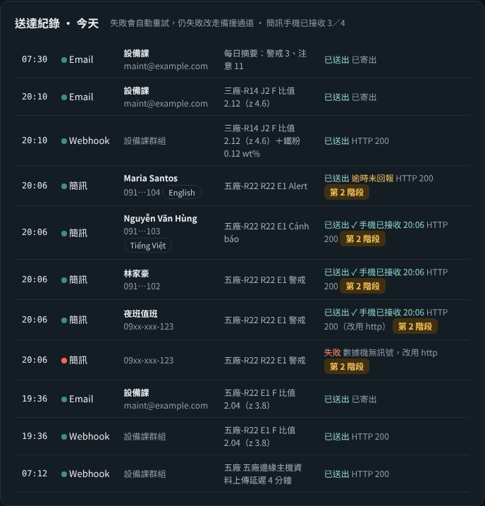

### 7.3 Webhook (including connecting LINE yourself)

The webhook sends notifications by HTTP POST to `webhook_url`. Without `[notify.webhook_body]`, it sends the default JSON (`text`, `level`, `robot`, `message`, …); to connect a specific service, use header and body templates in that service's API format. Templates can use `{text}{subject}{level}{robot}{site}{message}{axis}{kind}{time}{short}`.

**Connecting LINE yourself through the webhook (official account, Messaging API push)**:

1. Create a LINE Official Account with a company account, enable the Messaging API and obtain a **channel access token (long-lived)** in LINE Developers.
2. Obtain the group ID (starting with C) or user ID (starting with U) to push to.
3. Set "`Bearer ` + token" as an environment variable (for example `DTM_LINE_BEARER`), and in the config file:

```toml
[notify]
webhook_url = "https://api.line.me/v2/bot/message/push"
[notify.webhook_headers]
Authorization = "env:DTM_LINE_BEARER"
[notify.webhook_body]
to = "C1234567890abcdef..."
messages = [{ type = "text", text = "{text}" }]
```

4. Press "Test webhook" on the dashboard. Pushes count against the official account's monthly free message quota (pushes to groups count per member); upgrade the plan for larger volumes. LINE's API and pricing are as announced by LINE.

Teams, WeCom and others work the same way: fill in `webhook_url`, `webhook_headers` and `webhook_body` according to the service's webhook documentation.

### 7.4 Network and security

- SMS-provider HTTP gateways and webhooks need access to external networks. Set `proxy` if a proxy is required; where no outside connection is allowed at all, send SMS through a 4G modem and e-mail through the company's internal mail server.
- Always read tokens and passwords from environment variables with `env:VARIABLE_NAME`; do not write them in plain text in the config file. Restrict read access to the config file as well.

## 8. Spare parts and work packages (added in 1.3)

When a maintenance decision makes a recommendation (grease change, prepare spare parts, schedule replacement, inspect the motor), the system finds the matching work package by "axis + component" and lists:

- spare-part numbers and quantities, stock and shortages, part-number confirmation status, and the grease type and amount for this axis;
- tools and equipment, staffing and roles, work safety instructions;
- work steps with the time for each step, estimated downtime, and links to SOP documents.

Where it appears:

| Location | Contents |
|---|---|
| "Maintenance decision" on the dashboard | Below recommendations at Caution or above, a "Spare parts & work package" button shows the number of people, downtime hours, shortages and items awaiting confirmation |
| E-mail/webhook notifications | The first 3 spare parts, staffing, downtime hours, shortage reminders and a link to the work order are attached; SMS stays within one message and has none of this |
| Printed work order | `http://monitor-pc:8080/workorder?axis=3&comp=reducer`, A4 portrait, with check boxes, an actual-hours column and sign-off fields |
| Commands | `workpack --list`, `workpack --axis 3 --comp reducer`, `workpack --axis 3 --comp reducer --html wo.html` |

Settings:

```toml
[workpack]
catalog = "workpacks.r2000ic_165f.toml"
notify_level = 1
```

`workpacks.r2000ic_165f.toml` is the R-2000iC/165F template, with four work packages: J3 reducer, J2 reducer (steps to be completed), J2/J3 servo motors and J2/J3 grease change.

- **Part numbers come from public sources** (parts dealers' listings, FANUC catalogues and greasing data) and are all marked `verified = false`. Before ordering, confirm them against the "Maintenance Parts" appendix of the maintenance manual and the robot's nameplate, then change them to `true`.
- **Work hours are reference estimates**, not the manufacturer's standard hours. Correct them with the "Actual h" column on the work order.
- `stock` is the current stock; when it is below the requirement, a shortage is shown. The catalogue file is reloaded automatically when saved, with no restart.
- For other models or axes (for example the J4 gearbox), add `[[pack]]` entries in the same format. When no matching work package exists, the screen shows "No work package yet".

**Spare-part prices and maintenance material cost estimates (2.1)**: enter the "Unit price" when editing spare parts under "Maintenance & spare parts → Spare parts stock" (currency under "Settings → General → Currency for spare part prices", default TWD). Each scheduled maintenance item estimates its material cost from the work package's parts list (quantity × unit price); press "Details" on the work-package card to see each item's unit price and its source; the top shows the estimated material cost for the next 30 days and for this week.

- The unit price is taken in this order: `price` in the work-package catalogue → the spare-parts stock with the same part number → the same name → for the main part (`main = true`, e.g. the reducer), the stock item of the same component and axis; if grease is stocked in kg, it is converted from this axis's grease amount × 1.5.
- Items without a unit price are not included in the total, and the screen shows "n without a unit price". Only materials are estimated, not labour or downtime losses.

**Service providers (2.1)**: the bottom of the "Maintenance & spare parts" page lists the manufacturer's service offices (address, phone, fax and website as published on the websites of FANUC companies in each region), with the region chosen by the viewer's screen language: Traditional Chinese → Taiwan, Simplified Chinese → mainland China, English → United States, Japanese → Japan, Korean → Korea, Vietnamese → Vietnam; the region can also be switched on the screen.

- The websites do not publish contact persons or e-mail addresses. Administrators enter your plant's assigned sales or service engineer, phone, e-mail and customer number under "Settings → Service provider", shown as "Your plant's service contact".
- When foreign colleagues view the screen in another language, the manufacturer's office changes with the language (for example, Vietnamese shows the office in Vietnam); to always show the local office, set it directly under "Settings → Service provider → Manufacturer service office to show".
- Contact details are taken from the websites (the date of retrieval is shown on the screen) and may change; the websites are authoritative. This project has no relationship with FANUC and does not use FANUC's trademark graphics.

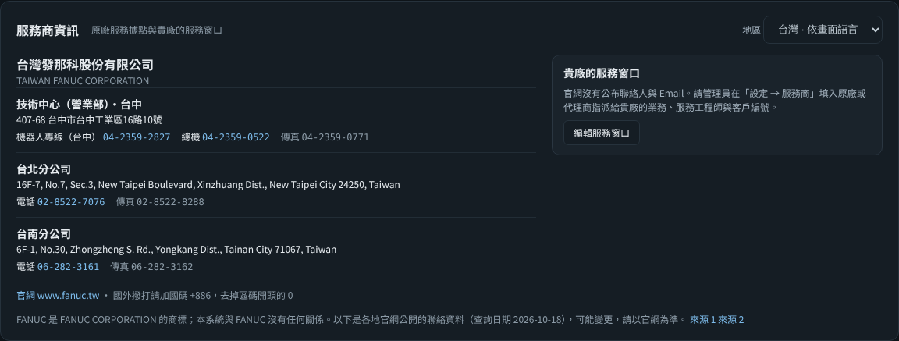

## 9. Languages (6 languages, all available from 2.1)

Supported: `zh-TW` 繁體中文, `zh-CN` 简体中文, `en` English, `ja` 日本語, `ko` 한국어, `vi` Tiếng Việt. The interface, alarms and notifications, reports, work orders, work packages and the command line are all translated (over 2,700 strings, complete in all 6 languages; tests fail if a translation is missing). English follows US usage and spelling (judgment, gray, canceled, cell phone, spare parts…). Languages whose translation is less than 95% complete do not appear in the language menu (for languages added in the future).

Translations other than Simplified Chinese were made by AI and the wording may not be idiomatic; native speakers are welcome to correct them through an issue or pull request (see item 4 of this section).

### 9.1 Three language settings

| Setting | Affects | How to set |
|---|---|---|
| System language | SMS/e-mail/webhook notifications, reports, work orders, command-line output, log files | `[ui] lang` in the config file; or `--lang` at start-up; or the environment variable `DTM_LANG` (precedence: `--lang` > `DTM_LANG` > config file) |
| Screen language | Only what this user sees on screen (the same for standalone, plant, central and Pro) | The language menu at the top of the screen (globe icon, remembered in this browser); or add `?lang=en` to the URL |
| Notification-rule language | Notifications sent by this recipient rule | Add `lang = "vi"` to `[[notify.rules]]` (omitted = system language) |

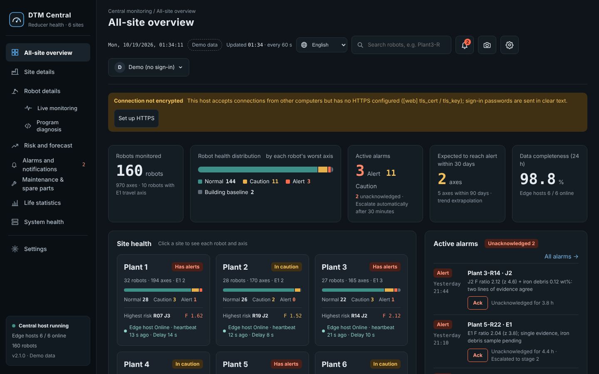

**Text already stored also changes language**: alarm messages and the diagnoses and recommendations that edge hosts send to central are stored together with the "original text + parameters", and the screen regenerates them in the viewer's language; for example, if the edge host of a Vietnamese plant uses Vietnamese, the engineers at central see Chinese. Data stored before 2.1 and text typed by users (event notes, teardown descriptions, spare-part names) are shown as they are. When central receives alarms from an edge host, it also converts them to the central language before notifying.

The central demo and the static demo have a separate set of demo data for each language (plant names, people's names and spare-part names follow the language too), so the first switch to a language takes a few more seconds.

### 9.2 Language versions of the work-package catalogue

`workpacks.r2000ic_165f.toml` is the Traditional Chinese original. The `.zh-CN`, `.en`, `.ja`, `.ko` and `.vi` versions in the same folder are generated by a tool, with part numbers, quantities, work hours and numbers of people identical to the original; only names, steps, safety instructions and notes are translated. The system picks the version matching the current language automatically; when Japanese, Korean or Vietnamese have no dedicated version, the English version is used.

To modify the work packages:

```bash
# 1. Edit the Traditional Chinese original workpacks.r2000ic_165f.toml
# 2. Add translations of new or changed strings in tools/workpack_tr/<lang>.json (not needed for Simplified Chinese, which is converted automatically)
python tools/workpack_l10n.py check   # list missing translations
python tools/workpack_l10n.py         # generate the language versions
```

The tool checks that the structure, numbers and part numbers of each translated version match the original, and generates nothing if something is missing. You can also edit the language versions directly, but they are overwritten the next time they are generated.

### 9.3 SMS length

English SMS is limited to 160 characters; Chinese, Japanese, Korean and Vietnamese (including Vietnamese tone marks) are Unicode SMS limited to 70 characters. The system shortens messages automatically by language, dropping the "Diagnosis" explanation first.

### 9.4 Changing or adding translations

- The source strings in the code are the Traditional Chinese strings wrapped in `_("…")`; translations are in `dtm/locales/<lang>.json`, mapping source → translation.
- After adding or changing strings:

```bash
python tools/i18n_tool.py extract   # update dtm/locales/_msgids.json (currently 2,334 entries)
python tools/i18n_tool.py check     # list missing translations and parameter mismatches per language
```

- Parameters such as `{name}`, `{ratio:.2f}` and `%s` must be kept exactly; nouns in the middle of English and Vietnamese sentences can be written as `{comp!l}` to lower-case the first letter.
- Text that is stored in the database and must later be shown in other languages is produced with `_()` and joined with `+` or `i18n.join()` (which remembers the source and parameters); an f-string turns it back into plain text.
- Punctuation and separators (`、`, `；`, `：`) are also written as `_("、")`, so that English and other languages use half-width forms.
- When a translation is missing, English is shown (for Simplified Chinese, the Traditional Chinese original), without errors.
- Simplified Chinese is converted from Traditional Chinese and then adjusted to mainland usage; English, Japanese, Korean and Vietnamese were translated by the developer. Having local maintenance staff or local FANUC materials check the terminology is recommended; please report errors through an issue.

## 10. Data safety and false-alarm control (added in 1.5)

### 10.1 Write password and operation log

Every action that changes data requires signing in first, including registering events, revoking events, acknowledging alarms, and entering iron debris, vibration, hours and notification tests. Viewing the screens needs no sign-in.

> From 2.1 on: **while there is no account and no write password, the dashboard is always read-only**, and the top of the screen asks you to create an administrator account; the first administrator can only be created locally on the monitoring computer (`http://127.0.0.1`), and there is no default password. The shared write password below is the 1.x method; it keeps working where it was set, but new deployments should use personal accounts directly ([section 12, item 9](#129-personal-accounts-and-permissions)).

```toml
[web]
write_password = "choose-your-own"   # or "env:DTM_WRITE_PASSWORD" to read it from an environment variable
session_hours = 12                 # how long until signing in again is required
```

- The first time you press a button such as "Register", a sign-in window appears: enter your name and the password. The top right then shows "Operator: name"; click it to sign out.
- The password is a single one shared by the whole plant, and the name is entered by whoever signs in. So the operation log records "who said they were who", not verified identity.
- After 5 wrong passwords in a row from the same computer, sign-in is suspended for 10 minutes.
- The event list shows who registered and who revoked each event, and alarms show who acknowledged them. The full operation log is at `/api/audit`, including failed attempts; passwords are never logged.
- When the dashboard is opened to other computers (`host = "0.0.0.0"`) without HTTPS, `check` warns and the screen shows a notice (sign-in passwords would travel over the network in plain text).
- Command-line actions (`event`, `undo-event`, etc.) run locally on the computer and need no password; the operator defaults to the computer's login account and can be set with `--who`.

### 10.2 Revoking events registered by mistake

Wrong axis, wrong category, pressed twice: any of these can be undone by pressing "Revoke" in the event list of "Component life and maintenance log" on the dashboard and entering a reason. After revoking:

- The component record newly installed by the event is deleted, the old component it ended is restored to in service, and its life hours are restored.
- Hour-meter readings entered with the event are deleted.
- The health baseline returns to the period before the event, and the health judgement and maintenance decisions are recomputed immediately, without waiting for 2 consecutive confirmations.
- The event itself is kept, marked "Revoked", with who revoked it, when and why.

If the component installed by this event was later replaced by another event (for example a grease change followed by a reducer replacement), revoke the later one first; the system tells you which one. Grease-change and part-replacement events registered before 1.5 have no change records and cannot be restored automatically; in that case register a "Baseline reset" instead, or correct it manually.

Command line:

```bash
python -m dtm -c config.toml events                       # list events and their IDs
python -m dtm -c config.toml undo-event --id 25 --note "wrong axis selected"
```

### 10.3 Daily automatic backup, second copy on a network folder, restore wizard

```toml
[storage]
backup_dir = "backups"     # relative to the folder of the database; "" disables backups
backup_keep = 14           # keep the latest 14; older ones are deleted automatically
backup_hour = 3            # hour of the daily backup
backup_mirror_dir = '\\NAS01\dtm_backup\R01'   # second copy on a network folder (NAS/file server); "" disables copying
before_restore_keep = 5    # how many automatic pre-restore backups to keep
```

- Backups run automatically while DTM is running, with no stop needed. Integrity checks before and after each backup must pass for it to be kept.
- If the computer was off in the early morning, a backup is made immediately after start-up once more than 26 hours have passed since the last one.
- Backups do not include ordinary raw samples (kept only 7 days, the largest data); the raw segments kept around diagnostic runs and alarms and the per-cycle production records are included. Per-minute statistics, diagnostic features, events, component life, alarms and the operation log are all there.
- **Disk usage** (per robot at 5 samples per second, estimated from the growth in a 30-day accelerated simulation; the actual figure depends on the number of production cycles and alarms): the database levels off at about 2 GB (raw samples for 7 days about 0.25 GB, retained raw segments for 180 days about 0.7 GB, per-cycle production records for 180 days about 1.2 GB); each daily backup is about 0.7 GB, and 14 kept backups about 10 GB. **Reserve 15 GB per robot, and 150 GB or more for an edge host with 10 robots.** When space runs short, first reduce `backup_keep` (and set a second copy on a network folder), or reduce `cycle_retention_days` (daily medians of production cycles are kept permanently and are not affected).
- Backups are stored as zip files that Windows Explorer can open directly. The dashboard shows the time of the latest backup; more than 2 days without a backup, or a failed backup, is flagged in red.
- **Network folder**: each backup is copied there too, and the copy counts as successful only if the SHA-256 matches. While the network is down, local backups continue, and missing copies are made automatically once the connection returns (retried 30 minutes after a failure). When DTM runs as a Windows service, the service account also needs write permission on that network folder; `check` verifies this.

```bash
python -m dtm -c config.toml backup                 # back up now (also copies to the network folder if set)
python -m dtm -c config.toml backup --list          # list local backups; add --mirror to list the network folder
python -m dtm -c config.toml restore                # restore wizard: asks step by step
python -m dtm -c config.toml restore --list         # list all available sources
```

**Restore wizard** (the command, or the "Data restore" card on the dashboard; administrators, locally on this computer):

| Step | Options |
|---|---|
| Source | Local backup / network folder / automatic pre-restore backup / rebuild from central / a specific file (command line only) |
| Point in time | Which backup to use |
| Scope | Whole robot or selected axes; data types (trends and diagnostic features, vibration and iron debris, maintenance records and component life, alarms and notifications, system and operation logs, raw samples); time range |
| Mode | **Recover missing data** (default): adds only data that is in the backup but not currently present; deletes and changes nothing<br>**Return to a point in time**: makes the scope identical to the backup, deleting data after the backup; requires typing a confirmation such as "Return to a point in time J2" |

- A **difference preview** always comes first (for each kind of data: records in the backup, records now, records to be recovered, records to be deleted); the preview changes nothing.
- Before running, the current database is saved automatically as `…_before_restore_<date-time>.sqlite3`; if a restore goes wrong, restore again from the source "Automatic pre-restore backup".
- When finished, the health and maintenance judgements of that axis (or the whole robot) are recomputed automatically. Restoring is possible while DTM is running (written in chunks, one transaction each, without blocking monitoring).
- A raw sample contains all axes, so **raw samples are not restored per axis**; hours, notifications and system records have no axis and are handled only for the "Whole robot". The operation log is only added to, never deleted.
- **Rebuild from central**: when the computer is completely broken and there is no backup locally or on the network folder, the data this robot uploaded (diagnostic features, daily motion statistics, events, components, iron debris, vibration, alarms) is retrieved from central using the sync key; central gives out only the robots of your own plant. Central has no raw samples, per-minute statistics, per-cycle production records, calibrations or hours. If central cannot be reached, run `python -m dtm -c config.central.toml central-export --robot TW01/R01` on the central computer, bring the generated `.json.gz` over and pass it with `restore --file`.

```bash
# Example: J2 trend data was deleted by mistake; recover it from the 10/15 backup
python -m dtm -c config.toml restore --source local --name dtm_20261015_0300.zip --axis 2 --types trend --preview
python -m dtm -c config.toml restore --source local --name dtm_20261015_0300.zip --axis 2 --types trend
```

If the database file itself is broken and cannot be opened, replace it entirely with `restore --mode full --file backups\dtm_20261015_0300.zip` (close DTM first).

### 10.4 Config-file check

```bash
python -m dtm -c config.toml check
```

It points out where each problem is and how to fix it, in the system language. Checks:

- **Format errors**: the line number; full-width symbols (＝ “ ”), unmatched quotes, numbers in quotes.
- **Encoding**: the file is not UTF-8. Save it again from Notepad with "Encoding" set to UTF-8 (Notepad's "UTF-8 with BOM" can also be read).
- **Misspelled item names**: the closest correct name is suggested, for example `passwrod → write_password`.
- **Value ranges**: thresholds in the wrong order, axis numbers outside 1–6, overlapping registers and torque registers, folders that do not exist or are not writable.
- **Notifications**: enabled but without a token or recipients, or an environment variable that does not exist.

Results come in three levels:

| Level | Meaning |
|---|---|
| [Error] | Must be fixed; the exit code is 1 and `start.bat` stops |
| [Warning] | It runs, but may not be what you want |
| [Hint] | Optional items not yet filled in |

With `--connect`, it actually reads 10 seconds of data and checks:

- the reading rate;
- whether the heartbeat is changing (if not, BG Logic is not running);
- whether any axis's torque stays at 0 or is out of range;
- whether the override is 100%;
- whether segment codes can be recognized;
- whether temperature values are plausible.

### 10.5 Temperature, warm-up and common changes: false-alarm scenario simulation

Viscous friction Fv is very sensitive to temperature. Winter, cold starts on Monday mornings and slower production takt all raise Fv by 20–80%, which looks like grease degradation. The temperature compensation of 1.4.1 was enabled only when "the temperature difference over the 10 baseline diagnostic runs reached 5 °C", which is rarely the case on site; and many robots have no temperature signal at all.

1.5 changed this into two layers:

- **Temperature compensation**: always applied when there is a temperature signal; when nothing can be learned from the baseline period, default coefficients are used.
- **Cross-axis common-mode removal**: with two or more axes monitored, changes that occur on all axes at the same time are removed.
  - Air temperature and warm-up change the viscous friction of all axes together, while grease degradation on one axis changes only that axis.
  - The system takes the median of the cumulative viscous-friction changes of the axes as the "common change", converts it to an equivalent temperature difference, and removes it from each axis.
  - The conversion goes through the temperature coefficients, so even if constant friction (wear) rises on two axes at the same time, it is not removed as a common change.
  - Jumps caused by grease changes or part replacements on other axes are not counted.
  - With a temperature signal, what is removed is the common error remaining after temperature compensation, for example from an inaccurate default coefficient.

The `scenarios` command simulates one year (3 axes, one diagnostic run per day) and compares the number of false alarms of 1.4.1 and 1.5 (3 axes in total):

| Scenario | 1.4.1 | 1.5 |
|---|---|---|
| Control: constant temperature, no change | 0 | 0 |
| Seasonal temperature 16–36 °C (with temperature signal) | 13 | 0 |
| Seasonal temperature (without temperature signal) | 13 | 0 |
| Cold-start diagnosis: every Monday + after long holidays (with temperature signal) | 0 | 0 |
| Cold-start diagnosis (without temperature signal) | 18 | 0 |
| Gripper changed, payload setting updated | 13 | 0 |
| Production program change: reducer 8 °C colder at diagnosis | 31 | 0 |
| Gripper changed but payload setting not updated (should alarm) | All 3 axes report "check payload setting" | All 3 axes report it, none mistaken for a grease change |
| J2 grease degradation + seasons + cold starts, no temperature (should alarm) | J2 reported, plus 10 false alarms | J2 reported (change grease now), 0 false alarms |
| J3 reducer wear + seasonal temperature (should alarm) | J3 reported, plus 9 false alarms | J3 health Alert, 0 false alarms (only one kind of evidence, torque, so no direct recommendation to replace the reducer) |
| Grease of all axes degrading together + seasonal temperature (default settings) | — | Missed on the torque path (a known blind spot; see "cost" below) |
| Same, with temperature, calibrated coefficient, `common_mode = "auto"` | — | All 3 axes reported (change grease now), 0 false alarms |

- The "1.4.1" column was produced by switching off the new 1.5 processing (default temperature coefficient set to 0, no common-mode removal), representing the judgement method of 1.4.1.
- The "true" temperature coefficient in the simulator is 3% per °C, while the system default is 2.5%; they differ on purpose. Rerunning with a true coefficient of 4.5%, "seasonal temperature (with temperature)", "cold start (with temperature)", "cold start (without temperature)" and "production program change" still give 0 false alarms: the error from an inaccurate default coefficient is the same on every axis and is removed as common mode. With only two axes monitored (J2, J3), the 4 scenarios spot-checked give the same results.
- These numbers come from the simulator; the temperature coefficients and load effects are reasonable assumptions, not measurements. What they show is that "the decision logic neither raises false alarms under these disturbances nor removes real degradation"; the actual false-alarm rate still has to be confirmed with field data.
- Cost:
  - If all axes degrade **at the same time** in the same proportion (for example grease changed on the same day, the same batch of grease aging together), this is removed as a common change; in the simulation "grease of all axes degrading together", the torque path indeed misses it. Grease life (hours, temperature acceleration) and iron debris guard against this case. Abnormalities of a single axis (leaks, water ingress, contamination, wear) are not affected.
  - With only one axis monitored, there is no common mode to remove and only the temperature signal helps; without a temperature signal, seasons and grease degradation cannot be distinguished.
- Sites with a temperature signal can close this blind spot: after one season, calibrate the temperature coefficient with `temp-coef`, then set `common_mode` to `"auto"` (temperature compensation only when temperature is available, no common-change removal). In the simulation, with a calibrated coefficient and `"auto"`, "grease of all axes degrading together" is caught on all three axes, and the other scenarios that should not alarm still give 0 false alarms. But switching to `"auto"` without calibrating the coefficient, with an actual coefficient of 4.5%, gives 8 false alarms a year for seasonal temperature and 24 for production program changes. So the default stays `true`.

```bash
python -m dtm -c config.sim.toml scenarios                         # all 12 scenarios, about 7 minutes
python -m dtm -c config.sim.toml scenarios --only cold_start_nosensor,grease_nosensor
```

### 10.6 Estimating the temperature coefficient from your own data

With a temperature signal, after one season (a temperature range of 8 °C or more and at least 20 diagnostic runs), run:

```bash
python -m dtm -c config.toml temp-coef
```

- It fits the regression "ln(value) = a − k × temperature + c × days". The days term absorbs slow degradation trends so that degradation is not counted as a temperature effect.
- When the estimate differs considerably from the current setting, a new `temp_coef_fv` is suggested. On simulated data, the estimated coefficient differs from the true value by less than 0.001.
- When temperature and time change almost in step (for example only data from autumn to winter), it reports that the two cannot be told apart and gives no suggestion.

### 10.7 Other

- The log file `dtm.log` now rotates every 5 MB and keeps 5 files, so it no longer grows without limit.
- An old database opened with 1.5 for the first time gets new columns added automatically; existing data is not touched.

### 10.8 Retention of raw segments, analysis data export, teardown form (2.1)

**Retention of raw segments**: ordinary raw samples are kept only 7 days (`raw_retention_days`), but the **raw waveforms of each diagnostic segment** and the raw data **10 minutes before and after each alarm** are kept for 180 days (`raw_keep_days`, `raw_keep_alarm_s`), and daily backups carry these segments too. So the data is still there later to look back at "what actually happened at the moment of the alarm" or for more detailed analysis.

**Analysis data export** (administrators): "Analysis data export (zip)" on the "Component life and maintenance log" card of the dashboard, or:

```bash
python -m dtm -c config.toml export-analysis --since 2026-01-01 --until 2026-09-30 --anonymize
python -m dtm -c config.edge.toml --robot R14 export-analysis          # edge host: specify the robot
python -m dtm -c config.central.toml export-analysis --rkey P3/R14     # central: use the data stored at central
```

| Included | Not included |
|---|---|
| Diagnostic features, daily motion medians, maintenance events, alarms, iron debris, vibration, component life (with teardowns and photos), operating hours, calibrations, system events, the sanitized config file (JSON), retained raw segments | Ordinary raw samples, the account database, keys and passwords, phone numbers and e-mail addresses, webhook URLs; controller and network addresses and full file paths are always masked |

With `--anonymize` (or ticking "Anonymize" on the screen), plant names, robot names, lines and operators are replaced with codes (SITE-A, ROBOT-01, Operator 1…), and the mapping table is not put in the zip. CSV files are UTF-8 (with BOM) and open directly in Excel. Download links generated on the web are valid for 10 minutes and can be used only once.

**Teardown form** (engineers and above): after replacing a reducer, gearbox or motor, press "Teardown" in the event list and fill in:

- Damage location (input gear, crankshaft bearing, cycloidal gear, pins, main bearing, oil seal, gearbox gear/bearing, motor bearing, brake, other)
- Damage mode (pitting, spalling, wear, broken tooth, other), grease condition (normal, discolored/blackened, metal powder, emulsified/water, hardened/dried, leaking)
- Photos (JPEG/PNG, stored in `data/photos/`), notes
- If there is no damage when opened, tick "**No fault found**": this replacement then counts as a preventive replacement (censored data) in the life statistics, and a record that "this judgement may have been too early" is kept for correcting the thresholds later

It can also be filled in on the central robot page (photos must be uploaded on that robot's dashboard). Command: `python -m dtm -c config.toml teardown --id 25 --location crank_bearing --mode spalling,wear --grease metal --photo IMG_0012.jpg`. When an event is revoked, its teardown results are reverted with it.

### 10.9 Planned stops, computer clock offset, commissioning report, threshold replay (2.1)

**Planned stop for a single robot** (engineers and above): for annual maintenance, line stops or die changes, set the end time under "Planned stop" in "Maintenance and inspection entry" on the dashboard; on an edge host each robot is set separately, and at central press "Planned stop" on the robot page (written to that robot at the next sync). During the stop, no alarms are sent for data gaps, heartbeat stops, connection losses or invalid values, and the watchdog does not report data gaps; other judgements continue. The screen shows "In planned stop", which ends automatically at the set time, for at most 60 days.

```bash
python -m dtm -c config.toml downtime --until "2026-10-20 08:00" --note annual-maintenance
python -m dtm -c config.toml downtime --until 8h
python -m dtm -c config.toml downtime --cancel
```

**Computer clock offset**: at each upload, the time is compared with central's reply; if they differ by more than `[central] clock_drift_s` (default 60 seconds), that robot raises "Caution", which clears automatically when back in range. The edge-host table in central's "System health" has an extra "Clock offset" column. An inaccurate clock misaligns trends and alarm times; turn on Windows time synchronization (or the company's NTP).

**Commissioning report**: generated automatically in `data/reports/` after the first 7 days, or by pressing "Commissioning report" on the dashboard or running `python -m dtm -c config.toml commissioning-report`. Contents: sampling rate and jitter, data gaps, heartbeat and connection, segmentation success rate and rejection reasons of diagnostic segments, per-axis noise (ripple, coefficient of variation of F), motion-code coverage and sensor update intervals, each marked ✔ or ⚠. Deal with the ⚠ items first before scheduling maintenance from DTM's decisions.

**Threshold replay**: before changing thresholds, replay "how many times and when would it have alarmed in the past if this had been the threshold":

```bash
python -m dtm -c config.toml replay --set health.caution_ratio=1.3 --set health.alert_ratio=1.6 --days 365
python -m dtm -c config.toml replay --set decision.weights.iron=0.8 --decision      # also replay maintenance decisions (slower)
```

"Threshold replay" on the central robot page can directly test the ratio thresholds of the health judgement and production monitoring (using data stored at central; the figures are approximate). Replay uses the data stored at the time, with baselines reset at the actual times of grease changes and replacements; compare with teardown records and field experience before changing the settings.

## 11. Tests

```bash
python -m unittest discover -s tests -v    # about 5 minutes (233 tests), of which the scenario simulation takes about 1.5 minutes
```

Covered: complete translations with consistent parameters in 6 languages, language versions of the work packages synchronized with the Traditional Chinese original, the API and pages in each language, stored alarms shown in another language, and the Pro analysis flow (line alignment, damage, sweep, improvement verification, streaming reception).

GitHub Actions (`.github/workflows/tests.yml`) runs all tests and pyflakes on Windows and Linux with Python 3.11–3.13 on every push.

**Long-run and load tests** (not part of the unit tests; run manually):

```bash
python tools/soak_test.py --days 30            # 30 days accelerated: memory, database growth, raw-sample cleanup, log rotation, daily backups
python tools/load_test.py                      # central load: 160 robots in 8 plants uploading at once for 10 rounds; upload processing time and screen response
python tools/load_test.py --mode standalone    # worst case: 160 robots each uploading at the same time
```

Results of 2.1.0 in the development environment (a Linux cloud host):

- Central load: with 160 robots in 8 plants uploading at once, each round is processed in about 1.6 seconds (the first round, including a 3,000-record backlog per robot, about 7.6 seconds); with 160 robots each uploading at the same time, each round takes about 2.5 seconds without errors (the connection queue has been enlarged to 256). Opening screens during uploads takes 0.1–0.5 seconds; normally the APIs of the 8 screens respond within 50 milliseconds.
- Long run (30 days accelerated, 2 samples per second, about 5.18 million samples through the full monitoring flow and daily backups, about 70 minutes to run): ordinary raw samples level off after day 7 and hourly cleanup works; the retained segments around diagnostic runs and alarms add about 20,000 records a day and expire after 180 days (by design). The database is 340 MB on day 30 and grows about 8.5 MB a day after day 7 (mostly per-cycle production records; the simulator produces a cycle about every 6 seconds). Memory rises from 50 MB to about 87 MB in the first 8 days and then slowly to about 100 MB by day 30; tracing Python objects showed no accumulation, but keep an eye on it during trials on real robots. Daily backups and deletion of old copies work. Processing one simulated day takes about 2–3 minutes, which corresponds to about 0.2% of one CPU core in real operation.
- These are simulated data; the long-term behaviour of the network, the controller and Windows itself still has to be validated on site.

## 12. Multi-plant, central monitoring and long-term operation (added in 2.0)

### 12.1 One program, three roles

The role is set by `[system] role` in the config file; the program is exactly the same:

| Role | Use | Config template | Screens |
|---|---|---|---|
| `standalone` (default) | One computer for one robot (the 1.x usage) | `config.example.toml` | Standalone dashboard :8080 |
| `edge` edge host | One computer manages several robots in one plant | `config.edge.example.toml` | Plant dashboard :8080, each robot :8101, :8102… |
| `edge` without central (small mode) | 10 robots or fewer, no central server (also works with 1) | `config.small.example.toml`, `start_small.bat` | Plant dashboard :8080, each robot :8101… |
| `central` central server | Receives uploads from all plants; 8 screens for all plants, notification center | `config.central.example.toml` | Central :8090 |

```
Robots ×N ──HTTP──→ Edge host (one per plant)                     Central server
                    ├ one program and one database per robot      ├ all-plant overview, plants, robots, risk
                    │   (judgement happens here)                  ├ alarm and notification center
                    ├ supervisor: restarts crashed or stuck       │   (only central sends notifications)
                    │   programs                                  ├ maintenance schedule, spare parts, fleet life statistics
                    ├ plant database + plant dashboard            └ system health (plant heartbeats, watchdogs, backups)
                    │   (viewable even when offline)
                    └ uploads new data every 60 s (gzip, key) ──HTTPS──→
                         ←── central replies: commands (grease change, replacement, acknowledgement…) + fleet life model
```

- **Judgements are made once, at the edge**: central receives the results and does not recompute; when the network is down, the edge keeps judging and recording, and after recovery it re-sends automatically from its cursors, without losing data.
- **Notifications have a single outlet**: normally central sends them all (deduplication, dispatch by plant and duty roster, escalation). Only when the edge cannot reach central for longer than `edge_fallback_s` (default 5 minutes) does it send "Alert" notifications itself.
- **Each piece of data has a single owner**: events registered at central (grease changes, replacements, iron debris, alarm acknowledgements) become "commands" that the edge executes on that robot at the next sync and then syncs back.
- **Central can see edges going offline**: an edge that has not uploaded for longer than `edge_timeout_s` (default 5 minutes) → system alarm (power failures, network failures and stopped programs are visible only at this level).
- **Fleet life models are distributed**: central computes Weibull models from the replacement records of all plants and distributes them every hour; edges write them to `run/rules.json`, and each robot uses the fleet model when its own failure records are insufficient.

### Small mode (10 robots or fewer, no central; 2.1)

With only a few robots and no wish to set up a central server, use one computer as an edge host and leave `[central] url` empty; that is small mode:

1. Copy `config.small.example.toml` to `config.small.toml` and fill in the plant name, the IP of each robot (`[[robots]]`, one is fine) and the notification channels.
2. Double-click `start_small.bat`. When you first open http://localhost:8080, create an administrator account on this computer.

Differences from running with a central server:

- **This computer sends all notifications**: the robot programs do not send on their own (so the same event does not arrive several times); the local plant database handles deduplication, dispatch by rules, escalation and the daily summary. Only when this main program has been down for longer than `edge_fallback_s` (default 5 minutes) do the robot programs send "Alert" notifications themselves as a fallback.
- **Plant life statistics**: every hour, Weibull models are computed from the replacement records of all robots in the plant and written to `run/rules.json` for each robot; when failure records are insufficient, the prior in `[life.prior]` is used. The life model on the screen shows its source (fitted to own records / plant fleet / central fleet / config prior).
- **The daily summary is the heartbeat**: set `summary_time` (for example `"07:30"`); receiving the summary on time every day means the system is alive, and on a day it does not arrive, go and check this computer. The summary can also be sent as a one-line SMS (add `"sms"` to `summary_channels`; counts toward the daily limit).
- To connect to a central server later, just fill in the URL and key in `[central]`; nothing else needs to change.

### 12.2 Look at the central screens first (demo data)

Double-click `start_central_demo.bat`, or:

```bash
python -m dtm -c config.central.example.toml demo          # opens http://localhost:8090
python -m dtm -c config.central.example.toml demo --rebuild # regenerate
```

This generates **demo data** for 6 plants and 160 R-2000iC/165F robots (10 of them with E1), marked "Demo data" at the top right of the screen. Demo mode does not connect to robots or send notifications (test notifications are blocked). It also starts a simulated robot connected as the first robot (plant 1), so "Live monitoring" and "Program diagnosis" in the left-hand menu can be tried in the same window (the first time takes about 1–2 minutes to prepare data; add `--no-live` if not needed). Demo accounts and settings are stored in `data/demo_users.sqlite3` and do not affect production use. The 8 screens:

**Online demo without installation**: `python tools/build_static_demo.py` exports the 8 central screens as a static website (`site/`, reading JSON snapshots of the demo data, with all writes disabled and a notice shown) that can be put on GitHub Pages directly. There is one snapshot per language for all 6 languages (about 45 MB, 3 minutes; `--langs zh-TW,en` generates only the given languages). The repository includes an automatic deployment workflow, `.github/workflows/pages.yml`: under Settings → Pages → Source choose "GitHub Actions", and every published Release updates it automatically.

| Screen | Contents |
|---|---|
| All-site overview | Number of monitored robots, health distribution, active alarms (can be acknowledged), axes expected to reach Alert within 30/90 days, plant cards, the 8 highest-risk axes, 90-day trends, maintenance in the next 14 days |
| Site details | Heat map per robot and axis (F ratio, z), items needing action, production cycles per hour today, the next 30 days, edge-host status; CSV export |
| Robot details | Axis cards, trends (diagnostic torque or production cycles, temperature, event markers), judgement and evidence, diagnostic features, life curves, events (can be revoked); register events and iron debris, print work orders |
| Risk and forecast | Timeline of expected time to Alert (with uncertainty ranges and scheduled maintenance), risk matrix (impact × timing), spare-part demand vs stock (marked "Urgent" when the lead time is too long) |
| Alarms and notifications | Alarm lists (active / unacknowledged / today / 90 days), escalation flow, delivery log, channel status, message preview, recipient rules |
| Maintenance & spare parts | 6-week schedule (filter by plant and type, click to complete), work-package preparation progress, grease changes by hours, spare-parts stock (editable) |
| Life statistics | Weibull probability plot (median ranks, censoring), β/η/B10 and confidence per axis, expected replacements over the next 12 months, distribution of hours |
| System health | CPU/memory/disk/latency/controller connection of each edge host, the 4 watchdog levels, 24-hour data latency, backups, operation log, distributed commands |

### 12.3 Edge host (several robots in one plant)

1. Copy `config.edge.example.toml` to `config.toml` and fill in `[system] site_id` (for example `"P3"`, unique per plant) and `[[robots]]` (one block per robot: `id`, `host`, `line`, `impact`, plus `e1 = true` if it has E1).
2. Check with `python -m dtm -c config.toml check` (duplicate IDs or ports are reported as errors).
3. `python -m dtm -c config.toml run` (or install it as a service; see item 5).

- Each robot has its own program and its own database (`data/R14.sqlite3`); a problem with one robot does not affect the others.
- Each robot's live monitoring and program diagnosis open directly inside the plant screens (left-hand menu, or "Open" in the site details); the plant screen relays to that robot's program on the same host (ports from 8101, used only inside the host), and one sign-in is enough.
- The supervisor checks every 5 seconds: a program that exits is restarted (with increasing intervals, at most `max_restarts` times per robot per hour; beyond that it stops and raises a system alarm); if the status file has not been updated for longer than `stale_s` (stuck), the program is killed and restarted.
- To run a command for a single robot: `python -m dtm -c config.toml --robot R14 events` (every standalone command accepts `--robot`).
- Settings that differ for individual robots go under `[[robots]]`, for example `[robots.axis.2]`, `[robots.sensors]`.

### 12.4 Central server

1. Copy `config.central.example.toml` to `config.central.toml`.
2. Set the upload key: `[central] token = "env:DTM_SYNC_TOKEN"` (shared by all plants), or `[central.tokens]` with one per plant (recommended). Set the same values in `[central] url` and `token` on the edge hosts.
3. HTTPS is recommended (`[web] tls_cert`, `tls_key`, with a certificate issued by the company's internal CA through your IT department); edges verify it with `[central] ca_file`.
4. Create accounts: `python -m dtm -c config.central.toml user add wang --role engineer --display "Alex Wang"`.
5. Double-click `start_central.bat`, or `python -m dtm -c config.central.toml run`.

A standalone installation (one robot) can also upload to central directly: fill in `[system] site_id` and `[central] url`, `token` in `config.toml`.

### 12.5 Long-term operation (no stops)

```bash
python -m dtm -c config.toml service install            # run as administrator; WinSW on Windows, systemd on Linux
python -m dtm -c config.toml service install --no-error-dialog   # also turn off the "program has stopped working" dialog
python -m dtm -c config.toml service status | restart | stop | uninstall
python -m dtm -c config.toml maintenance on --minutes 120 --reason "software update"   # turn on before maintenance; pauses the watchdog
python -m dtm -c config.toml maintenance off
python -m dtm -c config.toml selfcheck
```

- **Windows service**: starts automatically at boot, needs no login, and has no black console window to click or close by mistake; restarts automatically 10/30/60 seconds after the program exits; log files are split automatically. A separate `DTM-Watchdog` service is also installed. WinSW is included in `tools/winsw/` (MIT license).
- **Four watchdog levels** (each level acts only if the previous one cannot recover):
  1. Automatic service restart (program exited) / supervisor restart (robot programs on the edge);
  2. Software watchdog: status file or acquisition loop stops updating → restart the service; at most `max_restarts` times per hour, beyond which it stops and notifies (no endless restarts); robot data gaps are only notified, not restarted;
  3. Hardware watchdog (optional): `[watchdog.hw] type = "linux"` (/dev/watchdog), `"command"` (the industrial PC vendor's tool), `"modbus"` (heartbeat to a PLC, which power-cycles the computer); it is fed only while DTM is healthy, and stops being fed when recovery fails so the hardware reboots; more than `max_reboots_day` times a day, it switches to feeding continuously and only notifies people;
  4. Central heartbeat: an edge that has not uploaded for too long → central raises a system alarm.
- **Self-check at start-up**: database integrity (after an abnormal shutdown, or every 7 days), disk space, write permissions, config file. With errors it does not start (exit code 4, logged in `logs/`); start again after fixing, or add `--force`.
- **Fail fast**: if an important thread stops unexpectedly, the program exits and leaves the restart to the service, so it never "looks as if it is running but is not recording". Crash logs are written to `logs/crash_*.log`.
- **Disk alarms**: below `disk_alarm_pct` (10%) free, Caution; below `disk_critical_pct` (3%), Alert, and writing raw samples is paused (features and events continue).
- When run from the command line, the Windows console's "QuickEdit mode" is turned off automatically (so a stray click in the window does not pause the program).
- Status files, maintenance mode and watchdog records are in `run/`; log files are in `logs/`.

### 12.6 E1 travel axis

- Robot side: `robot/DTM_BG_E1.LS` puts the E1 disturbance torque in R[107] (the file contains an alternative for a travel axis in group 2).
- Settings: add `7` to `[axes] enabled` (on an edge host, write `e1 = true` under `[[robots]]`); E1 defaults to `rack` (travel-axis gearbox + rack), a linear axis, and the gravity offset G is not judged.
- Diagnostic segment: `DTM_DIAG.LS` can optionally include an E1 segment (code 7xxx, end points PR[57]/PR[58]).
- Work packages: `R2000iC165F-E1-gearbox`, `R2000iC165F-E1-grease` (part numbers according to the travel-axis parts list).

### 12.7 Production motion-code monitoring (no need to stop for diagnostic runs)

- In the production program, write `R[110] = 9001` before a fixed motion (9000–9899, one code per motion) and `0` at the end; see `robot/DTM_MCODE_EXAMPLE.LS` for an example.
- DTM records the torque RMS of each cycle by (motion code, axis); each day's median is compared with the first `baseline_days` (10) valid days after a reset: ≥ 1.15 times is Caution, ≥ 1.30 times is Alert, confirmed only after `confirm_days` (2) days in a row; cycles whose duration deviates from the typical value or whose override is not 100% are not used.
- The result is merged into the "torque" evidence of the cross-analysis (it never counts as a separate second kind of evidence); the dashboard has a "Production monitoring" card.
- After changing a gripper or the program, register "Reset motion baseline" on the dashboard (a motion code can be specified). Codes can be named in `[motion.codes]`.

### 12.8 Vibration and temperature sensors (IO-Link / wireless gateway)

- `[sensors] enabled = true`, with `host` and `port` pointing to the gateway's Modbus TCP, and `[sensors.map]` giving the register of each value, for example `"2.radial.rms" = { addr = 200, type = "float32" }`, `"2.temp" = { addr = 210 }`.
- The values read are sliced by time window: diagnostic constant-speed segments (and 99xx vibration sampling windows) write one vibration feature record into the cross-analysis; production cycles record the median vibration of the cycle.
- For battery-powered wireless sensors (updating only every 1–5 minutes), set `only_changes = true` so that only readings within constant-speed segments or sampling windows are used.
- When the controller has no temperature register, the sensor temperature is used for temperature compensation.

### 12.9 Personal accounts and permissions

```bash
python -m dtm -c config.toml user add wang --role operator --display "Alex Wang"   # asks for a password (at least 8 characters)
python -m dtm -c config.toml user list
python -m dtm -c config.toml user passwd wang
python -m dtm -c config.toml user role wang --role engineer
python -m dtm -c config.toml user disable wang        # "enable" restores it
```

| Role | Can do |
|---|---|
| viewer | View the screens (with `[web] require_login = true`, even viewing requires sign-in) |
| operator | Acknowledge alarms, enter iron debris, vibration and hours, tick work-package preparation |
| engineer | Register and revoke maintenance events, maintenance schedules, completion, spare parts |
| admin | Accounts, system settings, notification recipients, notification tests, maintenance mode, restore, analysis export, diagnostic bundle |

- Accounts are stored in `users.sqlite3` (shared by the DTM programs on the same computer), with passwords stored as PBKDF2-SHA256 hashes.
- Once accounts exist, sign-in uses accounts; without accounts, the shared write password of 1.5 continues to apply.
- From 2.1 on, administrators can also add, disable and reset accounts under "Settings → User accounts" at the top right of the screen (see [section 14](#14-one-window-and-settings-21)).
- HTTPS: `[web] tls_cert`, `tls_key`.

### 12.10 Notification center

- Channels: SMS (4G modem or SMS provider's HTTP gateway, with optional `fallback`), e-mail, webhook (LINE, Teams, WeCom and others are connected yourself through webhook templates; see [section 7](#7-notifications-sms-e-mail-webhook)).
- Recipient rules `[[notify.rules]]`: which plants (ID or name, `"*"` = all), from which level, which escalation stage, which channels, which recipients; `duty = true` sends to the people on duty instead. See `config.central.example.toml` for examples.
- Escalation `[notify.escalation]`: an Alert unacknowledged for 30 minutes → stage 2 (for example SMS to the duty person); after 2 hours → stage 3 (for example the section manager). Escalation stops on acknowledgement or clearing. **Acknowledgement only stops escalation; it does not close the alarm.**
- Duty roster: `duty_file` points to a CSV (`date,start,end,name,phone,email`, overnight shifts allowed), or fixed shifts are written as `duty` in the config file.
- Quiet hours `quiet_hours = "22:00-07:00"`: during this period "Caution" is not sent immediately but included in the daily summary at `summary_time`; "Alert" is sent as usual.

### 12.11 New commands

| Command | Purpose |
|---|---|
| `run [--service] [--force]` | Start according to the role (standalone / edge / central) |
| `demo [--rebuild] [--port N] [--no-live]` | Central demo data (`--no-live`: do not start the simulated robot) |
| `service install/uninstall/start/stop/restart/status` | System service |
| `watchdog` | Program watchdog (normally run by the service) |
| `maintenance on/off/status` | Maintenance mode |
| `selfcheck` | Self-check |
| `user …` | Personal accounts |
| `version` | Show the version |
| `--robot ID` | Edge host: run a standalone command for one of its robots |
| `restore`, `central-export` | Restore wizard, central export of rebuild files (2.1) |
| `tls --self-signed/--off` | HTTPS: generate and enable a self-signed certificate, turn it off; without arguments, show the current certificate (2.1) |
| `validation [--days N] [--json]` | Field validation report (HTML, printable) (2.1) |
| `export-analysis` | Analysis data export zip (2.1) |
| `teardown` | Teardown form (2.1) |
| `downtime` | Planned stop for a single robot (2.1) |
| `commissioning-report` | Commissioning report (2.1) |
| `replay` | Threshold replay (2.1) |
| `pro …` | Pro program-level diagnosis (2.1; see [section 13](#13-pro-program-level-diagnosis-new-in-21)) |

### 12.12 Not yet included

- Local messaging apps such as KakaoTalk in Korea and Zalo in Vietnam (can be connected yourself through the webhook).
- Multiple robot models (currently only the R-2000iC/165F).
- The user manual, operating manual and introduction slides have not been updated for 2.x; this README and the comments in the config templates are authoritative.
- AI-written modification suggestions in Pro (the optional scheme of technical disclosure 6.9.2; 2.1 has only the rule-based version); testing of the KAREL streaming template on a real robot.
- Long-term validation on real robots (the goal of v3.0).
- For the complete list (with the verification level of every feature), see the [feature status table](docs/FEATURE_STATUS.md).

## 13. Pro program-level diagnosis (new in 2.1)

Resident monitoring (sections 1–12) answers "is the reducer's health getting worse"; Pro is a short, in-depth diagnosis that answers "**which program lines and which angle ranges consume reducer life, which change pays off best, and whether the change worked**". The two complement each other: when resident monitoring finds an axis degrading faster, use Pro to find the cause; after changing the program, resident monitoring keeps tracking.

### 13.1 Look at the demo first (no robot needed)

```bash
python -m dtm pro demo          # opens http://localhost:8091 (about 1 minute to generate demo data)
```

Two simulated robots: R01 has two diagnostic periods, before and after a change; R02 is an unchanged control over the same periods; there are also 9 weeks of full-range sweeps. The screen has 9 tabs: Overview, Timeline, Program, Angle, Wait slack, Suggestions, Impacts and stops, Full-range sweep, Improvement verification. The demo data is only for seeing the screens and the workflow; the simulator only simulates the built-in demo programs.

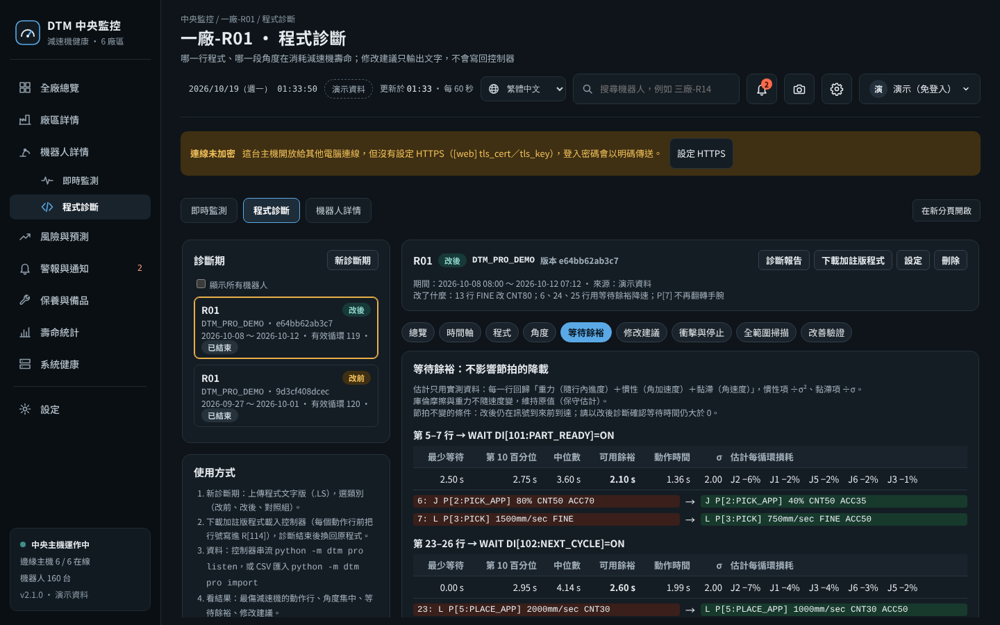

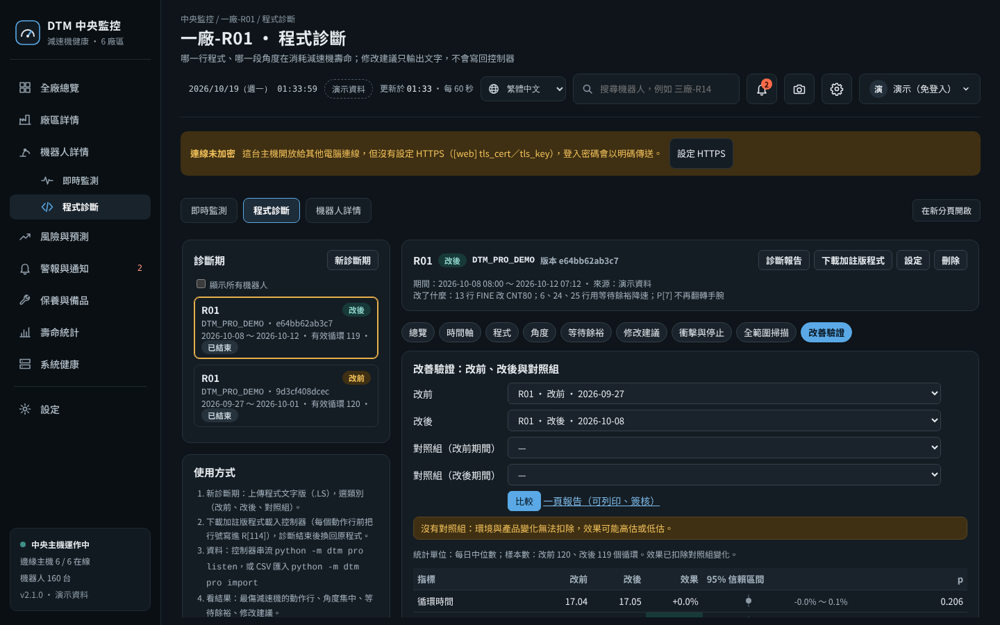

### 13.2 Procedure on site

1. **Get the text version of the production program** (.LS, from the controller's web pages or a USB backup).
2. **Generate the instrumented program**: `python -m dtm pro instrument PROG.LS` produces `PROG_DTM.LS`, with an extra line `R[114]=<original line number>` before every motion line; motions, speeds and points are unchanged. Upload it through your plant's change procedure, and **restore the original program when the diagnostic period ends**.
3. **Open a diagnostic period**: on the robot dashboard's `/pro` page (for example `http://monitor-pc:8080/pro`), press "New diagnostic period", upload the .LS and choose the category (before, after, control; engineers and above), or:
   ```bash
   python -m dtm -c config.toml pro new --program PROG.LS --role before
   ```
4. **Collect data (choose one)**, 3–7 days recommended (it ends automatically at `[pro] max_days`):
   - **Controller streaming**: `robot/DTM_STREAM.KL` (KAREL template) + `python -m dtm -c config.toml pro listen` (default port 9750). **This template has not yet been tested on a real robot**; it requires the KAREL and Socket Messaging options, and every system variable must be confirmed for your controller version; only the configured controller IP is accepted.
   - **CSV import**: `python -m dtm -c config.toml pro import <period> data.csv`. Columns: `t` (seconds), `q1`…`q6` (angles, degrees), `tq1`…`tq6` (torque), `line` (the value of R[114]); with E1, add `e1`, `tqe1`.
5. **Optional**: controller alarm history (emergency stops, collision detection, safety-fence opening) with `pro alarms <period> ERRALL.LS`; accelerometers with `pro accel <period> accel.csv` (`t,peak,rms` or `t,acc`).
6. **See the results**: the `/pro` page, or `pro summary <period>`, `pro report <period>` (HTML report).
7. **Modify**: suggestions are output only as text and are **never written back to the controller, and speed is never lowered automatically**. People make the changes, then check in order: interference and cycle time in simulation software → low-speed trial in T1 → production.
8. **Verify**: after the change, open another diagnostic period "After"; if possible, leave another robot of the same model and similar load unchanged and open a "Control" period for it during both the before and the after periods. The "Improvement verification" tab, or:
   ```bash
   python -m dtm -c config.toml pro compare --before <before> --after <after> --control-before <control-before> --control-after <control-after>
   ```
   produces a one-page report: effect = (after ÷ before) ÷ (control after ÷ control before) − 1, with a bootstrap confidence interval and a Mann–Whitney test; without a control group, the report notes that "changes in environment and products cannot be removed".

### 13.3 What you can see

| Tab | Contents |
|---|---|
| Overview | Valid cycles, cycle time, line-alignment confidence, damage per cycle and estimated time to rated life for each axis, the motion lines that wear the reducer most |
| Timeline | Torque of each axis in a typical cycle (median and 10–90% range) with the program lines, colored by damage |
| Program | Each line's share of damage, peak as a proportion of the allowable value, motion and dwell time; click a line for details |
| Angle | Angle-concentration map: damage density, the range holding 80% of damage, Gini, number of reversals, small oscillations (fretting risk); with the reduction ratio and number of pins entered, angles can be converted to estimated wear positions for comparison at teardown |
| Wait slack | Time spent waiting for a signal after a motion: how much the motion can be slowed while still arriving before the signal, and the estimated damage reduction; high-damage lines without slack get a cycle-time versus life trade-off table |
| Suggestions | Rule-based: FINE to CNT, slowing down within wait slack, soft start, avoiding large wrist flips, payload settings, L to J, angle concentration and small oscillations, impacts and stop events, acceleration profiles |
| Impacts and stops | Numbers of emergency stops, collisions, safety-fence openings and controlled stops (added to damage by weight), accelerometer impacts mapped to lines |
| Full-range sweep | Local wear index LWI (friction in frequently used angle ranges ÷ friction in rarely used ranges); ≥ 1.2 times the first sweep is Caution, ≥ 1.4 times is Alert |
| Improvement verification | Difference-in-differences of before, after and control with confidence intervals, cost conversion (`[pro.cost]`) |

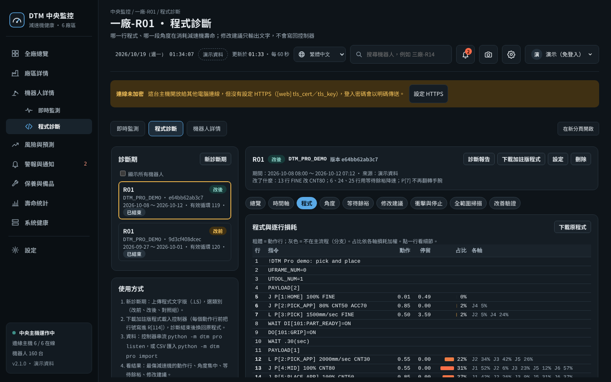

The estimated time to rated life, the slack-based damage reduction and the angle map are model estimates: the rated life is a statistical value (about 10% of components fail before it), a percentile-based slack lowers but does not eliminate the chance of a longer cycle time, and the angle map shows where on the output side the load concentrates; converting it to internal tooth or pin positions needs an initial phase calibrated at teardown, and inside an RV reducer the load of a narrow output range is spread all around the pins and crankshaft bearings. See the technical disclosure ([`docs/TECHNICAL_DISCLOSURE.en.md`](docs/TECHNICAL_DISCLOSURE.en.md), 6.5–6.8) for details.

### 13.4 Torque source (important)

- Damage calculation needs **transmitted torque** (the torque command, or motor current × a factor). The `DTM_STREAM.KL` template sends the disturbance torque `$MOR_GRP[1].$CUR_DIS_TRQ` by default (the same variable as DTM_BG), and **disturbance torque does not include gravity or inertia**. If your controller exposes transmitted torque, replace the variable in the template (**confirm the system variables actually available for your controller version**), or use clamp-on current sensors; if neither is available, set `[pro] torque = "disturbance"`: the damage ranking is then only a relative reference, as noted on the screen and in reports.
- `[pro] torque_unit`: `pct` (percentage of the reducer's rated torque T0), `nm`, `raw` (relative ranking only).
- Life estimation requires `rated_nm` (rated torque T0), `rated_rpm` and `rated_life_h` for each axis (RV catalogues commonly use 15 rpm and 6000 h); when the start/stop and momentary maximum allowable torques are not entered, the RV defaults are used (2.5 and 5 times rated). These defaults vary by model (small RV models allow about 2 times for start/stop), so enter the catalogue values of your model. Until calibrated with replacement records, treat the results only as relative references.

### 13.5 Full-range sweep `robot/DTM_SWEEP.LS`

- Once a week, after warm-up, with the same load, each axis moves once forward and once backward at a slow 5% over its largest interference-free range; `R[114] = 8000 + axis × 10 + direction` (1 = toward maximum, 2 = toward minimum). The example covers J2 and J3; copy a block for other axes.
- Uses `PR[50]` (DTM standby position, shared with DTM_DIAG) and `PR[61]`–`PR[64]` (taught as joint values, differing only in the axis under test).
- Sweep data is stored separately and automatically when streamed or imported as CSV; LWI needs one completed diagnostic period first (to know which angles are frequently used).

### 13.6 Notes

- **Registers**: Pro uses `R[114]` (line number; changeable in `[pro] line_reg`, must not overlap `[registers]`) and `PR[61]`–`PR[64]`; confirm before deployment that no other program uses them. The PC side never writes to the controller; the robot-side programs (background logic, diagnostic and sweep programs, motion codes, the instrumented program) are installed by people and write only to these dedicated registers.
- **Diagnostic programs run on their own**: DTM_DIAG and DTM_SWEEP are separate programs run alone during stops or shift changes; do not insert them into production programs. The instrumented program is used only during diagnostic periods.
- Only actually measured data is analysed; suggestions must be confirmed by people, simulated and test-run before going into production (the report also notes this at the end).
- What the design deliberately does not do: [docs/DESIGN_CONSTRAINTS.md](docs/DESIGN_CONSTRAINTS.md).
- For a technical comparison with known patents, see technical disclosure 6.15 (the first: FANUC JP5289608B2, which estimates reducer life by program simulation and lowers speed automatically). Pro deliberately stays "measured data, suggestions only, changes made by people"; before adding automatic program changes or replacing measurement with simulation in a derivative version, have a patent attorney assess it first.

## 14. One window and settings (2.1)

### 14.1 One window

Standalone, plant (edge host, small mode) and central all use the same screens: a left-hand menu, and the language menu, alarm bell, gear (Settings) and account at the top right.

| Mode | Left-hand menu |
|---|---|
| Standalone (one robot) | Live monitoring, Program diagnosis, Settings |
| Plant (edge host, small mode) | Site overview, Site details, Robot details (below it: Live monitoring, Program diagnosis), Risk and forecast, Alarms and notifications, Maintenance & spare parts, Life statistics, System health, Settings |
| Central | As above; live monitoring and program diagnosis are relayed by central to the plant's edge host and are **view-only** (sign-in does not carry across hosts); to make changes, sign in on the plant host |

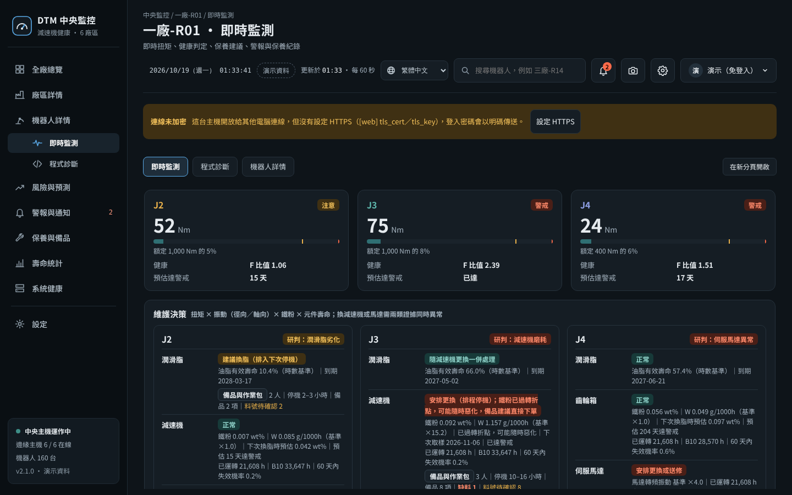

- Live monitoring and program diagnosis open directly inside the window with the same sign-in; "Open in new tab" at the top right shows a single screen on its own.
- On an edge host, each robot's program serves its screens only inside the host (ports from 8101), relayed by the plant screen; the relay carries the IP of the original computer, so permissions, the list of allowed computers and the operation log are evaluated for the original computer.
- Relaying from central to an edge host requires central to be able to reach the edge host (`[web] public_host` and the robot ports); if it cannot, the screen explains why.

### 14.2 Settings (gear at the top right)

| Section | Contents | Who can change it |
|---|---|---|
| My account | Display name, change password, this sign-in, signed-in devices (can sign out other devices) | The user |
| General | System display name, default language, screen refresh interval, currency for spare-part prices | Administrators |
| User accounts | Add accounts (generating a temporary password), roles, disable/enable, reset passwords, unlock, force sign-out; password policy; all signed-in devices | Administrators |
| Privacy & security | Sign-in required even for viewing, sign-in validity, automatic sign-out when idle, failed attempts before suspension, allowed computers, anonymized analysis export by default; HTTPS (one-click self-signed certificate, certificate download); operation log (search, failures only, CSV download); what data this host stores and where it connects to | Administrators (HTTPS only locally on the host) |
| Notifications | Recipient list (name, mobile number, e-mail, each person's language, which notifications); default recipients, recipients per rule, notification language of rules, enabling; sending test notifications | View: signed-in users (numbers partly hidden); change: administrators |
| Service provider | Which region's manufacturer service office to show, your plant's service contact (contact person, phone, e-mail, customer number, notes) | Administrators |
| System & backup | Version, run mode, host, database size, disk, backup status and back up now, self-check, config-file check, connection and data locations (display only), first-time setup wizard (standalone), field validation report, diagnostic bundle | View: signed-in users; actions: administrators |
| Change history | Old value, new value, who, from which computer for every change of system settings; one-click revert | Administrators |
| About | Version, author, license, no warranty, patents, trademarks, third-party components | Everyone |

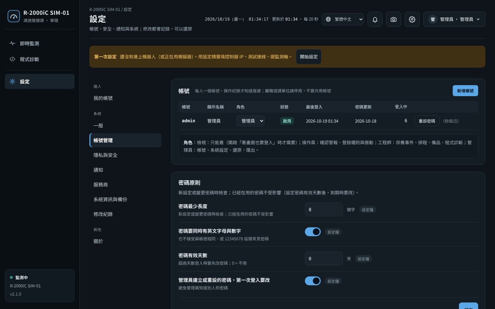

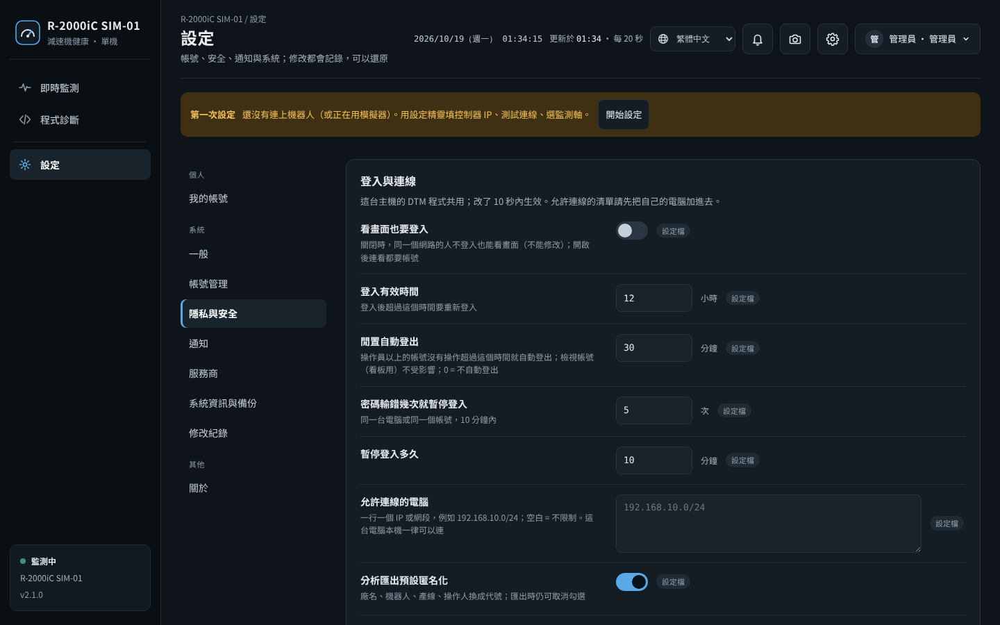

### 14.3 What can be changed on the web and what needs the config file

- **Changeable on the web**: items whose mistakes do not interrupt monitoring (the settings under "General", "User accounts", "Privacy & security" and "Notifications" in the table above). They are stored in `users.sqlite3` (the same file as the accounts), and **values set on the web take precedence over the config file**; each item shows whether the "Config file" or "Set on web" value is in use, and "Use config file value" reverts it.
- Shared by the DTM programs on the same host: change it once on the plant screen and each robot's program applies it within 10 seconds, without a restart.
- **Requires the config file**: robot addresses, data sources, sampling, ports, HTTPS certificates, database and backup locations, the central URL. Mistakes in these would interrupt monitoring, so the web only shows them; after changing them, run `python -m dtm check` and then restart. Exceptions: the first-time setup wizard (robot address, data source, monitored axes) and one-click HTTPS can be used only **locally on the host** by an administrator; they back up the config file first, check it automatically after writing, and revert if there are errors ([section 15](#15-date-and-time-full-page-screenshots-local-currency-https-setup-wizard-field-validation-21)).
- Default values for these items can also be written directly in the config file: `[web] idle_minutes`, `max_fails`, `lock_minutes`, `allow_ips`, `pw_min_length`, `pw_require_mix`, `pw_max_age_days`, `pw_change_first`, `[ui] refresh_s`, `[privacy] export_anonymize`, `[system] display_name` (see `config.example.toml`).

### 14.4 Accounts and sign-in security

- **Single sign-on**: sign-in state is stored in `users.sqlite3`, keeping only the SHA-256 of tokens; it is shared by the DTM programs on the same host, so one sign-in on the DTM screen is valid for the live monitoring and program diagnosis inside it.
- **Password policy** (default): at least 8 characters, with letters and digits, not the same as the account name, common passwords such as 12345678 rejected; a password validity period can be set. Passwords created or reset by an administrator must be changed at the user's first sign-in, and no data can be changed until then.
- **Automatic sign-out when idle** (default 30 minutes): applies only to accounts of operator and above; use a "viewer" account for display-board computers so they are not signed out.
- **Lockout after wrong passwords**: 5 wrong attempts within 10 minutes from the same computer or for the same account suspend sign-in for 10 minutes; a failed sign-in only says "Wrong account or password", without revealing whether the account exists.
- Disabling an account, resetting a password, or changing one's own password immediately signs that person out on other devices; role changes take effect immediately; at least one enabled administrator must remain, and you cannot disable yourself.
- **Operation log**: who, from which computer, when, what, success or failure (including sign-in, sign-out and settings changes); passwords, keys and photo contents are never logged.
- Every response carries security headers (no embedding of the screens in other websites, no content-type sniffing, no URLs passed to external sites). When opening the dashboard to other computers, enabling HTTPS is still recommended ([section 15, item 3](#153-one-click-https-and-why-it-is-not-on-by-default)).

### 14.5 Privacy and diagnostic bundle

- DTM sends no data to the author or any third party, with no usage statistics, automatic updates or advertising; "Privacy & security" lists the outbound connections actually configured on this host (robots, sensors, mail server, webhook, SMS gateway, central).
- Analysis exports are anonymized by default (plant names, robots, lines and operators replaced with codes); this can be unticked when exporting.
- **Diagnostic bundle** (administrators): for maintenance staff or reporting problems; contains version and host information, the config file (passwords, keys, URLs, e-mail addresses and phone numbers masked), the config-file check, the self-check, status files and recent log files; it does not contain the monitoring database, accounts or photos. Log files may contain IP addresses and operator names; open and check them before sending.

### 14.6 Allowed computers

Under "Privacy & security", enter IP addresses or networks (for example `192.168.10.0/24`); computers not on the list are always refused. This computer itself (`127.0.0.1`) can always connect, so if the list is set wrongly, open the screen locally on the host and fix it; when saving, if the computer you are using is not on the list, the save is refused so that you cannot lock yourself out. Edge-host uploads to central (`/api/sync`) are protected by the key and are not restricted by this list.

## 15. Date and time, full-page screenshots, local currency, HTTPS, setup wizard, field validation (2.1)

### 15.1 Date and time at the top of the screen, and full-page screenshots

Every screen (the DTM main screen, live monitoring, program diagnosis) shows the date, weekday and time at the top (in the format of the screen language, updated every second), so screenshots and printouts show when they were taken.

The camera icon at the top right takes a **full-page screenshot**: the whole page (including the parts scrolled out of view) is saved as one PNG whose file name contains the screen name and the date and time, for example `DTM_<screen>_20261018-143005.png`. The screenshot is made in the browser (html2canvas, MIT license, in `dtm/static/vendor/`) and is never uploaded anywhere. Live monitoring and program diagnosis opened inside the main screen are captured as whole pages separately and merged in, not just the part visible in the window. The screenshot is re-rendered, not a screen capture: shadows, blur effects and font details may differ slightly from the screen.


### 15.2 Spare-part prices in the local currency

Unit prices are always entered and stored in `[maint] currency` ("Settings → General"); the screen converts them for display according to **the viewer's language**: Traditional Chinese TWD, Simplified Chinese CNY, English USD, Japanese JPY, Korean KRW, Vietnamese VND. Hovering over an amount shows it in the original currency; the date and source of the exchange rates are noted below the table.

| `[maint] fx` | Behaviour |
|---|---|
| `auto` (default) | Downloads a rate table every 12 hours: public data from [ExchangeRate-API](https://www.exchangerate-api.com), falling back to [currency-api](https://github.com/fawazahmed0/exchange-api). Stored in `run/fx_rates.json`; if no rates can be fetched, the last rates are kept; after more than 3 days without an update, "Exchange rate may be outdated" is shown |
| `manual` | For plants without outside connections, fill in `[maint.fx_rates]` manually (1 unit of the original currency = how much of the target currency) |
| `off` | No conversion; always shows the original currency |

Fetching rates only downloads the rate table and sends no data; it is listed under "Privacy & security → Where this host connects to"; if a proxy server is needed, use `[notify] proxy`. Converted amounts are estimates only; purchase quotations are authoritative.

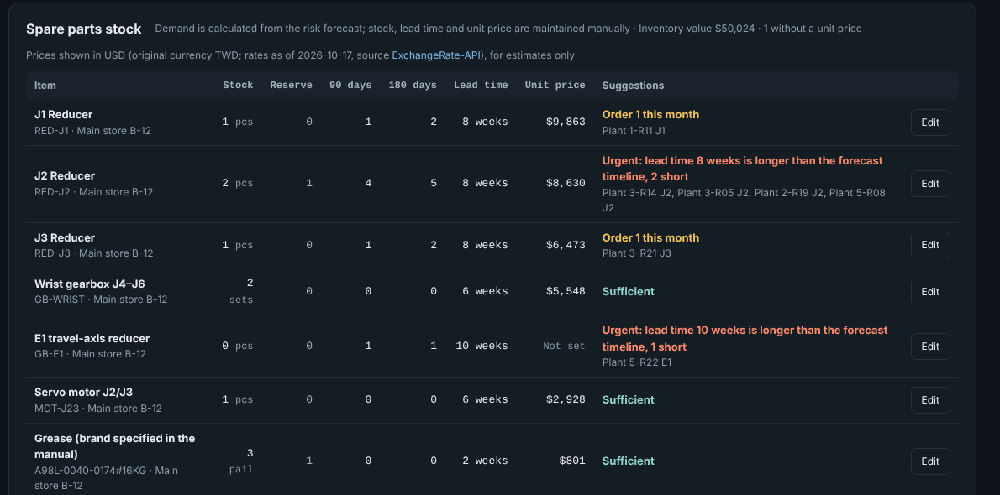

### 15.3 One-click HTTPS (and why it is not on by default)

"Settings → Privacy & security → HTTPS encryption" (administrators, locally on the host) or the command:

```bash
python -m dtm -c config.toml tls --self-signed                 # generate a self-signed certificate and write it to the config file
python -m dtm -c config.toml tls --self-signed --name dtm.plant.local --name 10.1.2.3   # names used by other computers
python -m dtm -c config.toml tls                               # show the current certificate (expiry, fingerprint)
python -m dtm -c config.toml tls --off                         # turn off
```

- The certificate is placed in `tls/` next to the config file (`dtm-cert.pem`, `dtm-key.pem`; the key is readable only by the account running DTM), contains this computer's names and IP addresses, and is valid for 825 days; only the two keys `[web] tls_cert` and `tls_key` in the config file are changed, after a backup to `config_backups/`. **After restarting DTM**, the address uses `https://`.
- Self-signed certificate: the browser on each computer shows "Not secure" the first time. Use "Download certificate" on the screen and import it into that computer's "Trusted Root Certification Authorities" (Windows: double-click the `.crt` → Install Certificate → Local Machine), after which the warning no longer appears; before importing, compare it with the SHA-256 fingerprint shown on the screen.
- If your company has an internal certificate authority (CA), ask your IT department for a certificate for this host and enter it in `[web] tls_cert`, `tls_key`, instead of using a self-signed certificate.
- When central has HTTPS on: change `[central] url` on each plant's edge host to `https://` and point `ca_file` to the downloaded certificate, so that uploads verify the identity of central.
- **Why it is not on by default**: a self-signed certificate makes every computer show a warning, and the edge hosts must change their settings too; forcing it on before dealing with each computer would make the site unreachable on the first day. So the default remains HTTP, the top of the screen shows "Connection not encrypted", and an administrator enables it with one click once the network administrator agrees. Local-only use (`host = "127.0.0.1"`) does not need HTTPS.
- On an edge host, each robot's program serves its screens only inside the host and is not encrypted separately; HTTPS is applied to the plant screen that users actually connect to.

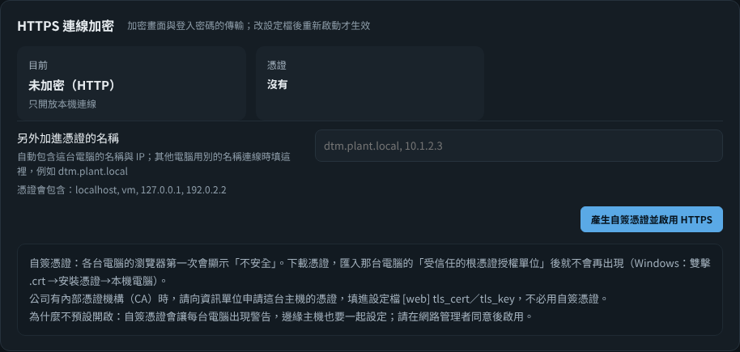

### 15.4 First-time setup wizard (standalone)

While still using the simulator, or before ever connecting to a robot, a "First-time setup" notice appears at the top of the screen (visible only to administrators locally on the host). The wizard changes only these items in the config file, keeping all other settings and comments:

1. Data source: FANUC controller web server (HTTP), Modbus TCP (via a PLC), simulator; controller IP, port, sampling rate
2. Monitored axes (J1–J6, E1) and rated torque (Nm, from the reducer catalogue; can be left blank if unknown)
3. Test connection: reads about 5 seconds of data with the values on the screen and checks the reading rate, heartbeat, torque registers and override (the same as `check --connect`)
4. Save: the config file is backed up first, a config-file check runs after writing, and it is reverted automatically if there are errors; takes effect after restarting DTM

For edge hosts, edit the robot list in `[[robots]]` of the config file.

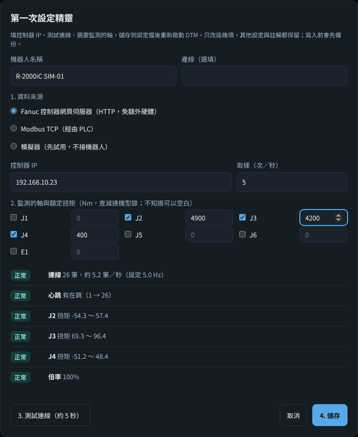

### 15.5 Field validation report

In the Beta version, the decision thresholds have to be corrected with field data. "Life statistics → Field validation report", "Settings → System information → Field validation report" or `python -m dtm -c config.toml validation` produces a report that prints on A4:

| Item | How it is calculated |
|---|---|
| Detection rate | For components with a confirmed failure (ticked "Failure" at replacement, or damage confirmed at teardown), the proportion for which Caution or Alert appeared within 365 days before the replacement (and after installation); with a 95% confidence interval (Wilson method) |
| Days of early warning | From the first day of Caution or Alert to the replacement date (median and minimum) |
| Missed | At least 30 days of monitoring data within the 90 days before the failure, but never an alarm |
| Insufficient data | Not enough monitoring data before the failure (for example, it failed before DTM was deployed); not counted in the detection rate |
| Replaced after an alarm, failure not confirmed | There was an alarm and a replacement, but the teardown found no fault or it was registered as a preventive replacement |
| Possible false alarms | Alerts followed by no maintenance or inspection within 90 days, and alerts followed only by a baseline reset; those less than 90 days old are listed as "under observation" |

Data sources: central and edge hosts use the daily health level of each axis (the higher of health and production monitoring) plus the alarm records; standalone installations use the alarm records and the days with diagnostic data. With fewer than 10 failures, the report warns that the confidence interval is wide. `--json` outputs the raw figures for analysis by other systems. Always register replacement events and fill in the teardown form when replacing components; otherwise this report is meaningless.

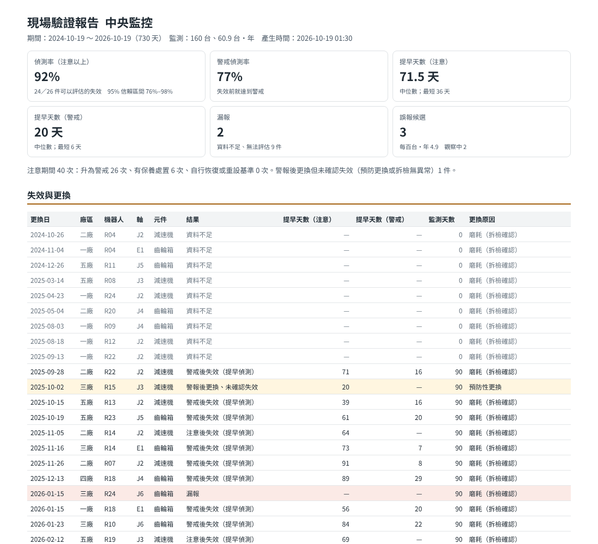

### 15.6 Security policy and software bill of materials

- [SECURITY.md](SECURITY.md): supported versions, how to report security issues privately (GitHub's "Report a vulnerability" or e-mail), a summary of the secure design, and a **self-assessment** against the seven foundational requirements of IEC 62443-4-2 (not a certification).
- **SBOM**: each Release includes `dtm-<version>-sbom.cdx.json` in CycloneDX 1.5 format, listing the optional packages (pymodbus, pyserial) and the bundled third-party files (WinSW, html2canvas, the Python of the Windows portable version) with their hashes; generate it yourself with `python tools/sbom.py`. Release files come with GitHub build provenance attestations (`gh attestation verify <file> --repo <owner>/<repo>`).

## License and notices

- **License**: Apache License 2.0 (`LICENSE`, `NOTICE`). You may freely use, modify and redistribute it (including commercially); keep the copyright and license notices, and mark modified files as changed. Apache-2.0 also contains a patent license clause: contributors license any patents covering their contributions to all users.
- **Author and attribution**: Domingo He. When republishing, adapting or publishing derivative work, credit the original author and the project; do not use the author's name to endorse derivative versions. For citations, use `CITATION.cff` or the DOI [10.5281/zenodo.23910956](https://doi.org/10.5281/zenodo.23910956) (Zenodo archive of v2.1.0).
- **Non-commercial maintenance**: this project is maintained by the author personally and non-commercially, with no sales, no paid support and no patent applications. Use GitHub Issues for problem reports and suggestions; the author will do his best to respond, but response times and fixes are not guaranteed.
- **No warranty**: the software is provided "as is", without any express or implied warranty (see sections 7 and 8 of `LICENSE`). Monitoring results are only an input to maintenance decisions; decisions on replacements, stops and safety must be made by qualified personnel according to the manufacturer's manuals and conditions on site. The author is not liable for any loss caused by using this software.
- **Patents**: the author has not applied for any patent on this system and publishes the details of the methods in the technical disclosure (defensive publication). The author cannot guarantee, however, that the software does not touch patents held by others in various countries; check before using, manufacturing or selling it in your country or region.
- **Trademarks**: FANUC is a trademark of FANUC CORPORATION; model names such as R-2000iC belong to their owners. This project has no relationship with FANUC and is not endorsed or sponsored by it; these names are mentioned only to describe the compatible models. Other trademarks belong to their respective owners.
- **AI-assisted development**: I design, AI writes the code, I verify. The decision logic, thresholds and field procedures come from the author's maintenance experience; the code was written by AI (Anthropic Claude) according to that design, and the author is responsible for review, testing and field judgement. The commit messages in the history keep the AI co-author marking.
- **Data**: all examples, screenshots and test data of this project come from the simulator and demo data, and contain no real production data of any company.
- **Third-party components**: `tools/winsw/` (WinSW, MIT license, see LICENSE.txt in that folder); `dtm/static/vendor/html2canvas.min.js` (html2canvas 1.4.1, MIT license, see html2canvas.LICENSE.txt in the same folder, used only for full-page screenshots). For the complete list, see the SBOM ([section 15](#15-date-and-time-full-page-screenshots-local-currency-https-setup-wizard-field-validation-21)).

## Technical disclosure, contributing and change log

- **Technical disclosure**: the monitoring and decision methods of this system are disclosed in detail (with parameters and variants) as prior art, so that they stay public and anyone can use them: English [docs/TECHNICAL_DISCLOSURE.en.md](docs/TECHNICAL_DISCLOSURE.en.md), Japanese [docs/TECHNICAL_DISCLOSURE.ja.md](docs/TECHNICAL_DISCLOSURE.ja.md) and Traditional Chinese [docs/TECHNICAL_DISCLOSURE.md](docs/TECHNICAL_DISCLOSURE.md), published simultaneously with identical section numbers; where the versions differ, whatever is disclosed in each version is disclosed. Section 6.15 is a technical comparison with known patents (not a legal opinion).
- **Contributing**: see [CONTRIBUTING.md](CONTRIBUTING.md) (DCO sign-off). For field trial reports, installation problems and bug reports, use the GitHub issue templates; **please do not upload raw data or any company's internal data**.
- **Change log**: see [CHANGELOG.md](CHANGELOG.md) (in Chinese). 1.x–2.0 were internal development versions; v2.1.0 is the first public release (Beta); v3.0 will follow validation on real robots.
- **Pre-release check**: maintainers use [docs/RELEASE_CHECKLIST.md](docs/RELEASE_CHECKLIST.md).
