# DTM：Fanuc 減速機干擾扭矩監控系統

[English](README.md) | **繁體中文**

[](https://doi.org/10.5281/zenodo.23910956)

> **Beta：判斷門檻待現場驗證。** v2.1.0 是第一個公開版本，演算法與門檻用模擬資料與情境測試調整過，還沒有在實際產線長期驗證。請先用「影子模式」試行（見〈第一次導入建議〉），不要只憑本系統的建議決定停機或換件。

| 項目 | 目前狀態（v2.1.0） |
|---|---|
| 電腦端程式（監測、交叉判斷、保養、通知、多廠區、Pro） | ✅ 完成；233 項自動測試通過，大多數用模擬資料跑過完整流程 |
| 機器人端程式（`DTM_BG`、`DTM_DIAG`、`DTM_SWEEP`、KAREL 串流） | 🧩 範本；要依控制器修改並在實機確認 |
| 接真的 FANUC 控制器 | — 還沒有 |
| 產線長期驗證、門檻校正 | — 還沒有（v3.0 的目標） |

每一項功能做到哪裡、驗證到哪一步、還沒做與刻意不做的事，見〈[功能狀態表](docs/FEATURE_STATUS.md)〉。

**一句話：用 Fanuc 控制器本來就算好的干擾扭矩，不加感測器、不停機，提早幾週看出減速機正在磨耗。**

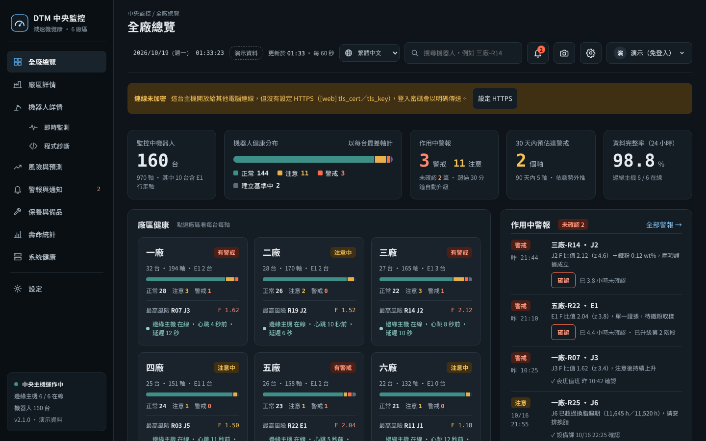

- **記錄與預警**：干擾扭矩即時監控、健康劣化（相對自己的基準、z 分數、連續確認）、生產動作代碼監測（不用停機跑診斷程式）。
- **交叉判斷**：干擾扭矩 × 振動 × 鐵粉 × 溫度 × 元件壽命，對每一軸給出「何時換潤滑脂、何時換減速機／齒輪箱、何時檢查馬達」，換件要兩類證據同時異常才建議。
- **保養落地**：備品與作業包、工單、保養排程、拆檢表單（讓門檻越用越準）、門檻回放試算。
- **多廠區**：單機、邊緣主機（一廠多台）、中央伺服器（全廠 8 個畫面）；10 台以下可用小型模式。
- **長時間運作**：Windows 服務、看門狗、每日備份（可加網路資料夾）、還原精靈、計畫停機、導入檢查報告。
- **Pro 程式層級診斷**：短期（3–7 天）提高取樣，找出哪一行程式、哪一段角度在消耗減速機壽命；利用等待餘裕給出節拍不變的修改建議（只輸出文字，不寫回控制器），改完用改前改後加對照組證明效果。
- **6 種語言**：繁中、簡中、英（美式用語）、日、韓、越，每位使用者在畫面上方的語言選單（地球圖示）自己切換；通知可以指定每位收件人的語言，同一廠區的外籍同仁收到自己看得懂的簡訊與 Email。
- **同一個視窗**：單機、廠區、中央都用同一套左側選單；每台機器人的即時監測與程式診斷在裡面直接打開，不用另外開網址。右上角齒輪是「設定」：我的帳號、帳號管理、隱私與安全、通知收件人、系統資訊與備份、修改紀錄（見第十四節）。
- 只用 Python 標準函式庫，Python 3.11 以上可直接執行；儀表板不需外網。目前只針對 **R-2000iC/165F**。

**English summary** (full English README: [README.md](README.md)). DTM (Disturbance Torque Monitor) turns the disturbance torque that a FANUC robot controller already computes into a reducer health monitor: no extra sensors and no production stop. It logs the torque, separates friction from gravity offset with short forward/reverse diagnostic runs (or uses daily medians of production motions), compares each axis with its own baseline, and combines torque with optional vibration, iron-powder (ferrous wear debris) and temperature data to recommend when to change grease, replace a reducer or gearbox, or inspect the servo motor. It runs standalone, as an edge host for one plant, or as a central server for several plants. An optional program-level module (Pro) raises the sampling rate for a few days, maps torque to each line of the robot program and each angle of the reducer, finds the lines that consume the most reducer life, suggests changes that use existing wait time, aiming to keep the cycle time unchanged (text only; nothing is written back to the controller), and verifies the effect with before/after measurements and a control robot. The interface, notifications, reports and work packages are available in Traditional Chinese, Simplified Chinese, English, Japanese, Korean and Vietnamese, switchable per user (translations other than Simplified Chinese are AI-made; corrections from native speakers are welcome). Pure Python standard library, Python 3.11+, Apache-2.0. **Beta**: thresholds still need field validation, and nothing has yet been run on a real controller; see `docs/FEATURE_STATUS.md` for the status and verification level of every feature. The methods are published as a defensive publication (prior art) in full English, Japanese and Traditional Chinese: `docs/TECHNICAL_DISCLOSURE.en.md`, `docs/TECHNICAL_DISCLOSURE.ja.md`, `docs/TECHNICAL_DISCLOSURE.md`.

建議的 GitHub 主題標籤（topics）：`predictive-maintenance`、`condition-monitoring`、`fanuc`、`industrial-robot`、`reducer`、`rv-reducer`、`disturbance-torque`、`iron-powder`、`weibull`、`python`、`sqlite`、`smart-manufacturing`。

**開發方式：我設計、AI 寫程式、我驗證。** 系統的判斷邏輯、門檻與現場流程來自作者十年 Fanuc 機器人維修經驗；程式碼由 AI（Anthropic Claude）依設計撰寫，作者負責審查、測試與現場判斷。授權、商標與免責聲明見最後〈授權與聲明〉。

## 第一次導入建議

1. **影子模式**：前 1–3 個月只看、不據以決定換件。系統的建議和你們現有的保養方式並行，對照兩者差在哪裡；警報先只發 Email／Webhook 給負責的工程師，不發給產線。
2. **先 1–3 台**：挑最近換過減速機（新品基準乾淨）或最常出問題的機台。穩定後再擴大，10 台以下用小型模式，更多再架中央。
3. **確認暫存器**：導入前確認控制器上 **R[101]–R[113]** 沒有被其他程式使用（DTM 用 R[101]–R[107] 放各軸干擾扭矩、R[110] 段代碼／動作代碼、R[111] 診斷旗標、R[112] 心跳、R[113] 速度倍率）。被占用就在設定檔 `[registers]` 改到空的號碼，並同步修改機器人程式。
4. **程式修改走變更流程**：背景邏輯 DTM_BG、診斷程式 DTM_DIAG、在生產程式裡寫動作代碼，都是修改機器人程式，請照工廠的變更管理流程申請、審核、備份 AOA／程式，在停機時段上傳並試跑。
5. **支援機型**：目前只針對 **FANUC R-2000iC/165F**（J1–J3 RV 減速機、J4–J6 齒輪箱）。其他機型的軸數、減速機型式、額定扭矩與作業包不同，要先改設定與作業包目錄並自行驗證。
6. **跑滿 7 天看導入檢查報告**：取樣、資料中斷、診斷切段、雜訊都 ✔ 再開始依判斷安排保養；換件時一定填拆檢表單。

## 系統架構

```
機器人控制器                       監控電腦（DTM）
┌──────────────────────┐        ┌───────────────────────────────────────┐
│ DTM_BG（背景邏輯）    │        │ 資料來源 → 即時緩衝 → SQLite           │
│ $CUR_DIS_TRQ → R[101~]│  HTTP  │          ↘ 即時警報（扭矩、心跳）       │
│ 心跳、倍率 → R[112~]  │ ─────→ │          ↘ 診斷切段 → F、G、Fc、Fv     │
│ DTM_DIAG（診斷程式）  │ 或 PLC │                 → 健康判定 → 健康警報 │
│ 段代碼 → R[110]       │        │ 儀表板 http://監控電腦:8080            │
└──────────────────────┘        └───────────────────────────────────────┘
```

## 檔案

| 路徑 | 內容 |
|---|---|
| `robot/DTM_BG.LS` | 背景邏輯：把 J1–J6 干擾扭矩複製到 R[101]–R[106]，並寫入心跳與速度倍率 |
| `robot/DTM_DIAG.LS` | 診斷程式：J2、J3 各以 5%、10%、20% 速度正反轉，用 R[110] 標示每一段 |
| `dtm/` | 監控程式（擷取、切段、判定、警報、網頁） |
| `config.example.toml` | 現場設定範本，每一項都有註解 |
| `config.sim.toml` | 模擬器設定，不接機器人也能測試 |
| `dtm/cross.py` | 交叉分析與維護決策 |
| `dtm/life.py` | 運轉時數、油脂有效老化、Weibull 壽命 |
| `dtm/workpack.py` | 備品與作業包、列印工單 |
| `workpacks.r2000ic_165f.toml` | R-2000iC/165F 作業包範本（料號待確認） |
| `workpacks.r2000ic_165f.<語言>.toml` | 作業包的各語言版（由工具產生） |
| `dtm/i18n.py`、`dtm/locales/` | 多國語言：翻譯函式與各語言翻譯表 |
| `tools/i18n_tool.py` | 抽出程式中要翻譯的字串、檢查各語言是否缺漏 |
| `tools/workpack_l10n.py` | 由繁中作業包目錄產生各語言版 |
| `tests/` | 單元測試與系統測試 |
| `start_sim.bat`、`start.bat` | Windows 雙擊啟動檔：試跑模擬器、正式監控（`start.bat` 會先檢查設定檔） |
| `LICENSE`、`NOTICE`、`CITATION.cff` | Apache-2.0 授權、著作權聲明、引用資訊 |
| `CHANGELOG.md`、`CONTRIBUTING.md`、`.github/` | 版本紀錄、貢獻方式（DCO）、Issue 範本與自動測試 |
| `docs/TECHNICAL_DISCLOSURE.md`、`.en.md`、`.ja.md` | 技術揭露（防禦性公開），繁中、英文、日文三版同時公開 |
| `docs/FEATURE_STATUS.md` | 功能狀態表：每項功能的完成度與驗證程度（測試、模擬、實機、現場） |
| `dtm/export.py`、`dtm/teardown.py`、`dtm/downtime.py`、`dtm/commissioning.py`、`dtm/replay.py` | 分析匯出、拆檢表單、計畫停機、導入檢查報告、門檻回放（2.1） |
| `dtm/auth.py` | 寫入密碼、登入、密碼錯誤鎖定 |
| `dtm/backup.py` | 每日自動備份、複製到網路資料夾 |
| `dtm/restore.py` | 還原精靈：補回遺失／回到時間點、預覽差異、從中央重建 |
| `dtm/check.py` | 設定檔檢查與連線自我診斷 |
| `dtm/scenarios.py` | 誤報／漏報情境模擬 |
| `robot/DTM_BG_E1.LS`、`robot/DTM_MCODE_EXAMPLE.LS` | E1 行走軸扭矩（R[107]）、生產動作代碼範例（2.0） |
| `dtm/motion.py`、`dtm/sensors.py` | 生產循環監測、振動與溫度感測器（2.0） |
| `dtm/runtime.py`、`dtm/watchdog.py`、`dtm/winservice.py` | 狀態檔、自我檢查、看門狗、Windows 服務（2.0） |
| `dtm/fleet.py`、`dtm/sync.py` | 邊緣主機（一廠多台）、上傳中央（2.0） |
| `dtm/central.py`、`dtm/fleetviews.py`、`dtm/fleetweb.py`、`dtm/static/central.html` | 中央伺服器與 8 個畫面（2.0） |
| `dtm/demo.py` | 中央演示資料（6 廠 160 台，標示「演示資料」） |
| `config.edge.example.toml`、`config.central.example.toml` | 邊緣主機、中央伺服器設定範本 |
| `config.small.example.toml`、`start_small.bat` | 小型模式（10 台以下、沒有中央；1 台也能用）設定範本與雙擊啟動檔（2.1） |
| `dtm/thermal.py`、`dtm/trend.py` | 溫度突升判斷、趨勢加速時的保守外推（2.1） |
| `start_central_demo.bat`、`start_central.bat` | 中央演示、中央伺服器雙擊啟動檔 |
| `tools/winsw/` | WinSW（MIT 授權），把 DTM 裝成 Windows 服務用 |
| `dtm/pro/`、`dtm/static/pro.html` | Pro 程式層級診斷：程式解析、行號對位、逐行損耗、角度集中、掃描、等待餘裕、建議、改善驗證（2.1） |
| `robot/DTM_SWEEP.LS` | Pro 全範圍掃描程式（每週一次，各軸慢速正反轉） |
| `robot/DTM_STREAM.KL` | Pro 診斷期串流的 KAREL 範本（**尚未在實機測試**） |
| `tools/build_static_demo.py` | 產生中央畫面的靜態演示（每種語言一份，可放 GitHub Pages） |
| `docs/DESIGN_CONSTRAINTS.md` | 設計邊界：本系統刻意不做的事（修改或新增功能前先看） |
| `dtm/sysconf.py`、`dtm/sysweb.py` | 設定（右上角齒輪）：網頁上可改的系統設定與修改紀錄、帳號管理、登入中的裝置、操作紀錄、診斷包（2.1） |
| `dtm/demolive.py` | 中央演示裡的模擬機器人（即時監測與程式診斷可以在演示裡試用） |
| `dtm/vendors.py` | 服務商資訊：各地 FANUC 公司官網公開的服務據點（依畫面語言選地區），以及貴廠的服務窗口（2.1） |
| `dtm/fx.py` | 備品價格依畫面語言換算當地貨幣（網路匯率，抓不到沿用上次；可改手動或關閉）（2.1） |
| `dtm/tlscert.py`、`dtm/settings.py` | HTTPS 一鍵啟用：不需 OpenSSL 產生自簽憑證；只改設定檔指定的鍵，先備份、寫完檢查（2.1） |
| `dtm/wizard.py` | 第一次設定精靈（單機）：資料來源與 IP、連線測試、監測軸與額定扭矩（2.1） |
| `dtm/validation.py` | 現場驗證報告：偵測率、提早天數、漏報、誤報候選（2.1） |
| `dtm/static/vendor/` | html2canvas 1.4.1（MIT 授權），全頁截圖用，在瀏覽器裡執行 |
| `SECURITY.md`、`tools/sbom.py` | 資安政策（回報方式、安全設計、IEC 62443-4-2 自我對照）、軟體物料清單 SBOM（CycloneDX） |
| `README.md`、`README.zh-TW.md` | 英文版 README（GitHub 預設顯示，內容與本檔相同）、繁體中文版 README（本檔） |

## 一、先用模擬器試跑（5 分鐘）

**免安裝版（建議）**：到 GitHub 的 Release 頁下載 `DTM-<版本>-win64.zip`（內含 Python，不用另外安裝），解壓縮到例如 `C:\DTM`，雙擊 `start_sim.bat` 即可。自己產生免安裝版或安裝程式：在能上網的電腦執行 `python tools/build_windows.py`，再用 Inno Setup 編譯 `tools/installer/dtm.iss`。

**自己裝 Python 的方式**：裝好 Python 3.11 以上後，在程式資料夾裡雙擊 `start_sim.bat`。第一次會先產生 180 天的模擬資料（約 1 分鐘），接著自動打開儀表板。要停止就關閉黑色視窗。正式接機器人後改用 `start.bat`（需要先建立 `config.toml`）。

用指令執行：

```bash
cd torque_monitor
python -m dtm -c config.sim.toml simulate-history --days 180   # 產生 180 天歷史
python -m dtm -c config.sim.toml run                            # 開 http://localhost:8080
```

畫面左側選單有「即時監測」「程式診斷」「設定」；右上角是語言、警報鈴、齒輪（設定）與帳號。第一次使用要在這台電腦本機建立管理員帳號（沒有帳號時一律唯讀）。

模擬情境：

- J2 油脂老化，黏性摩擦漸增，系統發出「注意」；第 120 天換脂後自動重建基準，回到「正常」。
- J3 減速機從第 60 天開始磨耗並加速劣化：約第 91 天發「注意」，第 130 天升為「警戒」。
- J3 的鐵粉生成速率與徑向包絡同步上升：約第 117 天建議「準備備品」，第 133 天建議「安排更換」。
- J4 齒輪箱的伺服馬達軸承從第 100 天開始劣化：摩擦上升，但鐵粉與減速機頻率都正常，只有馬達轉頻振動上升。系統判定為「伺服馬達異常」，而不是齒輪箱。
- 另匯入一份「模擬機群」更換紀錄，示範 Weibull 壽命擬合。這些數字都是示意值，不是實際資料。
- 即時模式每 90 秒插入一次診斷程式；每 75 秒在 J3 製造一次扭矩尖峰，用來測試即時警報。

## 二、現場導入步驟

### 1. 機器人端

1. **先驗證變數**：在示教器用 DATA → 系統變數，或在暫存器畫面確認 `$MOR_GRP[1].$CUR_DIS_TRQ[n]` 可以讀取，並在低速寸動時與 MENU → STATUS → Axis 的干擾扭矩畫面對照數值。變數名稱和索引依控制器版本而異，原廠沒有公開文件，**這一步不能省**。
2. 載入 `DTM_BG.LS`（需 ASCII 上傳功能；沒有的話照內容在示教器手動輸入），在 MENU → SETUP → BG Logic 設為執行。第 11 行的 `MOD` 運算若版本不支援，可改成單純的 `R[112]=R[112]+1`。
3. 教點，全部用**關節座標**記錄：
   - `PR[50]`：安全起點；
   - `PR[51]`／`PR[52]`：J2 起點 A、終點 B，只改 J2，B 的角度大於 A；
   - `PR[53]`／`PR[54]`：J3 起點 A、終點 B，只改 J3，B 的角度大於 A。

   行程要讓 5% 速度的等速段至少 4 秒（例如 ±25°），並確認整個行程沒有干涉。
4. 載入 `DTM_DIAG.LS`。**每天固定時段、暖機後、同一負載**執行一次。可排在換班或定期保養時，或由 PLC 呼叫。
5. 暫存器配置（可在 config 修改）：

| 暫存器 | 內容 |
|---|---|
| R[101]–R[106] | J1–J6 干擾扭矩 |
| R[110] | 診斷段代碼 = 軸 × 1000 + 速度% × 10 + 方向（1 = A→B，2 = B→A），例如 3102 = J3、10%、反轉；0 = 不在診斷段 |
| R[111] | 診斷執行中 = 1 |
| R[112] | 心跳（BG Logic 持續加 1） |
| R[113] | 速度倍率；不是 100% 的診斷段會被判為無效 |

### 2. 通訊方式（擇一）

- **`fanuc_http`（建議先用）**：直接讀控制器網頁伺服器的 `http://機器人IP/MD/NUMREG.VA`，不需額外選配。先在瀏覽器確認這個網址打得開。速率約每秒 2–5 次，足夠看趨勢與診斷平均值。
- **`modbus`**：由 PLC 或閘道器讀暫存器，PC 再用 Modbus TCP 讀，需要 `pip install pymodbus`。欄位對應寫在 `[source.modbus.map]`。
- 要做毫秒級的頻譜分析（曲軸頻率成分），以上兩種都不夠快，需要原廠工具或 ZDT。

### 3. 設定並啟動

```bash
cp config.example.toml config.toml        # 修改 IP、軸、暫存器
python -m dtm -c config.toml check        # 檢查設定檔：拼錯、格式、數值範圍
python -m dtm -c config.toml check --connect   # 再實際連到機器人讀 10 秒，檢查心跳、扭矩暫存器、倍率
python -m dtm -c config.toml run
```

雙擊 `start.bat` 時會自動先做 `check`，設定檔有【錯誤】就停下來顯示原因，不會啟動。

不想手改設定檔：複製 `config.example.toml` 成 `config.toml` 後先雙擊 `start.bat`，在**這台電腦本機**打開畫面（`http://localhost:8080`），建立第一個管理員帳號，再按畫面上方「第一次設定 → 開始設定」（或「設定 → 系統資訊 → 第一次設定精靈」）：選資料來源、填控制器 IP、按「測試連線」讀 5 秒資料、勾選監測軸與額定扭矩，儲存後重新啟動（見第十五節）。

開機自動啟動：

- **Windows**：工作排程器新增「開機時」觸發，執行 `python -m dtm -c C:\dtm\config.toml run`，起始位置設為 `C:\dtm`。
- **Linux**：systemd 服務，`ExecStart=/usr/bin/python3 -m dtm -c /opt/dtm/config.toml run`，`WorkingDirectory=/opt/dtm`，`Restart=always`。

### 4. 建立基準

啟動後的前 10 次有效診斷會建立基準。這段期間狀態顯示「建立基準中」，不做健康判定。換脂、更換減速機或馬達之後，請在儀表板「保養事件」登錄，系統會用接下來的 10 次診斷重新建立基準。

### 5. 換算成 Nm（加重法校正，選做）

不校正也能完整監控，因為健康判定用的是相對基準的比值，與單位無關。若要顯示 Nm、並做「額定扭矩百分比」的即時警報，做法如下：

1. 正常負載下跑一次 `DTM_DIAG`，記下診斷 ID：`python -m dtm -c config.toml runs --axis 3`。
2. 在末端加上已知質量 m（在負載容許範圍內），量出質量重心到受測軸的**水平距離** d（取診斷行程的中間姿態），再跑一次 `DTM_DIAG`。
3. 計算並儲存：

   ```bash
   python -m dtm -c config.toml calibrate --axis 3 --mass 5 --dist 1.2 --without 101 --with 102 --save
   ```

原理：G 是正反轉的平均，摩擦已經互相抵消，所以加重前後 G 的差值只反映重力矩 m·g·d，k = m·g·d ÷ |ΔG|。加重那一次會自動排除在健康判定之外。

**安全提醒**：

- 加重時負載設定（PAYLOAD）不要改，否則差值會被模型扣掉。
- 碰撞偵測裕度會變小，請用低速、清場，並依廠內作業安全規定執行。

### 6. 填額定扭矩

到減速機型錄查出額定輸出扭矩，填入 `rated_nm`。即時扭矩達 80% 為「注意」，達 100% 為「警戒」（可調），需持續 2 秒才觸發。

## 三、判定邏輯

| 指標 | 計算 | 代表 |
|---|---|---|
| F 摩擦 | (τ正 − τ反) / 2，取參考速度 10% | 減速機摩擦整體水準 |
| Fc 固定摩擦 | F 對速度回歸的截距 | 磨耗、預壓、煞車拖曳 |
| Fv 黏性摩擦 | F 對速度回歸的斜率 | 油脂黏度、填脂量、溫度 |
| G 重力型偏差 | (τ正 + τ反) / 2 | 平衡器、負載設定（不是摩擦） |
| 漣波 | 等速段的標準差 | 局部損傷、齒面或軸承異常 |

- **等級**：
  - 比值 ≥ 1.5 為注意，≥ 2.0 為警戒。
  - z 分數可以提早升到注意：z ≥ 2 且比值 ≥ 1.15。所以趨勢圖上可能出現「黃點在注意線下方」，代表統計上已明顯偏離基準。
  - 已達注意比值且 z ≥ 3 時升為警戒。
- **遲滯**：連續 2 次達到才升級，連續 2 次低於才降級。
- **溫度與共同變化的扣除**（1.5 版改版，見第十節第 5 點）：
  - 有溫度訊號：數值乘上 exp(k ×（溫度 − 基準期平均溫度）)。k 用預設值（黏性摩擦每 °C 2.5%、固定摩擦 0.4%），可用 `temp-coef` 指令從自己的資料估計。只監測一個軸、而且基準期溫差達 5°C 時，改用基準期資料自己學。
  - 監測兩軸以上：扣除各軸「同時」發生的黏性摩擦變化（氣溫、冷機、節拍改變），再依溫度係數換算到固定摩擦與 F。沒有溫度訊號也有效。設定 `[health] common_mode`：`true`（預設）、`"auto"`（只在沒有溫度訊號時扣）、`false`（不扣）。
- **趨勢**：最近 30 次的 F 做線性回歸，外推到注意與警戒門檻。劣化在加速時，實際到達會比預估更早。
- **失效模式提示**：依各指標變化的組合給方向，例如「黏性項上升為主：油脂劣化、過量填脂或低溫」。這只是提示，仍需以鐵粉、振動與拆檢確認。

以上數值都是建議起點，請累積現場資料後，對照鐵粉濃度與拆檢結果調整 `[health]`。

## 四、警報種類

| 類別 | 觸發條件 | 解除 |
|---|---|---|
| 即時扭矩 | 達額定 80%／100%，持續 2 秒 | 低於門檻持續 2 秒 |
| 通訊 | 心跳 5 秒不變，或讀不到資料 | 恢復 |
| 資料 | 干擾扭矩為無效值（例如 32767） | 恢復 |
| 診斷 | 等速段太短、倍率不是 100%、缺少正反轉配對 | 下一次有效診斷 |
| 健康 | 見上一節 | 降級，或登錄重設事件 |

通知設定在 `[notify]`，同一個警報 30 分鐘內只通知一次。

## 五、API（給 SCADA 或 MES 串接）

| 方法 | 路徑 | 內容 |
|---|---|---|
| GET | `/api/status` | 連線狀態、各軸即時值與健康等級 |
| GET | `/api/live?seconds=120` | 即時曲線 |
| GET | `/api/health` | 各軸指標、比值、z 分數、判定依據 |
| GET | `/api/trend?axis=3&metric=F&days=180` | 趨勢與基準線 |
| GET | `/api/alarms?active=1` | 警報 |
| GET | `/api/events` | 保養事件（含已撤銷的） |
| GET | `/api/audit?limit=50` | 操作紀錄：誰、從哪台電腦、做了什麼、成功與否 |
| POST | `/api/login` `{"who": "王小明", "password": "…"}` | 登入，回傳 token |
| POST | `/api/logout` | 登出 |
| POST | `/api/ack` `{"id": 12}` | 確認警報 |
| POST | `/api/event` `{"axis": 3, "kind": "grease_change", "note": ""}` | 登錄保養事件，回傳事件編號 |
| POST | `/api/event/undo` `{"id": 25, "note": "軸別選錯"}` | 撤銷事件 |
| GET | `/api/report`、`/api/export.csv` | 報告、特徵資料 |

所有 POST 都要在標頭帶 `X-DTM-Token: <登入取得的 token>`，否則回 401；還沒有任何帳號時整個儀表板是唯讀（回 403）。讀取（GET）預設不需要登入（`require_login = true` 時要）。儀表板請只放在工廠內網。

## 六、交叉分析與維護決策

### 1. 要輸入的資料

| 資料 | 來源 | 建議頻率 |
|---|---|---|
| 干擾扭矩 F、Fc、Fv、漣波、G | 自動（DTM_DIAG） | 每天或每班一次 |
| 振動：徑向、軸向的 RMS、包絡、嚙合頻率、馬達轉頻、峭度 | 量測系統呼叫 `POST /api/vibration`、`vib-import` 匯入 CSV，或儀表板手動登錄（手持振動計） | 與診斷同時段；手持量測至少每週一次 |
| 鐵粉濃度 wt% | 儀表板或 `iron` 指令；預設樣本類型「換脂排出（中段）」：排出口附近的前段先丟棄，取中段送驗 | 換脂時（舊脂中段＋24 小時後殘留）＋兩次換脂之間至少一次中途取樣；達注意後每 60 天、警戒後每 21 天（自動排進保養排程） |
| 外殼溫度、環境溫度 | 溫度感測器（「設備設定」勾選）或溫度暫存器 | 自動 |
| 元件安裝日 | 導入時用 `install` 指令登錄一次 | 之後換脂、換元件用事件登錄，自動接續 |
| 過去或其他機台的更換紀錄 | `history` 匯入 CSV（`comp,life_h,failed,robot,note`） | 一次性，之後持續累積 |
| 運轉時數表 | `hours` 指令，或登錄事件時填時數 | 每月一次即可 |

導入範例：

```bash
python -m dtm -c config.toml install --axis 3 --comp reducer --date 2021-05-01
python -m dtm -c config.toml install --axis 3 --comp motor   --date 2021-05-01
python -m dtm -c config.toml install --axis 3 --comp grease  --date 2025-11-20
python -m dtm -c config.toml history fleet_life.csv
python -m dtm -c config.toml iron --axis 3 --wt 0.048                      # 預設 --sample drain_mid（換脂排出中段）
python -m dtm -c config.toml iron --axis 3 --wt 0.051 --sample interim     # 中途取樣
python -m dtm -c config.toml vib-import vib.csv          # 欄位：ts 或 time、axis、direction、rms、env、mesh、motor1x、kurt
python -m dtm -c config.toml event --axis 3 --kind reducer_replace --failed --teardown "曲軸軸承剝離" --hours 52310
python -m dtm -c config.toml decide
```

### 2. 分析方法

1. **嚴重度**：每個訊號先和自己的基準比，換算成 0–1.5 的嚴重度（0.5 = 注意，1.0 = 警戒）。
   - 扭矩、振動、鐵粉生成速率 W 用相對基準的倍數；
   - 鐵粉濃度（RV）和峭度用絕對值。
2. **三類獨立證據**：
   - 扭矩看摩擦；
   - 鐵粉看磨耗量；
   - 振動看衝擊與頻率。

   **換減速機或馬達要兩類證據同時異常**。只有一類時最多到「觀察」，極端時到「準備」，避免單一感測器誤判就停機換件。
3. **用組合判斷是哪個元件**：

| 研判 | 扭矩 | 鐵粉 | 振動 | 壽命 |
|---|---|---|---|---|
| 潤滑脂劣化 | 黏性摩擦 Fv 上升 | 正常或偏高 | 包絡小幅上升 | 油脂有效壽命接近用完 |
| 減速機／齒輪箱磨耗 | 固定摩擦 Fc、漣波上升；換脂後仍高於新品基準 | 濃度與生成速率 W 上升 | 徑向包絡、嚙合頻率、峭度上升；軸向／徑向比改變 | 年齡風險 |
| 伺服馬達（軸承、煞車） | 摩擦上升 | **不升** | **馬達轉頻**上升，減速機頻率不升 | 年齡風險 |
| 平衡器、負載設定 | 重力型偏差 G 偏移 | 不升 | 不一定 | — |

4. **解釋掉**：摩擦上升、但鐵粉與減速機頻率都正常、而馬達轉頻振動上升時，摩擦的上升歸給馬達，不算減速機磨耗。
5. **新品基準**：換脂會重設扭矩基準，持續的磨耗可能被洗掉。所以另外和「元件更換後第一批診斷」的基準比（累積比值），換脂不會重設它。
6. **潤滑脂壽命**：時數與年限先到者為準（預設 11,520 小時或 3 年，依手冊修改）。外殼溫度每高於 40°C 10 度，有效老化加倍。這是常用的經驗法則，只會讓換脂提早，不會延後。儀表板、中央機器人頁與保養排程會顯示「溫度補正倍率」與補正後的換脂週期。**穩定的高溫只縮短換脂週期，不當成減速機異常。**
7. **元件壽命**：
   - 用 Weibull 分布，預防更換與仍在使用的元件當作「設限」資料一起擬合；
   - 算出 B10 壽命，以及「備品前置期間內的失效機率」；
   - 失效紀錄少於 3 筆時，不做年齡風險（或使用設定檔的先驗）。
8. **時間預估**：扭矩趨勢、鐵粉生成速率、振動包絡各自外推到警戒，取最早的一個。短於備品前置天數時提醒立即訂購。
   - 扭矩趨勢**在加速**（後半段斜率明顯大於前半段，或曲線明顯比直線貼合）時，改用保守估計（直線、後半段斜率、二次曲線取最短）。
   - 鐵粉**達注意後不再外推剩餘天數**：磨耗已過轉折點，可能隨時惡化，畫面顯示「已過轉折點」，減速機至少「準備備品」並建議備品直接下單。
   - 鐵粉生成速率 W **連續兩次加速上升**（三次取樣遞增、而且增量越來越大），鐵粉嚴重度升一級。
9. **防跳動**：維護決策和健康判定一樣，連續 2 次才升級或降級。登錄換脂或換元件後，對應的建議自動解除。

### 3. 溫度突升（2.1）

| 項目 | 規則（預設值，都可在 `[thermal]` 修改） |
|---|---|
| 溫升 ΔT | 外殼溫度 − 環境溫度，用同一個動作代碼的每日中位數比（同樣的動作才能比） |
| 參考溫度 | 有環境溫度感測器就用；沒有時用其他軸外殼溫度的中位數（至少另外 2 軸）；都沒有：只顯示、不發警報 |
| 溫度突升（注意） | ΔT 比自己最近 14 天中位數高 8°C，或一天內升 5°C 而且環境沒有同步升 |
| 換脂後 | 72 小時內不判突升；超過 72 小時（14 天內）仍比換脂前高 5°C → 提醒確認殘壓已釋放、填脂量、油封有無滲漏 |
| 過熱 | `overheat_c` 絕對門檻，達到直接警戒；預設 0 = 停用 |
| 在維護判斷裡 | 算在扭矩（摩擦）家族，比重 0.6；只有溫度異常時最多「觀察」 |

### 4. 證據比重 `[decision.weights]`

| 鍵 | 預設 | 內容 |
|---|---|---|
| `fc_ripple` | 1.0 | 固定摩擦 Fc、漣波、累積比值 |
| `f_motion` | 0.8 | 參考速度摩擦 F、生產循環每日中位數 |
| `temp_rise` | 0.6 | 溫度突升 |
| `vib_reducer` | 1.0 | 振動包絡、嚙合頻率、峭度 |
| `vib_axial` | 0.8 | 軸向 RMS、軸向比 |
| `iron` | 1.0 | 鐵粉濃度、生成速率 |

比重是 0–1.5 的數字，`check` 會檢查拼錯的鍵和超出範圍的值。在有實際拆檢紀錄之前，建議不要改。

### 5. 建議的意義

| 元件 | 注意（分數 ≥ 0.5） | 警戒（分數 ≥ 0.9） |
|---|---|---|
| 潤滑脂 | 建議換脂（排入下次停機） | 立即換脂（或油脂壽命已到、鐵粉濃度已達警戒） |
| 減速機／齒輪箱 | 準備備品、縮短監測週期 | 安排更換（排程停機） |
| 伺服馬達 | 檢查軸承、煞車、編碼器並準備備品 | 安排更換或送修 |

**分不清是油脂還是減速機時**（換脂分數高、減速機分數中等），系統會建議「先換脂，2–4 週後比對」：

- Fc 與鐵粉生成速率回到新品基準 1.3 倍內，代表是潤滑問題；
- 仍偏高，就是減速機劣化。

每次拆下減速機或馬達時，請登錄「失效更換」與拆檢結果。這些紀錄會讓 Weibull 壽命與門檻越用越準，也是唯一能驗證判斷對不對的依據。

## 七、通知：手機簡訊、Email、Webhook

2.1 版起內建通道只保留三種：**手機簡訊**（4G 數據機或簡訊商 HTTP 閘道）、**Email**、**Webhook**。LINE、Teams、企業微信等通訊軟體，請用 Webhook 依各家的 API 自行串接（下面有 LINE 的範例），程式不再內建，避免各家 API 改版就要改程式。

### 1. 預設規則

| 通道 | 預設最低等級 | 適合 |
|---|---|---|
| 手機簡訊 | 警戒 | 主管、夜間值班；簡訊有成本，只發最重要的 |
| Email、Webhook | 注意 | 保養群組、留存紀錄、串接通訊軟體 |

防止洗版的機制：

- 同一警報、同一等級、同一通道，30 分鐘內不重發；但等級升高（注意升為警戒）一定立即通知。
- 簡訊有每日上限（預設 30 則），超過的會記錄在通知紀錄、不發送。
- 警報解除時可選擇是否通知（`notify_clear`）。
- 每次發送失敗會自動重試 2 次，結果都寫入通知紀錄，儀表板「通知」區塊可查看；測試按鈕只有管理員能用。

簡訊會自動縮成 70 字以內（一則中文簡訊的長度），例如：`[警戒]R-2000iC #1 J3 減速機：安排更換（排程停機）… 10/14 18:52`。

### 2. 手機簡訊

| provider | 說明 |
|---|---|
| `modem` | **USB 4G 簡訊數據機插 SIM 卡，不需要網際網路**，適合不能對外連線的工控網路。需要 `pip install pyserial`，`[notify.sms.modem] port` 填數據機的序列埠 |
| `http` | 簡訊商的 HTTP 閘道（三竹、中華電信企業簡訊、Twilio 等）。依簡訊商文件填 `url` 與 `params`，`{phone}`、`{phone_e164}`、`{message}` 會自動替換；`success` 填回應中代表成功的字串（正規表示式）。`config.example.toml` 有三竹與 Twilio 的設定範例 |

- `fallback = ["http"]`：主要的送不出去時改用備援。
- `template`：自訂簡訊格式，可用 `{level}{robot}{site}{message}{time}{brand}`。
- 測試：`python -m dtm -c config.toml notify-test --channel sms`。

**送達回報（手機已接收，2.1）**：`[notify.sms.report] enabled = true` 之後，每則簡訊都會要求電信業者回報送達結果，「警報與通知」的送達紀錄顯示「手機已接收（時間）」「等待手機回報」「未送達」；超過 `timeout_min`（預設 30 分鐘）還沒回報的標示「逾時未回報」。

| provider | 送達回報怎麼來 |
|---|---|
| `modem` | 發送時要求狀態回報（TP-SRR），每 `poll_s` 秒（預設 60）讀一次數據機裡的回報，讀完刪掉回報（一般收到的簡訊不動）。多數 4G 數據機用預設的 `cnmi = "AT+CNMI=2,1,0,2,0"` 即可；少數機型要改成 `2,1,0,1,0`，或用 `report_mem = "SR"` 指定回報存放位置 |
| `http` | 簡訊商把送達結果回呼到 `{public_url}/api/sms/report?key=…`。要填 `key`（可寫 `env:變數名稱`）、從發送回應抓訊息編號的 `id_regex` 或 `id_json`、回呼的欄位名稱 `id_field`／`status_field`，以及代表「已送達」的 `delivered`（正規表示式）。回呼網址不用登入、不受「允許連線的電腦」限制，只靠 `key` 把關；沒填 `key` 就不開放。DTM 主機要讓簡訊商連得到（通常要經過防火牆設定）；連不到就改用 4G 數據機 |

### 收件人名單：每個人用自己的語言（2.1）

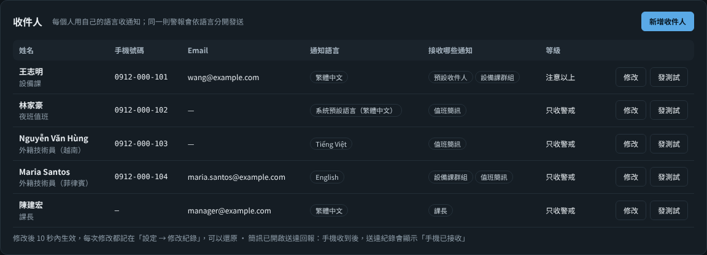

同一個廠區有外籍同仁時，在「警報與通知 → 收件人」（或「設定 → 通知」）新增收件人：姓名、手機、Email、**通知語言**、接收哪些通知（預設收件人或設定檔的哪幾條規則）、只收警戒或注意以上、啟用／停用。同一則警報會依語言分開發送，例如越南籍同仁收到越南文簡訊、其他人收到中文。每個人旁邊有「測試」可以發一則他自己語言的測試訊息。

- 只有管理員能新增、修改；其他人看到的手機與 Email 只顯示一部分。每次修改都記在「設定 → 修改紀錄」，可以還原；操作紀錄不記電話與 Email。
- 名單存在 `users.sqlite3`，同一台主機的 DTM 程式 10 秒內套用。也可以寫在設定檔 `[[notify.people]]`（見 `config.example.toml`），網頁上的名單優先。
- 原本規則裡直接寫的號碼（`to = { sms = [...] }`）照舊有效，用規則的 `lang`；值班表裡的號碼若在名單上，也會用那個人的語言。

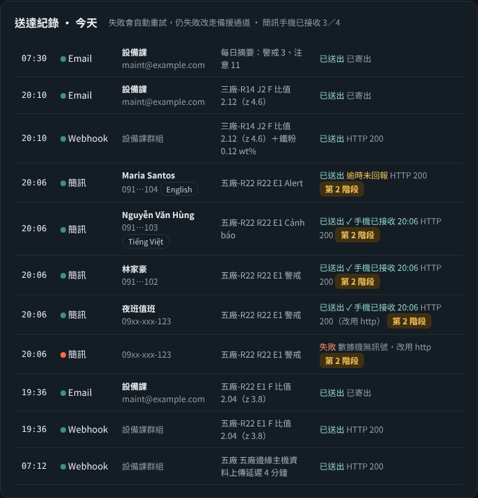

### 3. Webhook（含自行接 LINE）

Webhook 會把通知以 HTTP POST 送到 `webhook_url`。不設定 `[notify.webhook_body]` 時送預設 JSON（`text`、`level`、`robot`、`message`…）；要接特定服務，就用標頭與內容模板照那個服務的 API 格式送。模板可用 `{text}{subject}{level}{robot}{site}{message}{axis}{kind}{time}{short}`。

**用 Webhook 自行接 LINE（官方帳號 Messaging API 推播）**：

1. 用公司帳號建立 LINE 官方帳號，啟用 Messaging API，在 LINE Developers 取得 **Channel access token（長期）**。
2. 取得要推播的群組 ID（C 開頭）或個人 ID（U 開頭）。
3. 把「`Bearer ` + token」設成環境變數（例如 `DTM_LINE_BEARER`），設定檔：

```toml
[notify]
webhook_url = "https://api.line.me/v2/bot/message/push"
[notify.webhook_headers]
Authorization = "env:DTM_LINE_BEARER"
[notify.webhook_body]
to = "C1234567890abcdef..."
messages = [{ type = "text", text = "{text}" }]
```

4. 按儀表板「測試 Webhook」。推播會計入官方帳號每月免費則數（推播到群組依人數計算），量大時再升級方案。LINE 的 API 與收費以 LINE 官方公告為準。

Teams、企業微信等也是同樣做法：照該服務的 Webhook 文件填 `webhook_url`、`webhook_headers` 與 `webhook_body`。

### 4. 網路與安全

- 簡訊商 HTTP 閘道、Webhook 需要連到外部網路。要經代理就填 `proxy`；完全不能對外時，用 4G 數據機發簡訊、Email 走公司內部郵件伺服器。
- token、密碼一律用 `env:變數名稱` 從環境變數讀取，不要明碼寫在設定檔。設定檔也要限制讀取權限。

## 八、備品與作業包（1.3 版新增）

維護決策發出建議時（換脂、準備備品、安排更換、檢查馬達），系統依「軸＋元件」找到對應的作業包，列出：

- 備品料號與數量、庫存與缺料、料號確認狀態，以及潤滑脂型號與本軸給脂量；
- 工具與設備、人力與分工、作業安全指令；
- 作業步驟與每步工時、預估停機時數、SOP 文件連結。

出現的位置：

| 位置 | 內容 |
|---|---|
| 儀表板「維護決策」 | 達注意以上的建議下方出現「備品與作業包」按鈕，顯示人數、停機時數、缺料與待確認項數 |
| Email／Webhook 通知 | 附上前 3 項備品、人力、停機時數、缺料提醒與工單連結；簡訊維持 70 字以內，不附 |
| 列印工單 | `http://監控電腦:8080/workorder?axis=3&comp=reducer`，A4 直式，含勾選欄、實際工時欄與簽核欄 |
| 指令 | `workpack --list`、`workpack --axis 3 --comp reducer`、`workpack --axis 3 --comp reducer --html wo.html` |

設定：

```toml
[workpack]
catalog = "workpacks.r2000ic_165f.toml"
notify_level = 1
```

`workpacks.r2000ic_165f.toml` 是 R-2000iC/165F 的範本，有 J3 減速機、J2 減速機（步驟待補）、J2／J3 伺服馬達、J2／J3 換脂四個作業包。

- **料號來自公開資料**（零件商標示、FANUC 型錄與給脂資料），全部標為 `verified = false`。下單前請以維護手冊 Appendix「Maintenance Parts」與機台銘牌確認，確認後改成 `true`。
- **工時是參考估算**，不是原廠標準工時。請用工單上的「實際 h」修正。
- `stock` 填目前庫存，小於需求就標示缺料。目錄檔存檔後自動重新載入，不必重啟。
- 其他機型或軸（例如 J4 齒輪箱）照同樣格式新增 `[[pack]]`。沒有對應作業包時，畫面會顯示「尚未建立作業包」。

**備品單價與保養材料費估算（2.1）**：在「保養與備品 → 備品庫存」編輯備品時填「單價」（幣別在「設定 → 一般 → 備品單價幣別」，預設 TWD）。每一項排程保養會依作業包的備品清單估算材料費（數量 × 單價），工作包卡片上按「明細」看每一項的單價與來源；最上面顯示未來 30 天與本週的預估材料費。

- 單價依序取：作業包目錄的 `price` → 備品庫存同料號 → 同名稱 → 主件（`main = true`，例如減速機）用庫存裡同元件、同軸那一項；潤滑脂若庫存以 kg 計，依本軸給脂量 × 1.5 換算。
- 沒填單價的品項不算進合計，畫面會標示「n 項未填單價」。只估材料，不含人工與停機損失。

**服務商資訊（2.1）**：「保養與備品」頁最下面列出原廠服務據點（各地 FANUC 公司官網公開的地址、電話、傳真、官網），依觀看者的畫面語言選地區：繁中 → 台灣、簡中 → 中國大陸、英文 → 美國、日文 → 日本、韓文 → 韓國、越南文 → 越南，畫面上也可以切換地區。

- 官網沒有公布聯絡人與 Email。貴廠被指派的業務或服務工程師、電話、Email、客戶編號，請管理員在「設定 → 服務商」填寫，會顯示在「貴廠的服務窗口」。
- 外籍同仁用其他語言看畫面時，原廠據點會跟著語言換（例如越南文顯示越南的據點）；要固定顯示本地據點，在「設定 → 服務商 → 顯示哪個原廠服務據點」直接指定。
- 聯絡資料取自官網（查詢日期寫在畫面上），可能變更，請以官網為準。本專案與 FANUC 沒有任何關係，不使用 FANUC 的商標圖形。

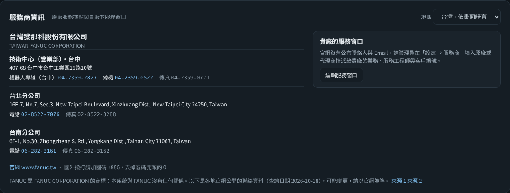

## 九、多國語言（6 種語言，2.1 全部開放）

支援 `zh-TW` 繁體中文、`zh-CN` 简体中文、`en` English、`ja` 日本語、`ko` 한국어、`vi` Tiếng Việt。介面、警報與通知、報告、工單、作業包、指令列都有翻譯（2,700 多條，6 種都完整，缺翻譯時測試會失敗）。英文以美式用語與拼字為準（judgment、gray、canceled、cell phone、spare parts…）。翻譯完成度未達 95% 的語言不會出現在語言選單（以後新增語言時用）。

簡中以外的譯文由 AI 翻譯，用詞可能不夠道地；歡迎母語使用者用 Issue 或 Pull Request 指正（修改方式見本節第 4 點）。

### 1. 三種語言設定

| 設定 | 影響範圍 | 怎麼設 |
|---|---|---|
| 系統語言 | 簡訊／Email／Webhook 通知、報告、工單、指令列輸出、記錄檔 | 設定檔 `[ui] lang`；或啟動時加 `--lang`；或環境變數 `DTM_LANG`（優先順序：`--lang` > `DTM_LANG` > 設定檔） |
| 畫面語言 | 只影響這位使用者看到的畫面（單機、廠區、中央、Pro 都一樣） | 畫面上方的語言選單（地球圖示，記在這台瀏覽器）；網址也可直接加 `?lang=en` |
| 通知規則語言 | 這條收件規則發出去的通知 | `[[notify.rules]]` 加 `lang = "vi"`（不寫 = 系統語言） |

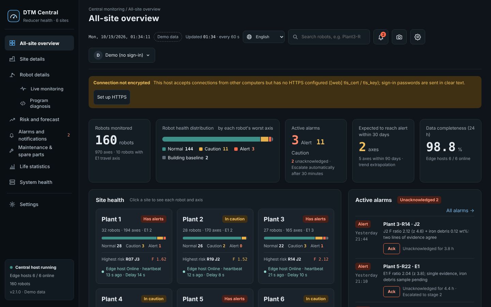

**已經存下來的文字也會換語言**：警報訊息、邊緣主機傳到中央的研判與建議，存的時候會連「原文＋參數」一起存，畫面依觀看者的語言重新產生；例如越南廠的邊緣主機用越南文，中央的工程師看到的是中文。2.1 以前存的舊資料、以及使用者自己打的文字（事件備註、拆檢說明、備品名稱）照原樣顯示。中央收到邊緣主機的警報後，也先換成中央的語言再發通知。

中央演示與靜態演示每種語言各一份演示資料（廠區名稱、人名、備品名稱也跟著語言），切換語言時第一次會多等幾秒。

### 2. 作業包目錄的語言版

`workpacks.r2000ic_165f.toml` 是繁中原檔。同目錄下的 `.zh-CN`、`.en`、`.ja`、`.ko`、`.vi` 版本由工具產生，料號、數量、工時、人數與原檔完全相同，只翻譯名稱、步驟、安全指令與備註。系統依目前語言自動挑選；日、韓、越文沒有專屬版本時改用英文版。

修改作業包的流程：

```bash
# 1. 改繁中原檔 workpacks.r2000ic_165f.toml
# 2. 新增或修改的字串，在 tools/workpack_tr/<語言>.json 補上翻譯（簡中不用，會自動轉換）
python tools/workpack_l10n.py check   # 列出缺哪些翻譯
python tools/workpack_l10n.py         # 產生各語言版
```

工具會檢查譯文版的結構、數字與料號跟原檔一致，有缺漏就不產生檔案。也可以直接編輯各語言版，但下次重新產生時會被覆蓋。

### 3. 簡訊長度

英文簡訊上限 160 字；中、日、韓、越文（含越南文聲調符號）是 Unicode 簡訊，上限 70 字。系統依語言自動截短，並先刪掉「研判」說明。

### 4. 修改或新增翻譯

- 程式裡的原文就是繁中字串，用 `_("…")` 包起來；翻譯放在 `dtm/locales/<語言>.json`，原文 → 譯文。
- 新增或修改字串後：

```bash
python tools/i18n_tool.py extract   # 更新 dtm/locales/_msgids.json（目前 2,334 項）
python tools/i18n_tool.py check     # 列出各語言缺漏與參數不符
```

- `{name}`、`{ratio:.2f}`、`%s` 等參數必須原樣保留；英文、越南文句中的名詞可寫成 `{comp!l}`，首字會改小寫。
- 要存進資料庫、之後還要換語言顯示的文字，用 `_()` 產生並用 `+` 或 `i18n.join()` 串接（會記住原文與參數）；f-string 會變回一般文字。
- 標點與分隔符號（`、`、`；`、`：`）也要用 `_("、")` 這類寫法，英文等語言會換成半形。
- 某語言缺翻譯時會顯示英文（簡中缺翻譯時顯示繁中原文），不會出錯。
- 簡中由繁中轉換後再依大陸用語調整；英、日、韓、越文由開發者翻譯，術語建議請當地維修人員或 FANUC 當地資料再校一次，有錯請用 Issue 回報。

## 十、資料安全與誤報控制（1.5 版新增）

### 1. 寫入密碼與操作紀錄

會改資料的動作都要先登入，包括登錄事件、撤銷事件、確認警報、登錄鐵粉、振動、時數、測試通知。只看畫面不用登入。

> 2.1 版起：**沒有任何帳號、也沒有設寫入密碼時，儀表板一律唯讀**，畫面上方會提示「請建立管理員帳號」；第一個管理員只能在監測電腦本機（`http://127.0.0.1`）建立，沒有預設密碼。下面的共用寫入密碼是 1.x 的做法，設過的照常可用，新導入請直接用個人帳號（第十二節第 9 點）。

```toml
[web]
write_password = "自己訂一組"      # 或寫 "env:DTM_WRITE_PASSWORD"，從環境變數讀
session_hours = 12                 # 登入後多久要重新登入
```

- 第一次按「登錄」等按鈕時會跳出登入視窗：填姓名和密碼。右上角會顯示「操作人：姓名」，按一下就登出。
- 密碼是全廠共用的一組，姓名由登入的人自己填。所以操作紀錄記的是「誰說自己是誰」，不是身分驗證。
- 同一台電腦連續輸錯 5 次，暫停登入 10 分鐘。
- 事件清單會顯示登錄人與撤銷人，警報會顯示確認人。完整的操作紀錄在 `/api/audit`，連失敗的嘗試也有記錄，密碼不會被記錄。
- 儀表板開放給其他電腦（`host = "0.0.0.0"`）但沒有設定 HTTPS 時，`check` 會警告、畫面也會提示（登入密碼會以明碼在網路上傳送）。
- 指令列（`event`、`undo-event` 等）在電腦本機執行，不需要密碼；登錄人預設是電腦登入帳號，也可以用 `--who` 指定。

### 2. 撤銷登錄錯誤的事件

軸選錯、類別選錯、按了兩次，都可以在儀表板「元件壽命與保養紀錄」的事件清單按「撤銷」，並填原因。撤銷後：

- 這筆事件新裝的元件紀錄刪除，被它結束的舊元件恢復成使用中，壽命時數還原。
- 隨事件登錄的時數表讀數刪除。
- 健康基準回到登錄前的那一期，健康判定與維護決策立刻重算，不必等連續 2 次確認。
- 事件本身保留，標示「已撤銷」，並記錄誰、何時、為什麼撤銷。

如果這次裝上的元件之後又被另一筆事件換掉（例如先換脂、後來又換減速機），要先撤銷後面那一筆，系統會提示是哪一筆。1.5 版以前登錄的換脂、換零件事件沒有變動紀錄，不能自動還原；這種情況請改登錄「重設基準」，或手動修正。

指令列：

```bash
python -m dtm -c config.toml events                       # 列出事件與編號
python -m dtm -c config.toml undo-event --id 25 --note "軸別選錯"
```

### 3. 每日自動備份、網路資料夾第二份、還原精靈

```toml
[storage]
backup_dir = "backups"     # 相對於資料庫所在的資料夾；填 "" 不備份
backup_keep = 14           # 保留最近 14 份，舊的自動刪除
backup_hour = 3            # 每天幾點備份
backup_mirror_dir = '\\NAS01\dtm_backup\R01'   # 第二份：網路資料夾（NAS／檔案伺服器）；填 "" 不複製
before_restore_keep = 5    # 還原前自動備份保留幾份
```

- DTM 執行中就會自動備份，不用停機。備份前後會做完整性檢查，通過才保留。
- 電腦凌晨沒開機時，開機後只要超過 26 小時沒備份，就會立刻補做。
- 備份不含一般原始樣本（只保留 7 天，佔空間最多）；診斷段與警報前後保留的原始片段、生產循環逐筆資料會帶著。每分鐘統計、診斷特徵、事件、元件壽命、警報、操作紀錄都在。
- **磁碟用量**（每台機器人、每秒 5 筆，用 30 天加速模擬的成長量推估；實際依生產循環次數與警報次數）：資料庫穩定後約 2 GB（原始樣本 7 天約 0.25 GB、保留的原始片段 180 天約 0.7 GB、生產循環逐筆資料 180 天約 1.2 GB）；每日備份一份約 0.7 GB，保留 14 份約 10 GB。**每台請預留 15 GB，10 台的邊緣主機預留 150 GB 以上**。空間不夠時先調小 `backup_keep`（並設網路資料夾第二份），或調小 `cycle_retention_days`（生產循環的每日中位數永久保留，不受影響）。
- 備份存成 zip，Windows 檔案總管可以直接打開。儀表板會顯示最近一次備份的時間；超過 2 天沒備份或備份失敗，會以紅字提醒。
- **網路資料夾**：每份備份再複製一份過去，比對 SHA-256 一致才算成功。網路斷線時本機備份照做，連線恢復後自動補複製缺的份數（失敗後 30 分鐘再試）。DTM 以 Windows 服務執行時，服務帳號也要有那個網路資料夾的寫入權限；`check` 會檢查。

```bash
python -m dtm -c config.toml backup                 # 立刻備份一份（有設網路資料夾會一起複製）
python -m dtm -c config.toml backup --list          # 列出本機備份；加 --mirror 列出網路資料夾
python -m dtm -c config.toml restore                # 還原精靈：一步一步問
python -m dtm -c config.toml restore --list         # 列出所有可用的來源
```

**還原精靈**（指令或儀表板「資料還原」卡片，管理員、在這台電腦本機操作）：

| 步驟 | 選項 |
|---|---|
| 來源 | 本機備份／網路資料夾／還原前自動備份／從中央重建／指定檔案（指令才能指定） |
| 時間點 | 選哪一份備份 |
| 範圍 | 整台或指定軸；資料類型（趨勢與診斷特徵、振動與鐵粉、維護紀錄與元件壽命、警報與通知、系統與操作紀錄、原始取樣）；時間區間 |
| 模式 | **補回遺失**（預設）：只補備份有、目前沒有的資料，不刪、不改現有資料<br>**回到時間點**：範圍內改成跟備份一模一樣，備份之後的資料會刪除；要再輸入「回到時間點 J2」這類確認文字 |

- 一定先**預覽差異**（每種資料：備份幾筆、目前幾筆、會補回幾筆、會刪除幾筆），預覽不改任何資料。
- 執行前自動把目前的資料庫另存成 `…_before_restore_日期時間.sqlite3`；還原錯了，用來源「還原前自動備份」再還原一次即可。
- 完成後自動重算該軸（或整台）的健康與維護判定。DTM 執行中也可以還原（分段寫入，每段一個交易，不會卡住監測）。
- 原始取樣一筆含全部軸，**不做單軸還原**；時數、通知、系統紀錄沒有軸別，只在「整台」處理。操作紀錄只補不刪。
- **從中央重建**：電腦整台壞掉、本機與網路資料夾的備份都沒有時，向中央取回這台上傳過的資料（診斷特徵、每日動作統計、事件、元件、鐵粉、振動、警報），用的是同步金鑰，中央只給自己廠區的機器人。中央沒有原始取樣、每分鐘統計、生產循環逐筆、校正與時數。連不到中央時，在中央電腦執行 `python -m dtm -c config.central.toml central-export --robot TW01/R01`，把產生的 `.json.gz` 帶過來用 `restore --file` 指定。

```bash
# 例：J2 的趨勢資料被誤刪，從 10/15 的備份補回
python -m dtm -c config.toml restore --source local --name dtm_20261015_0300.zip --axis 2 --types trend --preview
python -m dtm -c config.toml restore --source local --name dtm_20261015_0300.zip --axis 2 --types trend
```

資料庫檔案本身壞掉、打不開時，用 `restore --mode full --file backups\dtm_20261015_0300.zip` 整個換掉（要先關閉 DTM）。

### 4. 設定檔檢查

```bash
python -m dtm -c config.toml check
```

會用中文指出問題的位置與改法。檢查項目：

- **格式錯誤**：第幾行；全形符號（＝ “ ”）、引號沒成對、數字加了引號。
- **編碼**：檔案不是 UTF-8。用記事本另存新檔，「編碼」選 UTF-8 即可（記事本的「UTF-8 含 BOM」也可以讀）。
- **拼錯的項目名稱**：會提示最接近的正確名稱，例如 `passwrod → write_password`。
- **數值範圍**：門檻前後顛倒、軸號超出 1–6、暫存器和扭矩暫存器重疊、資料夾不存在或沒有寫入權限。
- **通知**：已啟用但沒填 token 或收件人，或環境變數不存在。

結果分三級：

| 等級 | 意思 |
|---|---|
| 【錯誤】 | 一定要修；結束代碼為 1，`start.bat` 會停下來 |
| 【警告】 | 可以跑，但可能不是你要的 |
| 【提示】 | 還沒填的選填項目 |

加 `--connect` 會實際讀 10 秒資料，檢查以下項目：

- 讀取速率；
- 心跳有沒有在跳。沒在跳代表 BG Logic 沒執行；
- 各軸扭矩是否一直是 0、有沒有超出範圍；
- 倍率是不是 100%；
- 段代碼能不能辨識；
- 溫度值是否合理。

### 5. 溫度、冷機與共同變化：誤報情境模擬

黏性摩擦 Fv 對溫度很敏感。冬天、週一早上冷機、生產節拍變慢，都會讓 Fv 上升 20–80%，看起來就像油脂劣化。1.4.1 版的溫度補償只在「基準期 10 次診斷的溫差達 5°C」時才啟用，現場通常達不到；而且很多機台根本沒有溫度訊號。

1.5 版改成兩層：

- **溫度補償**：有溫度訊號就一律補償。沒辦法從基準期學的時候，用預設係數。
- **跨軸共模扣除**：監測兩軸以上時，扣除各軸同時發生的變化。
  - 氣溫與冷機會讓各軸的黏性摩擦一起變，單一軸的油脂劣化只有那一軸變。
  - 系統取各軸黏性摩擦累積變化的中位數，當作「共同變化」，換算成等效溫差後，從每一軸扣掉。
  - 換算是依溫度係數，所以固定摩擦（磨耗）就算兩個軸同時上升，也不會被當成共同變化扣掉。
  - 其他軸換脂、換零件造成的跳動不計入。
  - 有溫度訊號時，扣的是溫度補償後剩下的共同誤差，例如預設係數不準。

用 `scenarios` 指令模擬一年（3 軸，每天一次診斷），比較 1.4.1 版與 1.5 版的誤報次數（3 軸合計）：

| 情境 | 1.4.1 版 | 1.5 版 |
|---|---|---|
| 對照組：恆溫、無變化 | 0 | 0 |
| 季節溫差 16–36°C（有溫度訊號） | 13 | 0 |
| 季節溫差（沒有溫度訊號） | 13 | 0 |
| 冷機診斷：每週一＋長假後（有溫度訊號） | 0 | 0 |
| 冷機診斷（沒有溫度訊號） | 18 | 0 |
| 更換夾具，負載設定已更新 | 13 | 0 |
| 生產程式變更：診斷時減速機冷 8°C | 31 | 0 |
| 更換夾具但負載設定沒改（應該報警） | 3 軸都報「檢查負載設定」 | 3 軸都報，沒有誤判成換脂 |
| J2 油脂劣化＋季節＋冷機，沒有溫度（應該報警） | J2 有報，另有 10 次誤報 | J2 有報（立即換脂），0 誤報 |
| J3 減速機磨耗＋季節溫差（應該報警） | J3 有報，另有 9 次誤報 | J3 健康警戒，0 誤報（只有扭矩一類證據，不會直接建議換減速機） |
| 所有軸油脂一起劣化＋季節溫差（預設設定） | — | 扭矩這一路漏報（已知盲點，見下方「代價」） |
| 同上，有溫度、係數已校正、`common_mode = "auto"` | — | 3 軸都報（立即換脂），0 誤報 |

- 「1.4.1 版」一欄是把 1.5 版的新處理關掉（預設溫度係數設 0、不做共模扣除）跑出來的，代表 1.4.1 版的判定方式。
- 模擬器裡的「真實」溫度係數是每 °C 3%，系統預設是 2.5%，兩者刻意不同。把真實係數改成 4.5% 再跑，「季節溫差（有溫度）」「冷機（有溫度）」「冷機（沒有溫度）」「生產程式變更」仍然是 0 誤報：預設係數不準造成的誤差，對各軸都一樣，會被共模扣除。只監測兩軸（J2、J3）時，抽測的 4 個情境結果相同。
- 這些數字來自模擬器，溫度係數、負載影響都是合理假設，不是量測值。它證明的是「判定邏輯在這些干擾下不會亂報、也不會把真的劣化扣掉」，實際誤報率仍要用現場資料確認。
- 代價：
  - 所有軸**同時**以同樣比例劣化（例如同一天換脂、同一批油脂一起老化），會被當成共同變化扣掉；模擬「所有軸油脂一起劣化」時，扭矩這一路確實漏報。這種情況靠油脂壽命（時數、溫度加速）與鐵粉把關。單一軸的異常（漏油、進水、污染、磨耗）不受影響。
  - 只監測一個軸時沒有共模可扣，只能靠溫度訊號；沒有溫度訊號就無法區分季節與油脂劣化。
- 有溫度訊號的現場可以補上這個盲點：累積一個季節後用 `temp-coef` 校正溫度係數，再把 `common_mode` 改成 `"auto"`（有溫度時只做溫度補償、不扣共同變化）。模擬中，係數校正後改用 `"auto"`，「所有軸油脂一起劣化」三軸都抓到，其他不該報的情境仍是 0 誤報。但係數沒校正就改 `"auto"` 的話，若實際係數是 4.5%，季節溫差一年會誤報 8 次、生產程式變更 24 次。所以預設維持 `true`。

```bash
python -m dtm -c config.sim.toml scenarios                         # 全部 12 個情境，約 7 分鐘
python -m dtm -c config.sim.toml scenarios --only cold_start_nosensor,grease_nosensor
```

### 6. 從自己的資料估計溫度係數

有溫度訊號、累積一個季節（溫差 8°C 以上、至少 20 次診斷）之後執行：

```bash
python -m dtm -c config.toml temp-coef
```

- 會用「ln(值) = a − k × 溫度 + c × 天數」做回歸。天數項吸收慢慢的劣化趨勢，避免把劣化算成溫度效應。
- 估計值和目前設定差很多時，會建議新的 `temp_coef_fv`。在模擬資料上，估出的係數和真實值相差不到 0.001。
- 溫度和時間幾乎同步變化（例如只有秋天到冬天的資料）時，會說「分不出來」，不給建議。

### 7. 其他

- 記錄檔 `dtm.log` 改為每 5 MB 換一個檔，保留 5 個，不會無限長大。
- 舊資料庫第一次用 1.5 版開啟時會自動加欄位，原有資料不動。

### 8. 原始片段保留、分析資料匯出、拆檢表單（2.1）

**原始片段保留**：一般原始取樣只留 7 天（`raw_retention_days`），但每次**診斷段的原始波形**與**每次警報前後各 10 分鐘**的原始資料保留 180 天（`raw_keep_days`、`raw_keep_alarm_s`），每日備份也會帶著這些片段。之後要回頭看「警報當下到底發生什麼事」、或拿去做更細的分析，都還有資料。

**分析資料匯出**（管理員）：儀表板「元件壽命與保養紀錄」卡片的「分析資料匯出（zip）」，或：

```bash
python -m dtm -c config.toml export-analysis --since 2026-01-01 --until 2026-09-30 --anonymize
python -m dtm -c config.edge.toml --robot R14 export-analysis          # 邊緣主機：指定機器人
python -m dtm -c config.central.toml export-analysis --rkey P3/R14     # 中央：用中央保存的資料
```

| 包含 | 不包含 |
|---|---|
| 診斷特徵、每日動作中位數、保養事件、警報、鐵粉、振動、元件壽命（含拆檢與照片）、運轉時數、校正、系統事件、去敏設定檔（JSON）、保留的原始片段 | 一般原始取樣、帳號資料庫、金鑰與密碼、電話與 Email、Webhook 網址；控制器與網路位址、完整檔案路徑一律遮蔽 |

加 `--anonymize`（或畫面勾選「匿名化」）時，廠名、機器人名稱、產線、操作人換成代號（SITE-A、ROBOT-01、操作人1…），對照表不放進 zip。CSV 是 UTF-8（含 BOM），Excel 可直接開。網頁產生的下載連結 10 分鐘內有效、只能下載一次。

**拆檢表單**（工程師以上）：更換減速機、齒輪箱、馬達後，在事件列表按「拆檢」填寫：

- 損傷位置（輸入齒輪、曲軸軸承、擺線齒輪、針齒、主軸承、油封、齒輪箱齒輪／軸承、馬達軸承、煞車、其他）
- 損傷型態（點蝕、剝離、磨耗、斷齒、其他）、油脂狀態（正常、變色變黑、含金屬粉、乳化進水、硬化乾涸、漏油）
- 照片（JPEG／PNG，存在 `data/photos/`）、備註
- 拆開沒有損傷時勾「**檢查無異常**」：這筆更換在壽命統計裡改當預防更換（設限資料），也留下「這次判斷可能太早」的紀錄，之後用來修正門檻

中央的機器人頁也能填（照片要在那台機器人的儀表板上傳）。指令：`python -m dtm -c config.toml teardown --id 25 --location crank_bearing --mode spalling,wear --grease metal --photo IMG_0012.jpg`。撤銷事件時拆檢結果一併還原。

### 9. 計畫停機、電腦時間偏差、導入檢查報告、門檻回放（2.1）

**單台計畫停機**（工程師以上）：歲修、停線、換模時，在儀表板「保養與檢測登錄」的「計畫停機」設定結束時間；邊緣主機每台各自設定，中央在機器人頁按「計畫停機」（下次同步時寫入那台）。期間不發資料中斷、心跳停止、連線中斷與無效值警報，看門狗也不報資料中斷；其他判斷照常。畫面標示「計畫停機中」，到期自動結束，最長 60 天。

```bash
python -m dtm -c config.toml downtime --until "2026-10-20 08:00" --note 歲修
python -m dtm -c config.toml downtime --until 8h
python -m dtm -c config.toml downtime --cancel
```

**電腦時間偏差**：每次上傳中央時比對中央回覆的時間，相差超過 `[central] clock_drift_s`（預設 60 秒）就在那台發「注意」，回到範圍內自動解除。中央「系統健康」的邊緣主機表格多一欄「時間偏差」。時間不準會讓趨勢與警報時間錯位，請開啟 Windows 時間同步（或公司 NTP）。

**導入檢查報告**：第一次跑滿 7 天自動產生在 `data/reports/`，也可以在儀表板按「導入檢查報告」或執行 `python -m dtm -c config.toml commissioning-report`。內容：取樣頻率與抖動、資料中斷、心跳與連線、診斷段切割成功率與丟棄原因、各軸雜訊（漣波、F 變異係數）、動作代碼涵蓋率、感測器更新間隔，每項標 ✔ 或 ⚠。⚠ 的項目先處理，再開始依判斷安排保養。

**門檻回放試算**：想調門檻時，先回放「如果當初是這個門檻，過去會報幾次、什麼時候報」：

```bash
python -m dtm -c config.toml replay --set health.caution_ratio=1.3 --set health.alert_ratio=1.6 --days 365
python -m dtm -c config.toml replay --set decision.weights.iron=0.8 --decision      # 連維護決策也回放（較慢）
```

中央機器人頁的「門檻回放」可以直接試算健康判定與生產監測的比值門檻（用中央保存的資料，數字是近似值）。回放用的是當時已存的資料，換脂、換件依實際時間重設基準；改設定前請對照拆檢紀錄與現場經驗。

## 十一、測試

```bash
python -m unittest discover -s tests -v    # 約 5 分鐘（233 項），其中情境模擬約 1.5 分鐘
```

包含：6 種語言翻譯完整且參數一致、作業包各語言版跟繁中原檔同步、每種語言的 API 與頁面、已存警報換語言顯示、Pro 分析流程（行號對位、損耗、掃描、改善驗證、串流接收）。

GitHub Actions（`.github/workflows/tests.yml`）每次推送都在 Windows 與 Linux、Python 3.11–3.13 跑全部測試與 pyflakes。

**長時間與負載測試**（不在單元測試裡，手動執行）：

```bash
python tools/soak_test.py --days 30            # 加速模擬 30 天：記憶體、資料庫成長、原始樣本清理、記錄檔輪替、每日備份
python tools/load_test.py                      # 中央負載：160 台、8 個廠區同時上傳 10 輪，量上傳處理時間與畫面回應
python tools/load_test.py --mode standalone    # 最壞情況：160 台各自同時上傳
```

2.1.0 在開發環境（Linux 雲端主機）的結果：

- 中央負載：160 台分 8 個廠區同時上傳，每輪約 1.6 秒處理完（第一輪含每台 3,000 筆補傳約 7.6 秒）；160 台各自同時上傳每輪約 2.5 秒、無錯誤（連線佇列已放大到 256）。上傳進行中開畫面 0.1–0.5 秒，平常 8 個畫面的 API 都在 50 毫秒內。
- 長時間（加速模擬 30 天、每秒 2 筆，約 518 萬筆樣本，走完整監測流程與每日備份，約 70 分鐘跑完）：一般原始樣本第 7 天後持平，每小時清理正常；診斷段與警報前後的保留片段每天約多 2 萬筆，180 天後到期清除（設計如此）。資料庫第 30 天 340 MB，第 7 天後每天約增加 8.5 MB（大部分是生產循環逐筆資料，模擬器約每 6 秒一個循環）。記憶體前 8 天從 50 MB 升到約 87 MB，之後到第 30 天緩升到約 100 MB；追蹤 Python 物件沒有發現累積，實機試跑時仍請留意。每日備份與保留份數自動刪除正常。模擬一天的處理時間約 2–3 分鐘，換算成實際運轉約佔一顆 CPU 核心的 0.2%。
- 這是模擬資料；網路、控制器與 Windows 本身的長期行為仍要在現場驗證。

## 十二、多廠區、中央監控與長時間運作（2.0 版新增）

### 1. 同一套程式、三種角色

用設定檔 `[system] role` 決定，程式完全相同：

| 角色 | 用途 | 設定範本 | 畫面 |
|---|---|---|---|
| `standalone`（預設） | 一台電腦接一台機器人（1.x 的用法） | `config.example.toml` | 單機儀表板 :8080 |
| `edge` 邊緣主機 | 一台電腦管理一個廠區的多台機器人 | `config.edge.example.toml` | 廠區儀表板 :8080，每台機器人 :8101、:8102… |
| `edge`＋不接中央（小型模式） | 10 台以下、沒有中央伺服器（1 台也能用） | `config.small.example.toml`、`start_small.bat` | 全廠儀表板 :8080，每台機器人 :8101… |
| `central` 中央伺服器 | 接收各廠上傳，全廠 8 個畫面、通知中心 | `config.central.example.toml` | 中央 :8090 |

```
機器人 ×N ──HTTP──→ 邊緣主機（每廠一台）                         中央伺服器
                    ├ 每台機器人一個程式、一個資料庫（判斷在這裡）   ├ 全廠總覽、廠區、機器人、風險
                    ├ 監督者：程式掛了重啟、卡住強制重啟           ├ 警報與通知中心（只有中央發通知）
                    ├ 廠區資料庫＋廠區儀表板（斷網也能看）          ├ 保養排程、備品、機群壽命統計
                    └ 每 60 秒上傳新資料（gzip、金鑰）──HTTPS──→  └ 系統健康（各廠心跳、看門狗、備份）
                         ←── 中央回覆：指令（換脂、換件、確認…）＋ 機群壽命模型
```

- **判斷只在邊緣做一次**：中央收的是結果，不重算；斷網時邊緣照常判斷、記錄，恢復後依游標自動補傳，不會掉資料。
- **通知只有一個出口**：平常由中央統一發（去重、依廠區與值班派送、逐級通報）。邊緣連不上中央超過 `edge_fallback_s`（預設 5 分鐘）才自己發「警戒」。
- **一份資料只有一個主人**：在中央登錄的事件（換脂、換件、鐵粉、確認警報）會變成「指令」，下次同步時由邊緣在那台機器人上執行，再同步回來。
- **中央看得到邊緣斷線**：邊緣超過 `edge_timeout_s`（預設 5 分鐘）沒上傳 → 系統警報（斷電、斷網、程式停止只有這一層看得到）。
- **機群壽命模型下發**：中央用所有廠的更換紀錄算 Weibull，每小時下發；邊緣寫入 `run/rules.json`，各機器人自己的失效紀錄不足時改用機群模型。

### 小型模式（10 台以下、沒有中央；2.1）

只有幾台機器人、不想另外架中央伺服器時，用一台電腦當邊緣主機、不填 `[central] url` 就是小型模式：

1. 把 `config.small.example.toml` 複製成 `config.small.toml`，填廠區名稱、每台機器人的 IP（`[[robots]]`，1 台也可以）與通知方式。
2. 雙擊 `start_small.bat`。第一次開啟 http://localhost:8080 時，在這台電腦上建立管理員帳號。

跟接中央時的差別：

- **通知由這台電腦統一發**：各機器人程式不各自發（避免同一件事收到好幾則），由本機的廠區資料庫負責去重、依規則派送、逐級通報與每日摘要。這台主程式停擺超過 `edge_fallback_s`（預設 5 分鐘）時，各機器人程式才自己發「警戒」當備援。
- **本廠壽命統計**：每小時用本廠所有機器人的更換紀錄算 Weibull，寫到 `run/rules.json` 給各台使用；失效紀錄不足時用 `[life.prior]` 的先驗。畫面上的壽命模型會標示來源（自有紀錄擬合／本廠機群／中央機群／設定檔先驗）。
- **每日摘要就是心跳**：設 `summary_time`（例如 `"07:30"`），每天準時收到摘要＝系統還活著；哪天沒收到，就去看一下這台電腦。摘要也可以發一行簡訊（`summary_channels` 加 `"sms"`，計入每日上限）。
- 之後要接中央，只要在 `[central]` 填網址與金鑰，其他設定不用改。

### 2. 先看中央畫面（演示資料）

雙擊 `start_central_demo.bat`，或：

```bash
python -m dtm -c config.central.example.toml demo          # 開 http://localhost:8090
python -m dtm -c config.central.example.toml demo --rebuild # 重新產生
```

會產生 6 個廠區、160 台 R-2000iC/165F（其中 10 台含 E1）的**演示資料**，畫面右上角標示「演示資料」。演示模式不連機器人、不發通知（測試通知會被擋下）。另外會啟動一台模擬機器人接到第一台（一廠），左側選單的「即時監測」「程式診斷」可以在同一個視窗裡試用（第一次約 1–2 分鐘準備資料；不需要可加 `--no-live`）。演示的帳號與設定存在 `data/demo_users.sqlite3`，不影響正式使用。8 個畫面：

**不用安裝的線上演示**：`python tools/build_static_demo.py` 會把中央 8 個畫面輸出成靜態網頁（`site/`，讀演示資料的 JSON 快照，所有寫入停用並提示），可以直接放 GitHub Pages。6 種語言各一份快照（約 45 MB、3 分鐘；`--langs zh-TW,en` 只產生指定語言）。倉庫已附自動部署流程 `.github/workflows/pages.yml`：Settings → Pages → Source 選「GitHub Actions」，之後每次發布 Release 會自動更新。

| 畫面 | 內容 |
|---|---|
| 全廠總覽 | 監控台數、健康分布、作用中警報（可確認）、30／90 天內預估達警戒、各廠卡片、風險前 8 軸、90 天趨勢、未來 14 天保養 |
| 廠區詳情 | 每台每軸熱圖（F 比值、z）、需要處理、今日每小時生產循環、未來 30 天、邊緣主機狀態；匯出 CSV |
| 機器人詳情 | 各軸卡片、趨勢（診斷扭矩或生產循環、溫度、事件標記）、判定與證據、診斷特徵、壽命曲線、事件（可撤銷）；登錄事件與鐵粉、列印工單 |
| 風險與預測 | 預估達警戒時間軸（含不確定範圍與已排保養）、風險矩陣（影響度 × 時程）、備品需求 vs 庫存（交期來不及標「緊急」） |
| 警報與通知 | 警報清單（作用中／未確認／今天／90 天）、升級流程、送達紀錄、通道狀態、訊息預覽、收件規則 |
| 保養與備品 | 6 週排程（依廠區、類型篩選、點選完工）、工作包準備進度、依時數換脂、備品庫存（可編輯） |
| 壽命統計 | Weibull 機率圖（中位秩、截尾）、各軸 β／η／B10 與可信度、未來 12 個月預估更換、時數分布 |
| 系統健康 | 各邊緣主機 CPU／記憶體／磁碟／延遲／控制器連線、看門狗 4 層觸發、24 小時資料延遲、備份、操作紀錄、下發指令 |

### 3. 邊緣主機（一個廠區多台）

1. 複製 `config.edge.example.toml` 成 `config.toml`，填 `[system] site_id`（例如 `"P3"`，各廠不可重複）、`[[robots]]`（每台一段：`id`、`host`、`line`、`impact`，有 E1 加 `e1 = true`）。
2. `python -m dtm -c config.toml check` 檢查（代碼或連接埠重複會報錯）。
3. `python -m dtm -c config.toml run`（或裝成服務，見第 5 點）。

- 每台機器人一個獨立程式、一個資料庫（`data/R14.sqlite3`）；一台出問題不影響其他台。
- 每台的即時監測與程式診斷直接在廠區畫面裡打開（左側選單，或廠區詳情的「開啟」）；廠區畫面在同一台主機上轉送給那台的程式（連接埠 8101 起，只在主機內部使用），登入一次就有效。
- 監督者每 5 秒檢查：程式結束就重啟（間隔逐次拉長，每台每小時最多 `max_restarts` 次，超過就停止並發系統警報）；狀態檔超過 `stale_s` 沒更新（卡住）就強制結束再重啟。
- 要對單一台下指令：`python -m dtm -c config.toml --robot R14 events`（所有單機指令都可以加 `--robot`）。
- 個別機器人不同的設定寫在 `[[robots]]` 底下，例如 `[robots.axis.2]`、`[robots.sensors]`。

### 4. 中央伺服器

1. 複製 `config.central.example.toml` 成 `config.central.toml`。
2. 設定上傳金鑰：`[central] token = "env:DTM_SYNC_TOKEN"`（各廠共用），或 `[central.tokens]` 每廠一組（建議）。邊緣主機的 `[central] url`、`token` 填同一組。
3. 建議設 HTTPS（`[web] tls_cert`、`tls_key`，向資訊單位申請公司內部 CA 簽發的憑證）；邊緣用 `[central] ca_file` 驗證。
4. 建帳號：`python -m dtm -c config.central.toml user add wang --role engineer --display 王小明`。
5. 雙擊 `start_central.bat`，或 `python -m dtm -c config.central.toml run`。

單機（一台機器人）也可以直接上傳中央：在 `config.toml` 填 `[system] site_id` 與 `[central] url`、`token`。

### 5. 長時間運作（不停機）

```bash
python -m dtm -c config.toml service install            # 以系統管理員身分執行；Windows 用 WinSW、Linux 用 systemd
python -m dtm -c config.toml service install --no-error-dialog   # 同時關閉「程式已停止運作」對話框
python -m dtm -c config.toml service status | restart | stop | uninstall
python -m dtm -c config.toml maintenance on --minutes 120 --reason "更新程式"   # 維護前開啟，看門狗暫停
python -m dtm -c config.toml maintenance off
python -m dtm -c config.toml selfcheck
```

- **Windows 服務**：開機自動啟動、不需要登入、沒有黑色視窗可以誤點或誤關；程式結束時 10／30／60 秒後自動重啟；記錄檔自動分割。另裝一個 `DTM-Watchdog` 服務。WinSW 已放在 `tools/winsw/`（MIT 授權）。
- **看門狗 4 層**（上一層救不回來才輪到下一層）：
  1. 服務自動重啟（程式結束）／監督者重啟（邊緣的機器人程式）；
  2. 軟體看門狗：狀態檔或擷取迴圈停止更新 → 重啟服務；每小時最多 `max_restarts` 次，超過就停止並通知（防止無限重啟）；機器人資料中斷只通知不重啟；
  3. 硬體看門狗（選用）：`[watchdog.hw] type = "linux"`（/dev/watchdog）、`"command"`（工業電腦廠商工具）、`"modbus"`（送心跳給 PLC，由 PLC 切電源重開）；DTM 健康才餵，救不回來就停止餵讓硬體重開機；一天超過 `max_reboots_day` 次就改成一直餵、只通知人；
  4. 中央心跳：邊緣太久沒上傳 → 中央發系統警報。
- **啟動自我檢查**：資料庫完整性（上次沒正常結束、或每 7 天一次）、磁碟空間、寫入權限、設定檔。有錯誤就不啟動（結束代碼 4，紀錄在 `logs/`），修好再啟動或加 `--force`。
- **快速失敗**：重要執行緒意外停止時程式直接結束，交給服務重啟，不會「看起來在跑其實沒在記錄」。當機紀錄寫在 `logs/crash_*.log`。
- **磁碟警報**：剩不到 `disk_alarm_pct`（10%）注意；不到 `disk_critical_pct`（3%）警戒並暫停寫原始樣本（特徵與事件照常）。
- 從命令列執行時自動關閉 Windows 主控台的「快速編輯模式」（避免誤點視窗讓程式暫停）。
- 狀態檔、維護模式、看門狗紀錄在 `run/`；記錄檔在 `logs/`。

### 6. E1 行走軸

- 機器人端：`robot/DTM_BG_E1.LS` 把 E1 的干擾扭矩放到 R[107]（行走軸在第 2 群組時，檔案內有替代寫法）。
- 設定：`[axes] enabled` 加入 `7`（邊緣主機在 `[[robots]]` 寫 `e1 = true`）；E1 預設為 `rack`（行走軸齒輪箱＋齒條）、直線軸，不判斷重力偏差 G。
- 診斷段：`DTM_DIAG.LS` 可選擇加入 E1 段（代碼 7xxx，PR[57]／PR[58] 兩端點）。
- 作業包：`R2000iC165F-E1-gearbox`、`R2000iC165F-E1-grease`（料號依行走軸 Parts list）。

### 7. 生產動作代碼監測（不用停機跑診斷程式）

- 在生產程式的固定動作前後寫 `R[110] = 9001`（9000–9899，每個動作一個代碼）、結束寫 `0`，範例見 `robot/DTM_MCODE_EXAMPLE.LS`。
- DTM 把每個循環的扭矩 RMS 依（動作代碼, 軸）記下；每天取中位數，跟重設後前 `baseline_days`（10）個有效日比較：≥ 1.15 倍注意、≥ 1.30 倍警戒，連續 `confirm_days`（2）天才成立；循環時間偏離典型值或倍率不是 100% 的循環不採用。
- 結果併入交叉判斷的「扭矩」證據（不會單獨當成第二類證據）；儀表板有「生產監測」卡片。
- 換夾具、改程式後在儀表板登錄「重設動作基準」（可指定動作代碼）。`[motion.codes]` 可以替代碼取名。

### 8. 振動與溫度感測器（IO-Link／無線閘道）

- `[sensors] enabled = true`，`host`、`port` 指向閘道的 Modbus TCP，`[sensors.map]` 填每個值的暫存器，例如 `"2.radial.rms" = { addr = 200, type = "float32" }`、`"2.temp" = { addr = 210 }`。
- 讀到的值依時間窗切片：診斷等速段（以及 99xx 振動取樣窗）寫一筆振動特徵進交叉判斷；生產循環記下該循環的振動中位數。
- 電池型無線感測器（1–5 分鐘才更新）設 `only_changes = true`，只採用落在等速段或取樣窗裡的讀值。
- 控制器沒有溫度暫存器時，改用感測器溫度做溫度補償。

### 9. 個人帳號與權限

```bash
python -m dtm -c config.toml user add wang --role operator --display 王小明   # 會詢問密碼（至少 8 個字）
python -m dtm -c config.toml user list
python -m dtm -c config.toml user passwd wang
python -m dtm -c config.toml user role wang --role engineer
python -m dtm -c config.toml user disable wang        # enable 恢復
```

| 角色 | 可以做 |
|---|---|
| viewer 檢視 | 看畫面（設 `[web] require_login = true` 時連看都要登入） |
| operator 操作員 | 確認警報、登錄鐵粉、振動、時數、工作包準備勾選 |
| engineer 工程師 | 登錄與撤銷保養事件、保養排程、完工、備品 |
| admin 管理員 | 帳號、系統設定、通知收件人、測試通知、維護模式、還原、分析匯出、診斷包 |

- 帳號存在 `users.sqlite3`（同一台電腦的 DTM 程式共用），密碼以 PBKDF2-SHA256 雜湊保存。
- 有建立帳號就改用帳號登入；沒有帳號時沿用 1.5 版的共用寫入密碼。
- 2.1 起，管理員也可以在畫面右上角「設定 → 帳號管理」新增、停用、重設密碼（見第十四節）。
- HTTPS：`[web] tls_cert`、`tls_key`。

### 10. 通知中心

- 通道：簡訊（4G 數據機或簡訊商 HTTP 閘道，可設備援 `fallback`）、Email、Webhook（LINE、Teams、企業微信等用 Webhook 模板自行串接，見第七節）。
- 收件規則 `[[notify.rules]]`：哪些廠區（代碼或名稱，`"*"` = 全部）、幾級以上、第幾階段、走哪些通道、收件人；`duty = true` 改發給當班的人。範例見 `config.central.example.toml`。
- 逐級通報 `[notify.escalation]`：警戒 30 分鐘沒人確認 → 第 2 階段（例如簡訊給值班）；2 小時 → 第 3 階段（例如課長）。確認或解除就停止。**確認只停止升級，不會關閉警報**。
- 值班表：`duty_file` 指向 CSV（`date,start,end,name,phone,email`，跨夜班可以），或在設定檔寫固定班別 `duty`。
- 夜間時段 `quiet_hours = "22:00-07:00"`：這段時間「注意」不即時發，併入 `summary_time` 的每日摘要；「警戒」照發。

### 11. 新增的指令

| 指令 | 用途 |
|---|---|
| `run [--service] [--force]` | 依角色啟動（單機／邊緣／中央） |
| `demo [--rebuild] [--port N] [--no-live]` | 中央演示資料（`--no-live`：不啟動模擬機器人） |
| `service install／uninstall／start／stop／restart／status` | 系統服務 |
| `watchdog` | 程式看門狗（通常由服務執行） |
| `maintenance on／off／status` | 維護模式 |
| `selfcheck` | 自我檢查 |
| `user …` | 個人帳號 |
| `version` | 顯示版本 |
| `--robot 代碼` | 邊緣主機：對其中一台執行單機指令 |
| `restore`、`central-export` | 還原精靈、中央匯出重建檔（2.1） |
| `tls --self-signed／--off` | HTTPS：產生自簽憑證並啟用、關閉；不加參數 = 查看目前的憑證（2.1） |
| `validation [--days N] [--json]` | 現場驗證報告（HTML，可列印）（2.1） |
| `export-analysis` | 分析資料匯出 zip（2.1） |
| `teardown` | 拆檢表單（2.1） |
| `downtime` | 單台計畫停機（2.1） |
| `commissioning-report` | 導入檢查報告（2.1） |
| `replay` | 門檻回放試算（2.1） |
| `pro …` | Pro 程式層級診斷（2.1，見第十三節） |

### 12. 尚未包含

- 韓國 KakaoTalk、越南 Zalo 等在地通訊軟體（可用 Webhook 自行串接）。
- 多機型（目前只針對 R-2000iC/165F）。
- 使用說明書、操作手冊、介紹簡報未隨 2.x 更新；以本 README 與設定範本的註解為準。
- Pro 的 AI 修改建議（技術揭露 6.9.2 的選用方案；2.1 只有規則版）；KAREL 串流範本的實機測試。
- 實機長期驗證（v3.0 的目標）。
- 完整清單（含每項功能的驗證程度）見〈[功能狀態表](docs/FEATURE_STATUS.md)〉。

## 十三、Pro 程式層級診斷（2.1 新增）

常駐監測（第一到十二節）看的是「減速機健康有沒有在變差」；Pro 是短期的深入診斷，回答「**哪一行程式、哪一段角度在消耗減速機壽命，怎麼改最划算，改了有沒有效**」。兩者互補：常駐監測發現某軸劣化較快時，用 Pro 找原因；改完程式，常駐監測繼續追蹤。

### 1. 先看演示（不用接機器人）

```bash
python -m dtm pro demo          # 開 http://localhost:8091（約 1 分鐘產生演示資料）
```

兩台模擬的機器人：R01 有改前、改後兩期診斷，R02 是同期間沒改的對照組，另有 9 週的全範圍掃描。畫面有 9 個分頁：總覽、時間軸、程式、角度、等待餘裕、修改建議、衝擊與停止、全範圍掃描、改善驗證。演示資料只用來看畫面與流程；模擬器只會模擬內建的演示程式。

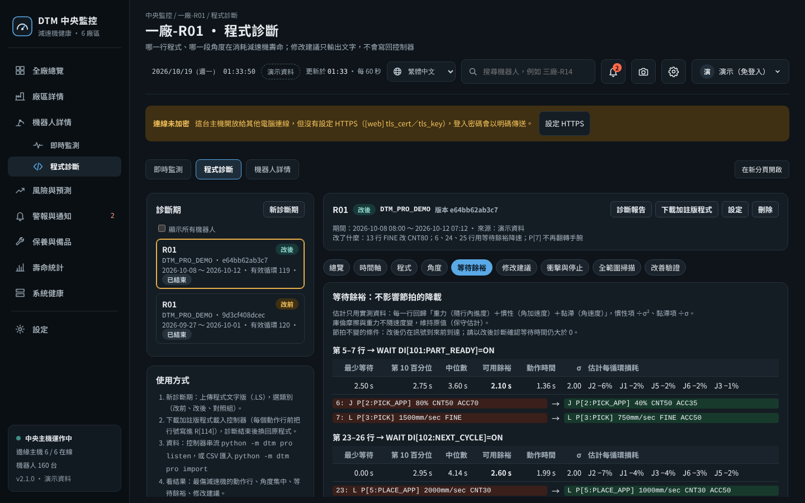

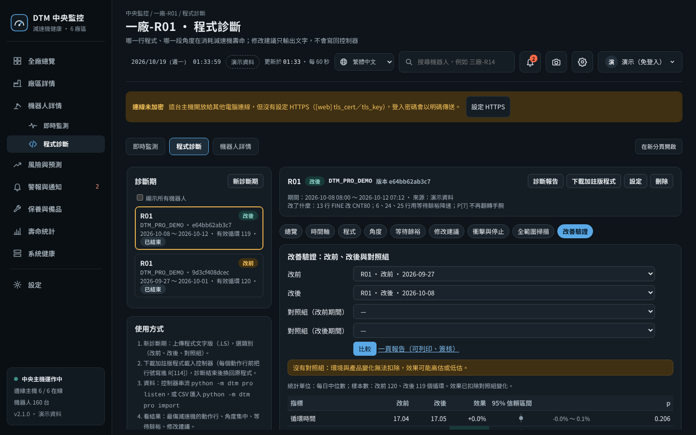

### 2. 現場流程

1. **取得生產程式文字版**（.LS，控制器網頁或 USB 備份）。
2. **產生加註版程式**：`python -m dtm pro instrument PROG.LS` 產生 `PROG_DTM.LS`：每個動作行前多一行 `R[114]=原行號`，動作、速度、點位都不變。照工廠的變更流程上傳，**診斷期結束換回原程式**。
3. **開一期診斷**：機器人儀表板的 `/pro` 頁（例如 `http://監控電腦:8080/pro`）按「新診斷期」上傳 .LS、選類別（改前、改後、對照組；工程師以上），或：
   ```bash
   python -m dtm -c config.toml pro new --program PROG.LS --role before
   ```
4. **收資料（擇一）**，建議 3–7 天（`[pro] max_days` 到期自動結束）：
   - **控制器串流**：`robot/DTM_STREAM.KL`（KAREL 範本）＋ `python -m dtm -c config.toml pro listen`（預設埠 9750）。**這個範本還沒在實機測試**，需要 KAREL 與 Socket Messaging 選配，每個系統變數都要依控制器版本確認；只接受設定的控制器 IP。
   - **CSV 匯入**：`python -m dtm -c config.toml pro import <診斷期> data.csv`。欄位：`t`（秒）、`q1`…`q6`（角度，度）、`tq1`…`tq6`（扭矩）、`line`（R[114] 的值）；有 E1 加 `e1`、`tqe1`。
5. **選用**：控制器警報履歷（急停、碰撞偵測、安全柵開啟）`pro alarms <診斷期> ERRALL.LS`；加速規 `pro accel <診斷期> accel.csv`（`t,peak,rms` 或 `t,acc`）。
6. **看結果**：`/pro` 頁，或 `pro summary <診斷期>`、`pro report <診斷期>`（HTML 報告）。
7. **修改**：修改建議只輸出文字，**不會寫回控制器、不會自動降速**。由人修改，依序用模擬軟體確認干涉與節拍 → T1 低速試跑 → 上線。
8. **驗證**：改後再開一期「改後」診斷；可以的話同型號、相近負載的另一台不修改，改前、改後期間各開一期「對照組」。「改善驗證」分頁或：
   ```bash
   python -m dtm -c config.toml pro compare --before <改前> --after <改後> --control-before <對照改前> --control-after <對照改後>
   ```
   產生一頁報告：效果 =（改後 ÷ 改前）÷（對照組改後 ÷ 改前）− 1，拔靴法信賴區間、Mann–Whitney 檢定；沒有對照組時會註明「環境與產品變化無法扣除」。

### 3. 看得到什麼

| 分頁 | 內容 |
|---|---|
| 總覽 | 有效循環、循環時間、行號對位信心、各軸每循環損耗與預估壽命、最傷減速機的動作行 |
| 時間軸 | 典型循環的各軸扭矩（中位數與 10–90% 範圍）與程式列，依損耗上色 |
| 程式 | 每一行的損耗占比、峰值占容許值比例、動作與停留時間；點一行看細節 |
| 角度 | 角度集中圖：損耗密度、80% 損耗所在範圍、Gini、換向次數、小幅擺動（微動磨損風險）；填了減速比與針齒數可換算預估磨耗位置 |
| 等待餘裕 | 動作後還要等訊號的時間：可以放慢多少而不影響節拍、損耗下降估計；沒有餘裕的高損耗行列出節拍與壽命取捨表 |
| 修改建議 | 規則版：FINE 改 CNT、用等待餘裕降速、軟啟動、避免手腕大幅翻轉、負載設定、L 改 J、角度集中與小幅擺動、衝擊與停止事件、加速曲線 |
| 衝擊與停止 | 急停、碰撞、安全柵、控制停止次數（依權重計入損耗）、加速規衝擊對到行號 |
| 全範圍掃描 | 局部磨耗指數 LWI（常用角度區摩擦 ÷ 少用角度區摩擦），相對第一次 ≥ 1.2 倍注意、≥ 1.4 倍警戒 |
| 改善驗證 | 改前、改後、對照組的差異中的差異與信賴區間、成本換算（`[pro.cost]`） |

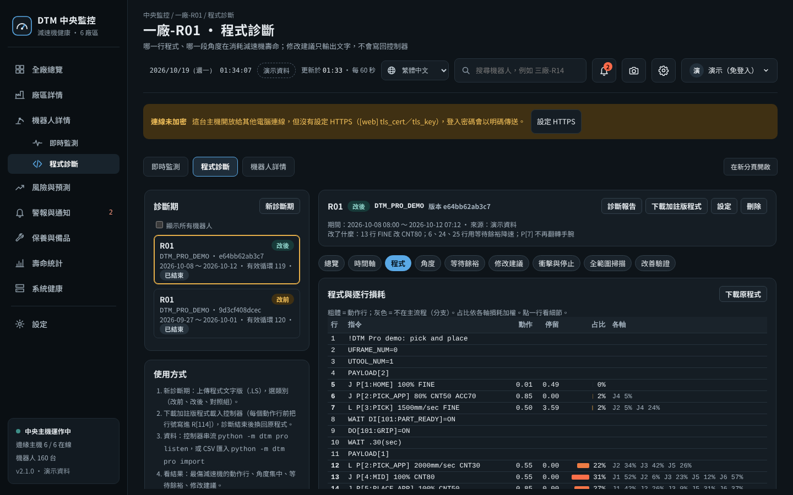

### 4. 扭矩來源（重要）

- 損耗計算要用**傳遞扭矩**（扭矩指令，或馬達電流 × 係數）。`DTM_STREAM.KL` 範本預設送的是干擾扭矩 `$MOR_GRP[1].$CUR_DIS_TRQ`（跟 DTM_BG 同一個變數），**干擾扭矩不含重力與慣性**。控制器有開放傳遞扭矩就把範本裡的變數換掉（**實際可用的系統變數請依控制器版本確認**），或用鉗式電流感測器；都沒有時設 `[pro] torque = "disturbance"`，損耗排名只當相對參考，畫面與報告會註明。
- `[pro] torque_unit`：`pct`（減速機額定扭矩 T0 的百分比）、`nm`、`raw`（只做相對排名）。
- 壽命估算要填各軸 `rated_nm`（額定扭矩 T0）、`rated_rpm`、`rated_life_h`（RV 型錄常用 15 rpm、6000 h）；起動停止與瞬間最大容許扭矩沒填時依 RV 預設（額定的 2.5 倍、5 倍）。以換件紀錄校正前只當相對參考。

### 5. 全範圍掃描 `robot/DTM_SWEEP.LS`

- 每週一次、暖機後、同樣負載，各軸在無干涉的最大範圍以 5% 慢速正反轉各一次；`R[114] = 8000＋軸×10＋方向`（1 = 往最大、2 = 往最小）。範例含 J2、J3，其他軸照樣複製一段。
- 用到 `PR[50]`（DTM 待機點，跟 DTM_DIAG 共用）、`PR[61]`–`PR[64]`（以關節值教導，只有受測軸不同）。
- 掃描資料在串流或 CSV 匯入時自動另存；LWI 要先完成一期診斷（才知道哪些角度常用）。

### 6. 注意事項

- **暫存器**：Pro 用 `R[114]`（行號，可在 `[pro] line_reg` 改，不能跟 `[registers]` 重複）、`PR[61]`–`PR[64]`；導入前確認沒被其他程式使用。
- **診斷程式獨立執行**：DTM_DIAG、DTM_SWEEP 都是獨立程式，在停機或換班時單獨執行，不要插進生產程式；加註版程式只在診斷期使用。
- 只分析實際量到的資料；建議需經人確認、模擬與試跑後才能上線（報告最後也會註明）。
- 設計上刻意不做的事見 [docs/DESIGN_CONSTRAINTS.md](docs/DESIGN_CONSTRAINTS.md)。
- 與已知專利的技術對照見技術揭露 6.15（第一件：FANUC JP5289608B2，以程式模擬估算減速機壽命並自動調降速度）。Pro 刻意維持「實測資料、只給建議、由人修改」；在衍生版本加入自動改程式或模擬取代實測前，請先請專利律師評估。

## 十四、同一個視窗與設定（2.1）

### 1. 同一個視窗

單機、廠區（邊緣主機、小型模式）、中央都用同一套畫面：左側選單、右上角的語言、警報鈴、齒輪（設定）與帳號。

| 模式 | 左側選單 |
|---|---|
| 單機（一台機器人） | 即時監測、程式診斷、設定 |
| 廠區（邊緣主機、小型模式） | 廠區總覽、廠區詳情、機器人詳情（底下：即時監測、程式診斷）、風險與預測、警報與通知、保養與備品、壽命統計、系統健康、設定 |
| 中央 | 同上；即時監測與程式診斷由中央轉送到該廠的邊緣主機，**只能看**（登入狀態不跨主機），要修改請在廠區主機登入 |

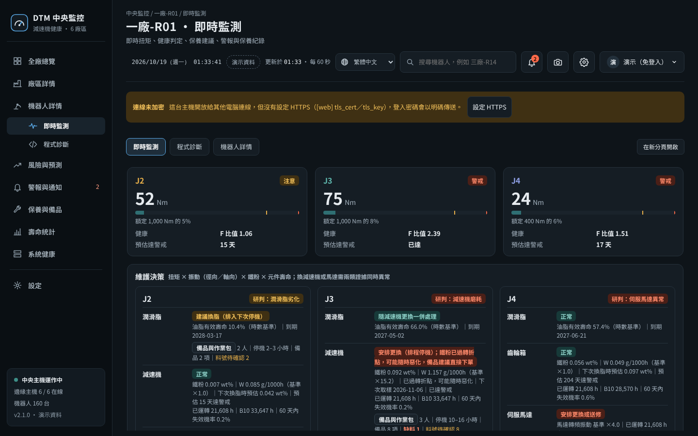

- 即時監測與程式診斷在視窗裡直接打開，用的是同一個登入；右上角「在新分頁開啟」可以單獨放大一個畫面。
- 邊緣主機上，每台機器人的程式只在主機內部提供畫面（8101 起），由廠區畫面轉送；轉送時會帶上原本那台電腦的 IP，權限、允許連線清單、操作紀錄都照原本的電腦計算。
- 從中央轉送到邊緣主機需要中央連得到邊緣主機（`[web] public_host` 與機器人的連接埠）；連不到時畫面會說明原因。

### 2. 設定（右上角齒輪）

| 區塊 | 內容 | 誰可以改 |
|---|---|---|
| 我的帳號 | 顯示名稱、變更密碼、這次登入、登入中的裝置（可登出其他裝置） | 本人 |
| 一般 | 系統顯示名稱、預設語言、畫面自動更新間隔、備品單價幣別 | 管理員 |
| 帳號管理 | 新增帳號（產生臨時密碼）、角色、停用／啟用、重設密碼、解除鎖定、強制登出；密碼原則；所有登入中的裝置 | 管理員 |
| 隱私與安全 | 看畫面也要登入、登入有效時間、閒置自動登出、輸錯幾次暫停登入、允許連線的電腦、分析匯出預設匿名化；HTTPS（一鍵產生自簽憑證、下載憑證）；操作紀錄（搜尋、只看失敗、下載 CSV）；這台主機存了哪些資料、會連到哪裡 | 管理員（HTTPS 只能在主機本機） |
| 通知 | 收件人名單（姓名、手機、Email、每個人的語言、接收哪些通知）；預設收件人、每條規則的收件人、規則的通知語言、啟用；發送測試通知 | 看：登入者（號碼只顯示一部分）；修改：管理員 |
| 服務商 | 顯示哪個地區的原廠服務據點、貴廠的服務窗口（聯絡人、電話、Email、客戶編號、備註） | 管理員 |
| 系統資訊與備份 | 版本、執行模式、主機、資料庫大小、磁碟、備份狀態與立即備份、自我檢查、設定檔檢查、連線與資料位置（只顯示）、第一次設定精靈（單機）、現場驗證報告、診斷包 | 看：登入者；動作：管理員 |
| 修改紀錄 | 每次修改系統設定的舊值、新值、誰、從哪台電腦；一鍵還原 | 管理員 |
| 關於 | 版本、作者、授權、不擔保、專利、商標、第三方元件 | 所有人 |

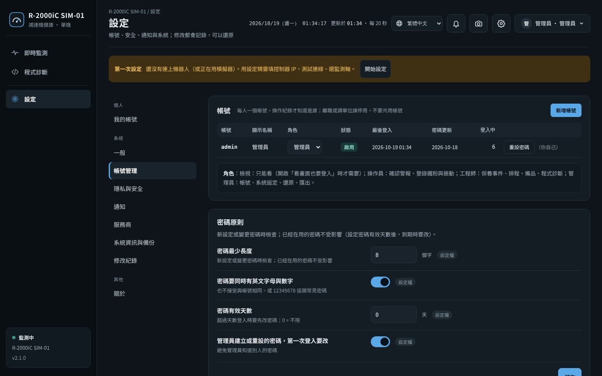

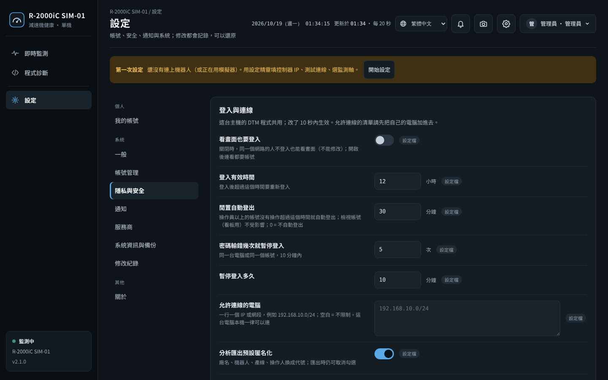

### 3. 網頁上可以改的、要改設定檔的

- **網頁上可以改**：改錯也不會中斷監測的項目（上表「一般」「帳號管理」「隱私與安全」「通知」的設定）。存在 `users.sqlite3`（和帳號同一個檔），**網頁上的值優先於設定檔**；每個項目旁邊標示目前用的是「設定檔」或「網頁設定」，可以「恢復設定檔的值」。
- 同一台主機的 DTM 程式共用：在廠區畫面改一次，每台機器人的程式 10 秒內套用，不必重新啟動。
- **要改設定檔**：機器人位址、資料來源、取樣、連接埠、HTTPS 憑證、資料庫與備份位置、中央網址。這些改錯會讓監測中斷，網頁上只顯示；改完先執行 `python -m dtm check`，再重新啟動。例外：第一次設定精靈（機器人位址、資料來源、監測軸）與 HTTPS 一鍵啟用，只能**在主機本機**由管理員操作，會先備份設定檔、寫完自動檢查，有錯誤就還原（第十五節）。
- 設定檔裡也可以直接寫這些項目的預設值：`[web] idle_minutes`、`max_fails`、`lock_minutes`、`allow_ips`、`pw_min_length`、`pw_require_mix`、`pw_max_age_days`、`pw_change_first`，`[ui] refresh_s`，`[privacy] export_anonymize`，`[system] display_name`（見 `config.example.toml`）。

### 4. 帳號與登入安全

- **單一登入**：登入狀態存在 `users.sqlite3`，只存 token 的 SHA-256；同一台主機的 DTM 程式共用，所以在 DTM 畫面登入一次，裡面的即時監測、程式診斷都有效。
- **密碼原則**（預設）：至少 8 個字、要有英文字母與數字、不能和帳號相同、不接受 12345678 這類常見密碼；可設定密碼有效天數。管理員建立或重設的密碼，對方第一次登入要先改，改好之前不能修改任何資料。
- **閒置自動登出**（預設 30 分鐘）：只看操作員以上的帳號；看板電腦請用「檢視」帳號，不會被登出。
- **輸錯鎖定**：同一台電腦或同一個帳號 10 分鐘內輸錯 5 次，暫停 10 分鐘；登入失敗只說「帳號或密碼錯誤」，不透露帳號存不存在。
- 停用帳號、重設密碼、自己改密碼，都會立刻登出那個人其他裝置的登入；角色改了立即生效；至少要保留一個啟用中的管理員，也不能停用自己。
- **操作紀錄**：誰、從哪台電腦、什麼時候、做了什麼、成功或失敗（包括登入、登出、改設定）；密碼、金鑰、照片內容一律不記。
- 所有回應都加安全標頭（不讓其他網站嵌入畫面、不猜檔案類型、不把網址傳給外站）。開放給其他電腦連線時，仍建議啟用 HTTPS（第十五節第 3 點）。

### 5. 隱私與診斷包

- DTM 不會把任何資料傳給作者或第三方，沒有使用統計、自動更新或廣告；「隱私與安全」列出這台主機實際設定的對外連線（機器人、感測器、郵件伺服器、Webhook、簡訊閘道、中央）。
- 分析匯出預設匿名化（廠名、機器人、產線、操作人換成代號），匯出時可以取消。
- **診斷包**（管理員）：給維護人員或回報問題用，包含版本與主機資訊、設定檔（密碼、金鑰、網址、Email、電話已遮蔽）、設定檔檢查、自我檢查、狀態檔、最近的記錄檔；不含監測資料庫、帳號與照片。記錄檔可能有 IP 與操作人姓名，寄出前可以先打開檢查。

### 6. 允許連線的電腦

在「隱私與安全」填 IP 或網段（例如 `192.168.10.0/24`），清單以外的電腦一律拒絕。這台電腦本機（`127.0.0.1`）一律可以連，萬一設錯，到主機本機開畫面改回來即可；存檔時如果你目前用的電腦不在清單裡，系統會拒絕存檔，避免把自己擋在外面。邊緣主機上傳中央（`/api/sync`）用金鑰把關，不受這個清單限制。

## 十五、日期時間、全頁截圖、當地貨幣、HTTPS、設定精靈、現場驗證（2.1）

### 1. 畫面頂端的日期時間與全頁截圖

每個畫面（DTM 主畫面、即時監測、程式診斷）頂端都顯示年月日、星期與時間（依畫面語言的格式，每秒更新），截圖與列印時就知道是什麼時候的畫面。

右上角的相機圖示是**全頁截圖**：把整頁（含捲動到下面的部分）存成一張 PNG，檔名含畫面名稱與日期時間，例如 `DTM_機群總覽_20261018-143005.png`。截圖在瀏覽器裡完成（html2canvas，MIT 授權，放在 `dtm/static/vendor/`），不會上傳到任何地方。在主畫面裡打開的即時監測、程式診斷，會另外截下它整頁的內容再拼進來，不會只截到視窗看得到的那一段。截圖是重新畫出來的，不是螢幕擷取：陰影、模糊等效果與字型細節可能和畫面略有差異。


### 2. 備品價格以當地貨幣顯示

單價一律用 `[maint] currency`（「設定 → 一般」）輸入與儲存；畫面依**觀看者的語言**換算顯示：繁中 TWD、簡中 CNY、英文 USD、日文 JPY、韓文 KRW、越南文 VND。滑鼠移到金額上會顯示原幣別金額；表格下方註明匯率日期與來源。

| `[maint] fx` | 做法 |
|---|---|
| `auto`（預設） | 每 12 小時下載一次匯率表：[ExchangeRate-API](https://www.exchangerate-api.com) 的公開資料，抓不到改用 [currency-api](https://github.com/fawazahmed0/exchange-api)。存在 `run/fx_rates.json`，抓不到就沿用上次的匯率；超過 3 天沒更新會標示「匯率可能過時」 |
| `manual` | 工廠不能連外時，在 `[maint.fx_rates]` 手動填（1 單位原幣別 = 多少目標幣別） |
| `off` | 不換算，一律顯示原幣別 |

抓匯率只下載匯率表，不送出任何資料，列在「隱私與安全 → 這台主機會連到哪裡」；需要代理伺服器時用 `[notify] proxy`。換算後的金額只供估算，請以採購報價為準。

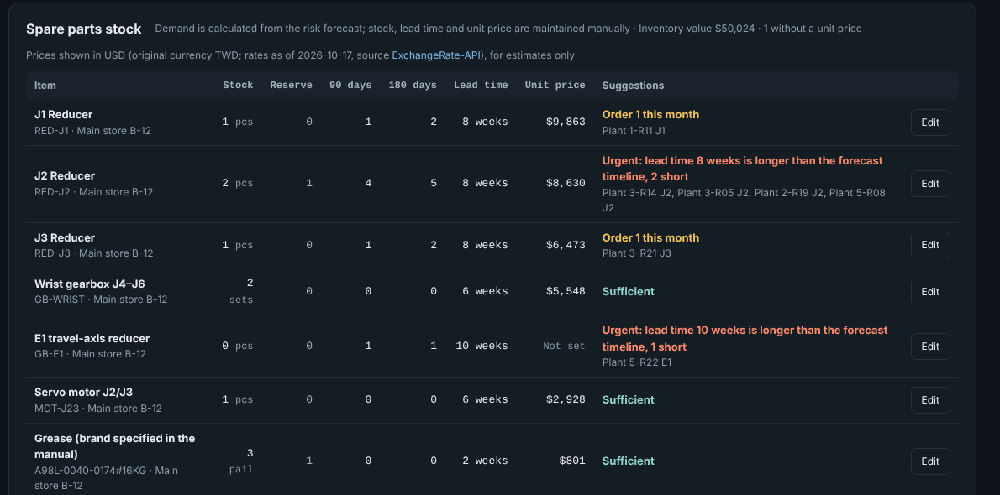

### 3. HTTPS 一鍵啟用（為什麼不預設開啟）

「設定 → 隱私與安全 → HTTPS 連線加密」（管理員、在主機本機操作）或指令：

```bash
python -m dtm -c config.toml tls --self-signed                 # 產生自簽憑證、寫進設定檔
python -m dtm -c config.toml tls --self-signed --name dtm.plant.local --name 10.1.2.3   # 其他電腦用的名稱
python -m dtm -c config.toml tls                               # 查看目前的憑證（到期日、指紋）
python -m dtm -c config.toml tls --off                         # 關閉
```

- 憑證放在設定檔旁邊的 `tls/`（`dtm-cert.pem`、`dtm-key.pem`，金鑰只有執行 DTM 的帳號可讀），包含這台電腦的名稱與 IP，有效 825 天；設定檔只改 `[web] tls_cert`、`tls_key` 兩個鍵，先備份到 `config_backups/`。**重新啟動 DTM 後**網址改用 `https://`。
- 自簽憑證：各台電腦的瀏覽器第一次會顯示「不安全」。在畫面上「下載憑證」，匯入那台電腦的「受信任的根憑證授權單位」（Windows：雙擊 `.crt` → 安裝憑證 → 本機電腦）後就不會再出現；匯入前可以和畫面上的 SHA-256 指紋比對。
- 公司有內部憑證機構（CA）時，請向資訊單位申請這台主機的憑證，填進 `[web] tls_cert`、`tls_key`，不必用自簽憑證。
- 中央開了 HTTPS：各廠邊緣主機的 `[central] url` 改成 `https://`，`ca_file` 指向下載的憑證，上傳才會驗證中央的身分。
- **為什麼不預設開啟**：自簽憑證會讓每台電腦都出現警告，邊緣主機也要一起改設定；一台一台處理之前就強制開啟，現場第一天就會連不上。所以預設維持 HTTP，畫面上方會提示「連線未加密」，由管理員在網路管理者同意後一鍵啟用。只在本機使用（`host = "127.0.0.1"`）不需要 HTTPS。
- 邊緣主機上每台機器人的程式只在主機內部提供畫面，不另外加密；HTTPS 加在使用者實際連線的廠區畫面上。

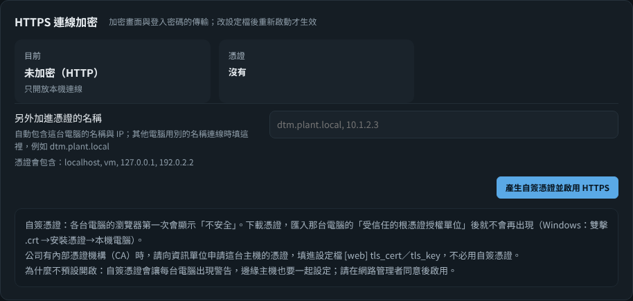

### 4. 第一次設定精靈（單機）

還在用模擬器、或從來沒有連上機器人時，畫面上方會出現「第一次設定」提示（只有管理員、在主機本機看得到）。精靈只改設定檔的這幾項，其他設定與註解都保留：

1. 資料來源：Fanuc 控制器網頁伺服器（HTTP）、Modbus TCP（經由 PLC）、模擬器；控制器 IP、連接埠、取樣頻率
2. 監測的軸（J1–J6、E1）與額定扭矩（Nm，查減速機型錄；不知道可以空白）
3. 測試連線：用畫面上的內容實際讀 5 秒資料，檢查讀取速率、心跳、扭矩暫存器、倍率（跟 `check --connect` 相同）
4. 儲存：先備份設定檔，寫完跑一次設定檔檢查，有錯誤就自動還原；重新啟動 DTM 後生效

邊緣主機的機器人清單仍請改設定檔 `[[robots]]`。

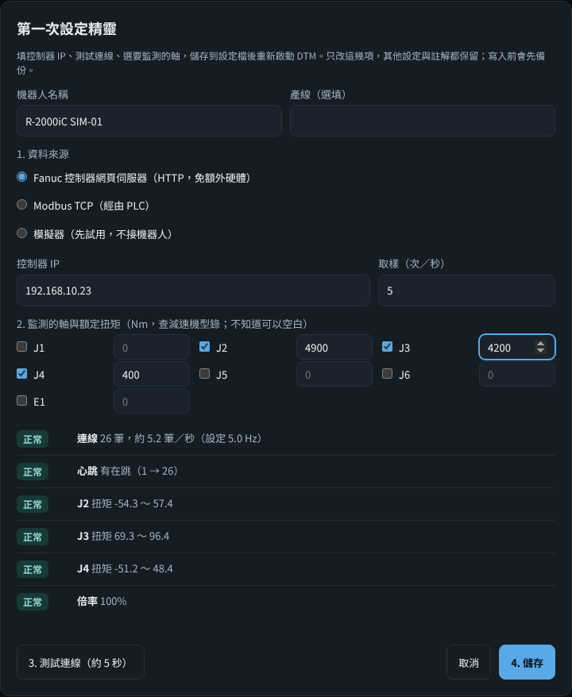

### 5. 現場驗證報告

Beta 版的判斷門檻要靠現場資料修正。「壽命統計 → 現場驗證報告」、「設定 → 系統資訊 → 現場驗證報告」或 `python -m dtm -c config.toml validation` 產生一份可以列印成 A4 的報告：

| 項目 | 怎麼算 |
|---|---|
| 偵測率 | 確認失效（更換時勾「失效」或拆檢確認損傷）的元件，更換前 365 天內（且在安裝之後）先出現過注意或警戒的比例；附 95% 信賴區間（Wilson 法） |
| 提早天數 | 第一次出現注意、警戒那天到更換日（中位數與最短） |
| 漏報 | 失效前 90 天內至少有 30 天監測資料，卻一直沒有警報 |
| 資料不足 | 失效前監測資料不夠（例如導入 DTM 之前就壞了），不算進偵測率 |
| 警報後更換、未確認失效 | 有警報、更換了，但拆檢無異常或登錄為預防更換 |
| 誤報候選 | 警戒後 90 天內沒有任何保養或點檢，以及只做了重設基準的警戒；未滿 90 天的列「觀察中」 |

資料來源：中央與邊緣主機用每天每軸的健康等級（健康與生產監測取較高者）加上警報紀錄；單機用警報紀錄與有診斷資料的天數。失效件數少於 10 件時，報告會提醒信賴區間很寬。`--json` 輸出原始數字給其他系統分析。換件時務必登錄更換事件並填拆檢表單，這份報告才有意義。

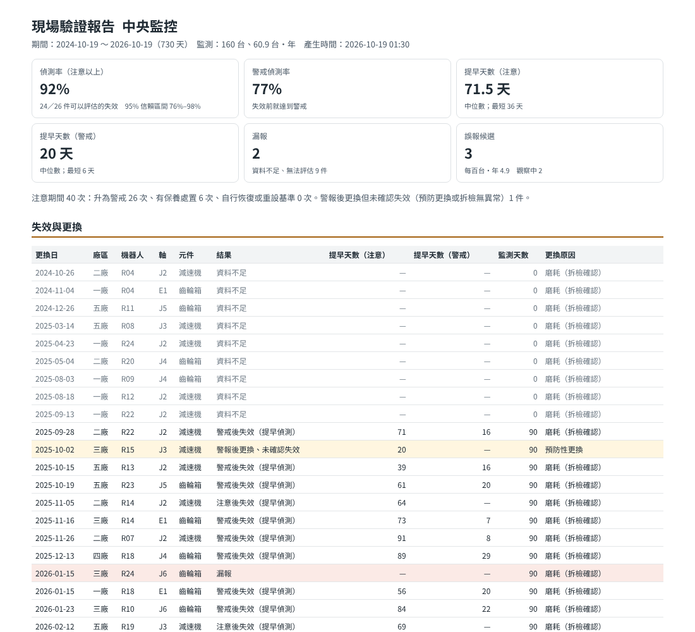

### 6. 資安政策與軟體物料清單

- [SECURITY.md](SECURITY.md)：支援的版本、怎麼私下回報安全性問題（GitHub 的 Report a vulnerability 或 Email）、安全設計摘要，以及依 IEC 62443-4-2 七個基本要求做的**自我對照**（不是認證）。
- **SBOM**：每個 Release 附 CycloneDX 1.5 格式的 `dtm-<版本>-sbom.cdx.json`，列出選用套件（pymodbus、pyserial）與內附的第三方檔案（WinSW、html2canvas、Windows 免安裝版的 Python）與雜湊值；自己產生：`python tools/sbom.py`。Release 檔案附 GitHub 建置來源證明（`gh attestation verify 檔名 --repo 帳號/倉庫`）。

## 授權與聲明

- **授權**：Apache License 2.0（`LICENSE`、`NOTICE`）。可以自由使用、修改、再散布（含商業使用），請保留著作權與授權聲明，修改過的檔案要註明有修改。Apache-2.0 也包含專利授權條款：貢獻者把自己貢獻內容涉及的專利授權給所有使用者。
- **作者與署名**：Domingo He。轉載、改作或發表衍生成果時，請標示原作者與專案出處；不得以作者名義為衍生版本背書。引用請用 `CITATION.cff` 或 DOI [10.5281/zenodo.23910956](https://doi.org/10.5281/zenodo.23910956)（v2.1.0 的 Zenodo 封存）。
- **非商業維護**：本專案由作者以個人身分、非商業方式維護，不販售、不提供付費支援，也不申請專利。問題回報與建議用 GitHub Issues，作者盡力回覆，但不保證回覆時間與修正。
- **不擔保**：本軟體依「現狀」提供，不附任何明示或默示的擔保（見 `LICENSE` 第 7、8 條）。監控結果只是保養決策的參考，換件、停機與安全相關的判斷，請由合格人員依原廠手冊與現場狀況決定；使用本軟體造成的任何損失，作者不負責任。
- **專利**：作者沒有為本系統申請任何專利，並以〈技術揭露〉文件公開方法細節（防禦性公開）。但作者無法保證本軟體不涉及他人在各國擁有的專利；在你的國家或地區使用、製造或販售前，請自行確認。
- **商標**：FANUC 是 FANUC CORPORATION 的商標；R-2000iC 等型號名稱屬於其所有人。本專案與 FANUC 沒有任何關係，未經其認可或贊助；提到這些名稱只是為了說明相容的機型。其他商標屬於各自的所有人。
- **AI 協助開發**：我設計、AI 寫程式、我驗證。判斷邏輯、門檻與現場流程來自作者的維修經驗；程式碼由 AI（Anthropic Claude）依設計撰寫，作者負責審查、測試與現場判斷。版本紀錄的提交訊息保留 AI 共同作者標記。
- **資料**：本專案的範例、截圖與測試資料全部來自模擬器與演示資料，不含任何公司的實際生產資料。
- **第三方元件**：`tools/winsw/`（WinSW，MIT 授權，見該資料夾的 LICENSE.txt）；`dtm/static/vendor/html2canvas.min.js`（html2canvas 1.4.1，MIT 授權，見同資料夾的 html2canvas.LICENSE.txt，只用在全頁截圖）。完整清單見 SBOM（第十五節）。

## 技術揭露、貢獻與版本紀錄

- **技術揭露**：[docs/TECHNICAL_DISCLOSURE.md](docs/TECHNICAL_DISCLOSURE.md) 詳細公開本系統的監測與判斷方法（含參數與變化形），作為先前技術（prior art），讓這些方法維持公開、任何人都能使用。另有英文全文 [TECHNICAL_DISCLOSURE.en.md](docs/TECHNICAL_DISCLOSURE.en.md) 與日文全文 [TECHNICAL_DISCLOSURE.ja.md](docs/TECHNICAL_DISCLOSURE.ja.md)，三版同時公開、章節編號相同；內容有差異時，各版所揭露的內容都屬公開。第 6.15 節是與已知專利的技術對照（不是法律意見）。
- **貢獻**：見 [CONTRIBUTING.md](CONTRIBUTING.md)（採用 DCO 簽署）。現場試用回報、安裝問題、錯誤回報請用 GitHub Issues 的範本；**請不要上傳原始資料或任何公司的內部資料**。
- **版本紀錄**：見 [CHANGELOG.md](CHANGELOG.md)。1.x–2.0 是內部開發版；v2.1.0 是第一個公開版本（Beta）；完成實機驗證後發布 v3.0。
- **發表前檢查**：維護者用 [docs/RELEASE_CHECKLIST.md](docs/RELEASE_CHECKLIST.md)。
